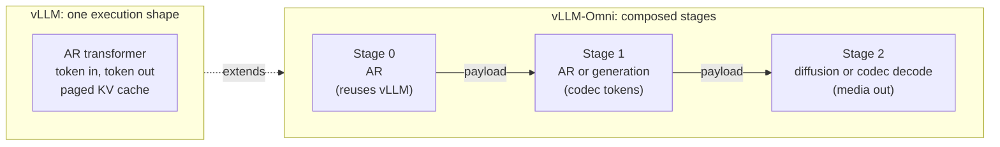

# Project Overview

## The problem

[vLLM](https://github.com/vllm-project/vllm) was built around one execution
shape: an autoregressive (AR) transformer that consumes text tokens and emits
text tokens, one token per step, with a paged KV cache making the attention
over previous tokens cheap. Almost every design decision in vLLM — the block
manager, continuous batching, the scheduler's token budget — follows from that
shape.

Omni-modality models do not have that shape. They have *several* shapes at
once, inside a single model:

- **Qwen3-Omni** runs an AR "Thinker" (text + conditioning), then an AR
  "Talker" (text + audio codec tokens), then a convolutional "Code2Wav"
  decoder that turns codec tokens into a waveform. Three different execution
  loops, chained, with streaming hand-offs between them.
- **MiniMax-H3** encodes text and reference media, runs a diffusion
  transformer (DiT) for a fixed number of denoising steps where *every* step
  attends over the whole latent sequence, then runs a VAE decoder to produce
  synchronized video and audio.
- **HunyuanImage-3.0** has an AR understanding path *and* an image-generation
  DiT path in one checkpoint, and a deployment may want either, or both with
  the AR stage's KV cache handed to the DiT.
- **π0.5** and **GR00T-N1.7** emit robot actions, on a control-loop latency
  budget, not tokens.

A single scheduler cannot serve all of these well. AR decode wants continuous
batching over many short steps. Diffusion denoising wants a fixed step count
over a large activation footprint, where batching two requests of different
sizes is often impossible. A VAE decoder wants neither — it wants to be handed
latents and left alone.

## What vLLM-Omni does

vLLM-Omni extends vLLM with a **stage-based runtime**. A *stage* is a logical
execution unit that owns:

- one model component (or a slice of one),
- its own execution policy (batching, attention backend, CUDA graph mode),
- its own resources (devices, replicas, memory budget),
- its own performance objective.

Stages are composed into a pipeline. The framework then takes care of routing
requests between them, transporting potentially large intermediate tensors
across process and node boundaries, and presenting the whole thing as a single
OpenAI-compatible endpoint.



The crucial design property is that **stage topology is separate from
deployment placement**. The same logical pipeline can run co-located in one
process on one GPU, or split across processes, GPUs, and nodes, without the
model code knowing which. That separation is what makes the disaggregated
serving in the [technical report](https://arxiv.org/abs/2610.09307) possible.

## The three execution types

Everything in the runtime reduces to three stage execution types, defined in
`vllm_omni/config/stage_config.py:288`:

```python
class StageExecutionType(str, Enum):
    """Merged StageType + WorkerType — 3 combinations today."""

    LLM_AR = "llm_ar"
    LLM_GENERATION = "llm_generation"
    DIFFUSION = "diffusion"
```

| Execution type | Scheduler | Used for |
| --- | --- | --- |
| `LLM_AR` | `OmniARScheduler` / `OmniARAsyncScheduler` | Token-by-token decode with a KV cache: Thinkers, Talkers, AR understanding paths |
| `LLM_GENERATION` | `OmniGenerationScheduler` | Non-AR work that still runs on the vLLM worker stack: codec decoders, vocoders, chunked audio decode |
| `DIFFUSION` | `RequestScheduler` / `StepScheduler` (in `vllm_omni/diffusion/sched/`) | Denoising loops: DiTs, plus their text encoders and VAE decoders |

`_resolve_scheduler()` at `vllm_omni/config/stage_config.py:366` is the single
place this mapping is applied. Diffusion returns `None` there because diffusion
stages do not use a vLLM scheduler at all — they run their own engine, covered
in [Diffusion Stage Execution](features/03-diffusion-stage.md).

A fourth, orthogonal axis applies only to diffusion stages: `DiffusionStageRole`
(`vllm_omni/config/stage_config.py:296`) splits one diffusion model into
`ENCODE`, `DENOISE`, `DECODE`, or `FULL` slices. This is what lets a DiT model
become disaggregatable through configuration alone, with no per-model source
changes.

## Repository map

```text
vllm_omni/
├── entrypoints/      Public surfaces: Omni, AsyncOmni, DuplexOmni, OpenAI server, CLI
├── config/           Config resolution: PipelineConfig, DeployConfig, stage configs
├── engine/           Control plane: AsyncOmniEngine, Orchestrator, StageRuntime, duplex
├── core/             Omni schedulers (sched/) and cross-stage prefix cache
├── worker_v2/        Model Runner V2: the current AR/generation execution path
├── worker/           Worker-side helpers, GPU workers, CUDA graph plumbing
├── diffusion/        The whole diffusion runtime: engine, sched, executor, worker, models
├── distributed/      OmniConnector transport, KV transfer, weight sharing, Ray
├── model_executor/   AR-side model implementations (models/<model>/...)
├── inputs/ outputs/  Request inputs and the MultimodalPayload / OmniRequestOutput path
├── attention/        Attention backend selection and omni-specific kernels
├── quantization/     Per-pipeline and per-component quantization resolution
├── platforms/        CUDA / ROCm / XPU / NPU / MUSA platform specialization
└── deploy/           Bundled deploy YAML defaults, one per supported pipeline
```

Supporting trees outside the package:

| Path | Contents |
| --- | --- |
| `docs/` | User and design documentation, including this folder |
| `recipes/` | Per-model deployment recipes with validated hardware profiles |
| `tests/` | Unit, e2e, model, and reliability (`tests/dfx/`) test suites |
| `examples/` | Runnable offline and online serving examples |
| `benchmarks/` | Throughput, latency, and accuracy benchmark drivers |
| `.buildkite/` | CI pipeline definitions, split by accelerator vendor |
| `.claude/skills/`, `.agents/skills/` | Repository skills for agent-assisted contribution |

## Vocabulary

These terms appear constantly in the code and in review comments. Getting them
straight early saves a lot of confusion.

| Term | Meaning |
| --- | --- |
| **Stage** | A logical execution unit. *Not* necessarily a process — stages may be co-located. |
| **Replica** | One running instance of a stage. A stage with `num_replicas: 2` has two. |
| **Pipeline** | The ordered set of stages for a model, declared by `PipelineConfig`. |
| **`PipelineConfig`** | Frozen, developer-authored topology. The source of truth for *what* the stages are. |
| **`DeployConfig`** | User-editable YAML. Controls *where* stages run and with what resources. |
| **Orchestrator** | Owns cross-stage request state, routing, cancellation, and output ordering. |
| **`StageRuntime`** | Expands logical stages into replicas and manages their process lifecycle. |
| **OmniConnector** | Transport for payloads and KV between stages. Moves data; never chooses routes. |
| **Payload** | A typed intermediate result handed from one stage to the next (`MultimodalPayload`). |
| **MRv2** | Model Runner V2, `vllm_omni/worker_v2/`. The current AR execution path; `model_runner: v2` is the default. |
| **Async chunk** | Forwarding a stage's partial output downstream before the stage finishes. |
| **Duplex** | Full-duplex realtime serving: the client streams audio in while the model streams audio out. |
| **TTFT / TTFP / E2EL / RTF** | Time to first token / first media packet / end-to-end latency / real-time factor. |

## Where to go next

[Architecture in Detail](02-architecture.md) covers the layer model and the
config resolution pipeline that turns a model name into running processes.
