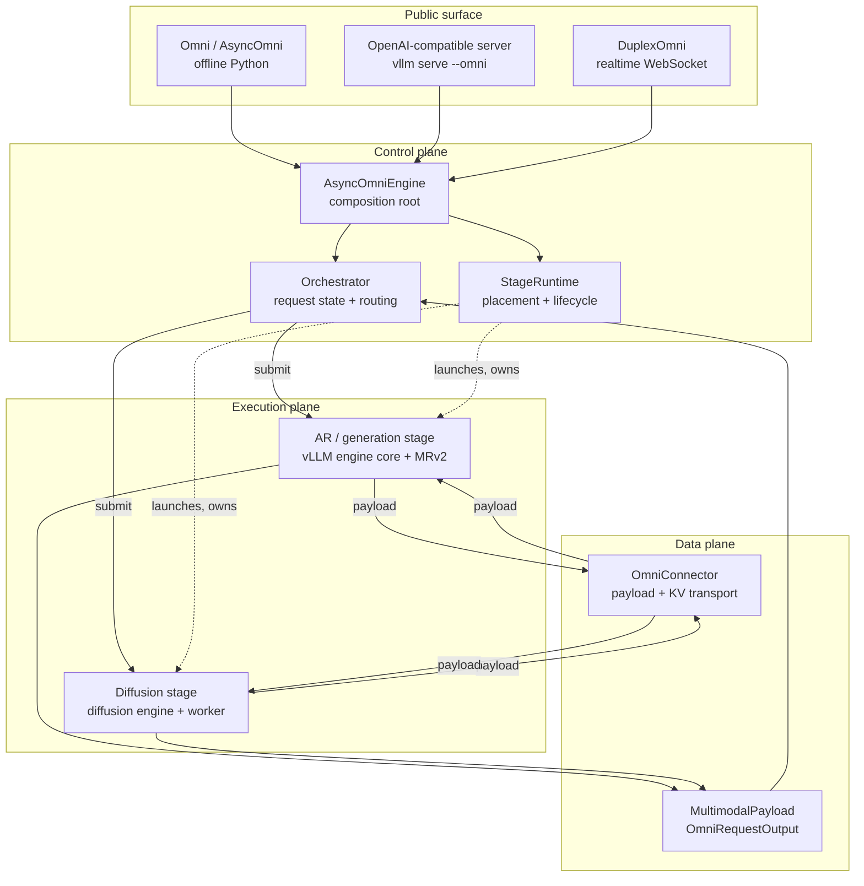
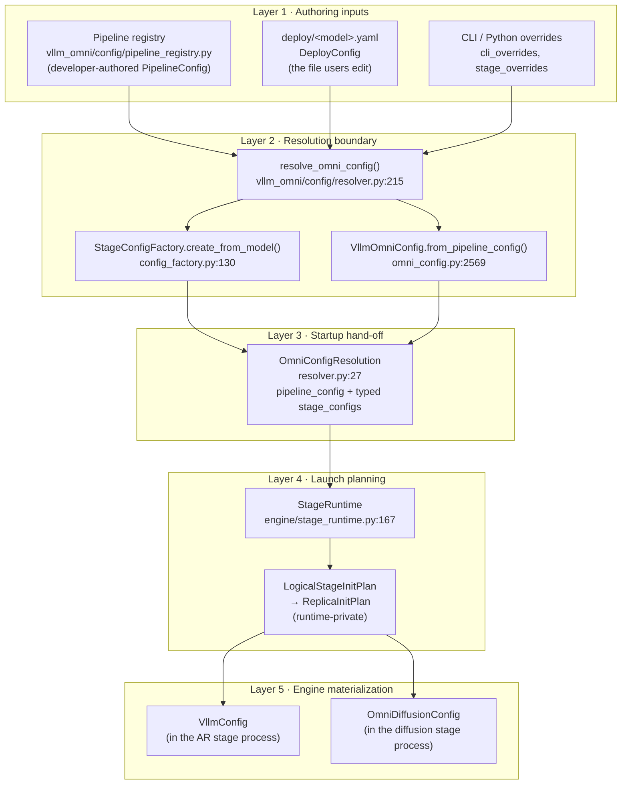
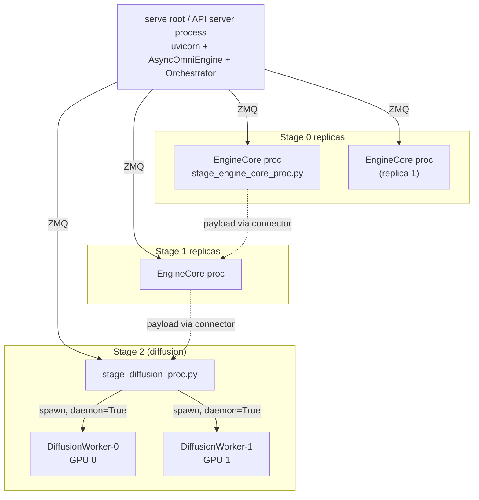
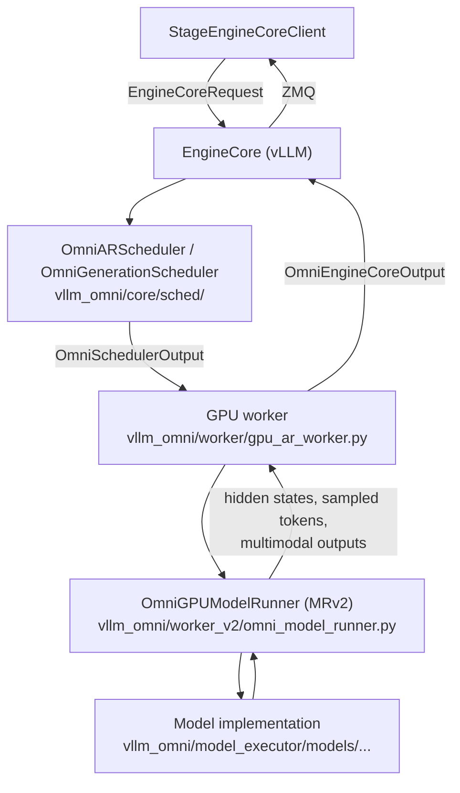
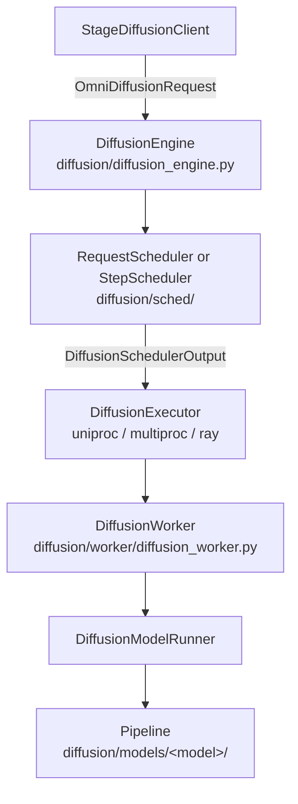

# Architecture in Detail

This document covers the layers of vLLM-Omni, the configuration pipeline that
turns a model name into running processes, and the ownership boundaries that
the codebase enforces. [Request Lifecycle](03-request-lifecycle.md) then traces
a single request through what is built here.

## The four planes

It helps to think of vLLM-Omni as four planes with deliberately narrow
interfaces between them. Most review disagreements in this repository are
really arguments about which plane a piece of logic belongs to.



The rules that keep this honest:

1. **The control plane never touches tensors.** The Orchestrator routes request
   *identities* and small metadata. Large intermediates travel through the data
   plane, and the Orchestrator only holds handles to them.
2. **The data plane never makes routing decisions.** A connector moves bytes
   from A to B because it was told to. Choosing B is the Orchestrator's job.
   This is stated explicitly in the key-components table of
   [the design overview](../design/architecture_overview.md).
3. **The execution plane does not know the topology.** A stage knows its own
   configuration and its input and output contracts. It does not know how many
   stages exist or where they run.
4. **Entrypoints do not own engine state.** They translate protocols. Every
   entrypoint funnels into the same `AsyncOmniEngine`.

## Configuration resolution

This is the part of the system that most often surprises newcomers, because a
single `vllm serve <model> --omni` expands into a validated, multi-stage,
transport-safe configuration before a single weight is loaded.



### Why these layers exist

`resolve_omni_config()` is the **only** production resolution entrypoint. Its
signature (`vllm_omni/config/resolver.py:215`) shows exactly what is allowed to
influence a resolved configuration:

```python
def resolve_omni_config(
    model: str,
    *,
    trust_remote_code: bool | None,
    deploy_config_path: str | None,
    cli_overrides: Mapping[str, Any] | None,
    stage_overrides: Mapping[str, Mapping[str, Any]] | None,
    strategy_config_path: str | None,
) -> OmniConfigResolution:
```

Two paths come out of it:

- **Registered pipeline.** `StageConfigFactory.create_from_model()` finds a
  `PipelineConfig` in the registry by `model_type`, by HF `architectures`
  matching `hf_architectures`, or — for sibling generations that ship the same
  architecture string — by evaluating `hf_config_predicate`. MiniCPM-o 4.5 and
  2.6 both declare `architectures=["MiniCPMO"]`, so the 4.5 pipeline
  disambiguates on `hf_config.version`.
- **Generic diffusion.** A model with no registered pipeline but a recognizable
  `model_index.json` falls through to
  `StageConfigFactory.create_typed_default_diffusion()`, which synthesizes a
  single-stage diffusion topology.

The result is an `OmniConfigResolution` (`resolver.py:27`), a frozen dataclass
carrying the effective `PipelineConfig` *and* the typed `stage_configs`. Both
views must describe the same topology, including stages the factory injected.
This object is the sole startup hand-off: `AsyncOmniEngine` and the headless
startup path both consume it and nothing else.

### Ownership rules

These are enforced by convention and reviewed strictly:

| Object | Owns | Must not |
| --- | --- | --- |
| `PipelineConfig` | Stage topology, execution types, model capabilities, stage relationships | Be user-editable; encode placement |
| `DeployConfig` | Placement, replicas, devices, connectors, deploy-time defaults | Redefine the model graph |
| `OmniConfigResolution` | The single startup hand-off | Be bypassed by a second resolution path |
| `StageRuntime` | Launch planning, replica lifecycle | Leak `ReplicaInitPlan` as user configuration |
| `VllmConfig` / `OmniDiffusionConfig` | Process-local engine materialization | Be constructed before placement is known |

`DeployConfig` (`vllm_omni/config/stage_config.py:918`) draws one more internal
line that is easy to trip over: its top-level fields are **pipeline-wide** and
apply uniformly to every stage, while anything that legitimately varies per
stage lives in the `StageDeployConfig` entries under `stages:`.

```python
class DeployConfig:
    """Loaded from deploy/<model>.yaml — the only config file users edit.

    Top-level fields (``trust_remote_code``, ``distributed_executor_backend``,
    ``dtype``, ``quantization``, ``enable_prefix_caching``,
    ``enable_chunked_prefill``, ``data_parallel_size``,
    ``pipeline_parallel_size``) are pipeline-wide: they apply uniformly to
    every stage. Fields that legitimately vary per stage live in the
    individual ``StageDeployConfig`` entries under ``stages:``.
    """
```

The legacy `stage_args` YAML path has been removed. If you find documentation
or a blog post referencing it, that content predates the typed config path.

## Process topology

A deployment is a tree of processes. Which processes exist depends entirely on
`DeployConfig`, not on the model.



Key implementation facts:

- Stage engine processes are launched by `StageRuntime.launch_stage_engines()`
  (`vllm_omni/engine/stage_runtime.py:359`) and spoken to over ZMQ through
  `StageClient` / `StageEngineCoreClient`.
- A `StagePool` (`vllm_omni/engine/stage_pool.py:196`) holds the clients for
  one stage's replicas and owns replica selection, request-to-replica binding,
  and liveness. The Orchestrator asks a pool to `pick()` a replica; it never
  addresses a replica directly.
- Diffusion stages add a second level: the stage process owns a
  `MultiprocDiffusionExecutor` which spawns one `DiffusionWorker` per GPU rank.
  Those workers are `daemon=True` *and* arm a Linux parent-death signal — the
  subtleties of getting that right are
  [case study 04](case-studies/04-diffusion-worker-orphans.md).
- Stages can also run **co-located**: a diffusion stage reachable in-process
  uses `InlineStageDiffusionClient` (`vllm_omni/diffusion/inline_stage_diffusion_client.py`)
  instead of a process boundary. The Orchestrator's code path is identical.

## The execution plane, by stage type

### AR and generation stages

These reuse vLLM's engine core, worker, and model runner, with omni-specific
subclasses layered on:



The omni schedulers subclass vLLM's scheduler through `OmniSchedulerMixin`
(`vllm_omni/core/sched/omni_scheduler_mixin.py:198`). They add what the extra
modalities need: multimodal prefix ranges, chunk receive handles, prewarm
hints, and cross-stage admission. `OmniSchedulerOutput`
(`vllm_omni/core/sched/output.py:134`) extends vLLM's `SchedulerOutput` with
those fields rather than passing them out of band.

### Diffusion stages

Diffusion does not use a vLLM scheduler. It has its own:



The two schedulers implement different batching philosophies, both deriving
from `BaseScheduler` (`vllm_omni/diffusion/sched/base_scheduler.py:74`):

- **`RequestScheduler`** admits a batch of requests and runs all their
  denoising steps together. Requires compatible shapes and sampling params.
- **`StepScheduler`** advances requests step by step, so requests can join and
  leave the running batch between steps — closer in spirit to continuous
  batching.

Compatibility is decided by a *batch sampling params key*
(`RequestBatchSamplingParamsKey` / `StepBatchSamplingParamsKey` in
`diffusion/sched/interface.py`). Two requests batch together only if their keys
match. This is why a request's output can be affected by what else is in its
batch when a pipeline's batching contract is subtly wrong — the subject of
[case study 01](case-studies/01-qwen-image-21-mixed-batch-rope.md).

## Data plane: payloads and outputs

Two abstractions carry results:

- **`MultimodalPayload`** separates tensor content from metadata so the control
  plane can route a payload by its metadata without materializing or
  deserializing the tensors.
- **`OmniRequestOutput`** is the common output envelope for both pipeline and
  diffusion results, so entrypoints have one shape to render.

Transport between stages goes through an `OmniConnector`
(`vllm_omni/distributed/omni_connectors/connectors/base.py:12` defines
`OmniConnectorBase`). The available implementations are:

| Connector | Scope |
| --- | --- |
| `shm_connector.py` | Shared memory, single node |
| `mooncake_store_connector.py`, `mooncake_transfer_engine_connector.py` | Multi-node Mooncake |
| `nixl_connector.py` | NIXL |
| `mori_transfer_engine_connector.py` | Mori |
| `yuanrong_connector.py`, `yuanrong_transfer_engine_connector.py` | Yuanrong |

KV-cache transfer (as opposed to payload transfer) is coordinated by
`OmniKVTransferManager` (`omni_connectors/kv_transfer_manager.py:352`). See
[OmniConnector Transport](features/04-omni-connector-transport.md).

## What to read next

- [Request Lifecycle](03-request-lifecycle.md) — the same architecture, traced
  dynamically through one request.
- [Stage Runtime and Orchestrator](features/01-stage-runtime-and-orchestrator.md)
  — the control plane in depth.
