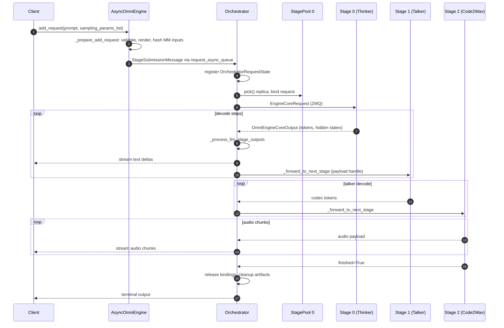
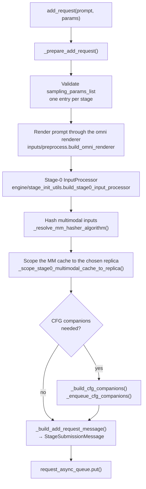
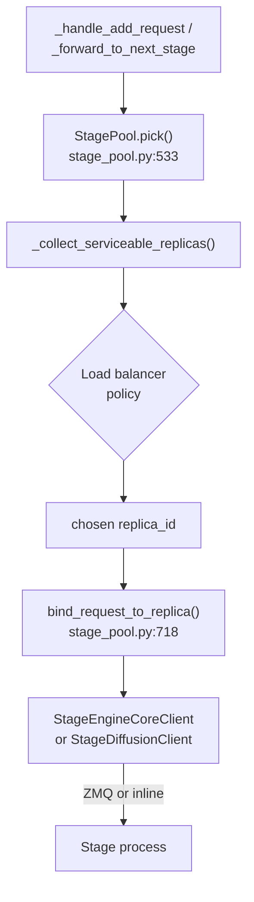
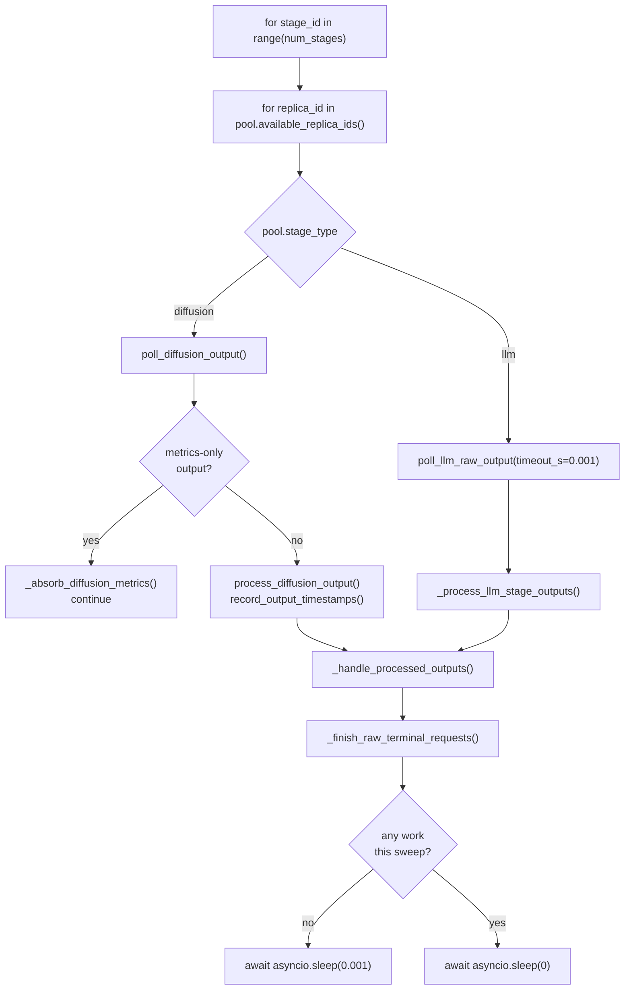
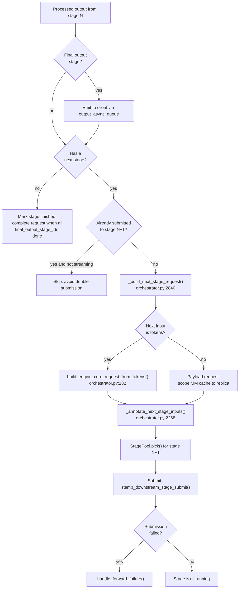

# Request Lifecycle

This document traces a single request from the moment it enters vLLM-Omni to
the moment its last byte reaches the client. Where
[Architecture in Detail](02-architecture.md) describes the static structure,
this one follows the dynamic path through it.

The running example is a three-stage pipeline in the shape of Qwen3-Omni:
Stage 0 (AR Thinker) → Stage 1 (AR Talker) → Stage 2 (Code2Wav audio decode).

## The whole path at a glance



## Phase 1: admission

### Entry surfaces

All three public surfaces converge on the same engine:

| Surface | Class | File |
| --- | --- | --- |
| Offline batch | `Omni.generate()` | `vllm_omni/entrypoints/omni.py:60` |
| Async / server-backing | `AsyncOmni.generate()` | `vllm_omni/entrypoints/async_omni.py:150` |
| Realtime WebSocket | `DuplexOmni` | `vllm_omni/entrypoints/duplex_omni.py` |

`Omni` is a synchronous wrapper; the engine underneath is always asynchronous.

### What the engine does before the Orchestrator sees anything

`AsyncOmniEngine.add_request()` (`vllm_omni/engine/async_omni_engine.py:538`)
delegates to `_prepare_add_request()` (line 605) and
`_build_add_request_message()` (line 224). This is where several important
things happen, all *before* any stage is involved:



Two details worth internalizing:

- **`sampling_params_list` is per stage, not per request.** A three-stage
  pipeline takes three sampling-params entries. `_handle_add_request()` rejects
  an empty list outright (`orchestrator.py:4185`).
- **The multimodal cache is replica-scoped.** If stage 0 has several replicas,
  the hashed multimodal entries must be scoped to the replica that will
  actually serve the request; otherwise a cache hit on replica A would claim
  data that lives in replica B. `_scope_stage0_multimodal_cache_to_replica()`
  (`async_omni_engine.py:158`) handles this, and a bug in exactly this area is
  what commit `800abb659` ("Preserve multimodal payloads across stage-0
  replicas") fixed.

### Crossing into the Orchestrator

The engine and the Orchestrator live in the same process but on different
threads: the engine owns the caller's thread, the Orchestrator runs its own
asyncio loop. They communicate through a `janus` queue — `request_async_queue`
in one direction, `output_async_queue` back.

`OrchestratorBase._request_handler()` (`orchestrator.py:788`) is the single
consumer. It hands every message to the `_dispatch_message()` seam, which the
turn-based `Orchestrator` subclass (`orchestrator.py:4012`) implements by
routing on message class and `type`:

```python
async def _dispatch_message(self, msg: EngineQueueMessage) -> bool:
    # Callers can edit a run payload's type field, so route it by class.
    if isinstance(msg, NextStageInputMessage):
        await self._handle_next_stage_input(msg)
        return True
    msg_type = getattr(msg, "type")
    if msg_type == "add_request":
        await self._handle_add_request(cast(StageSubmissionMessage, msg))
```

The comment on that first branch is a real defensive measure: a `type` field on
a caller-supplied payload is attacker- or bug-editable, so class identity
decides the routing for the sensitive case.

`_handle_add_request()` (`orchestrator.py:4178`) then:

1. Resolves `entry_stage_id`, `final_stage_id`, and `final_output_stage_ids`.
   The entry stage is not always 0 — a deployment may bypass earlier stages.
2. Reserves a specific replica if the caller pinned one
   (`reserve_requested_replica`).
3. Runs admission checks (`_fail_if_cannot_submit`).
4. Creates the `OrchestratorRequestState` that will track this request across
   every stage.

## Phase 2: per-request state

`OrchestratorRequestState` (`orchestrator.py:340`) is the heart of the control
plane. Understanding its fields is understanding what "orchestration" means
here:

| Field group | Fields | Purpose |
| --- | --- | --- |
| Topology | `entry_stage_id`, `final_stage_id`, `final_output_stage_ids` | Which stages this request will visit, and which produce client-visible output |
| Progress | `finished_stage_ids`, `finished_final_output_stage_ids` | What has completed; used to decide when the request is done |
| Timing | `stage_submit_ts`, `stage_submit_perf`, `pipeline_timings` | Per-stage wall-clock and monotonic timestamps, deliberately paired |
| Multimodal | `mm_processor_kwargs`, `mm_features` | Carried across stages so a downstream stage can re-derive inputs |
| Streaming | `streaming` (`StreamingInputState`) | Per-stage segment boundaries for streaming input |
| Session | `session_owned`, `routed_final_finished` | Duplex: the request's lifetime belongs to a session, not to its own `finished` flag |
| Cleanup | `request_artifact_dirs`, `native_kv_transfer_id` | Resources to release on completion or abort |

Note the timing comment in the source:

```python
# Wall-clock time the request was submitted to each stage. Output messages
# publish this. Elapsed generation uses stage_submit_perf, not this value.
stage_submit_ts: dict[int, float] = field(default_factory=dict)
# perf_counter() at the same instant as stage_submit_ts. Paired so a wall-clock
# step cannot disagree with the diffusion scheduler's monotonic queue wait.
stage_submit_perf: dict[int, float] = field(default_factory=dict)
```

Keeping both clocks, sampled at the same instant, is what prevents metrics from
contradicting each other when the wall clock steps. This kind of care is typical
of the orchestrator code.

## Phase 3: stage submission and replica selection

The Orchestrator never talks to a replica directly. It asks a `StagePool`:



The binding matters for correctness, not just load: once a request is bound to
a replica, its KV cache, its prefix-cache state, and its multimodal cache
entries all live in that replica. Rebinding mid-request would invalidate all of
them. `StagePool.release()` drops the binding when the request leaves the
stage; `invalidate_addr()` returns the request IDs that must be failed when a
replica dies.

## Phase 4: output collection and routing

The Orchestrator runs an output loop. There are two implementations, selected
by an environment flag (`_event_driven_orch_enabled()`, `orchestrator.py:127`):

- `_orchestration_loop()` (`orchestrator.py:1369`) — polls every replica of
  every stage in a round-robin sweep.
- `_orchestration_loop_event_driven()` (`orchestrator.py:1429`) — one reader
  task per replica, waking on data.

The polling loop is the clearer illustration of the control flow:



Error handling in that loop is deliberately narrow:

```python
except EngineDeadError as e:
    await self._handle_dead_replica(stage_id, replica_id, e)
    continue
```

A dead replica is *evicted*, not fatal. The comment in the source points at the
issue that motivated it: "Shared catch so a dead replica on either poll path is
evicted rather than tearing down every stage (#4285)."

## Phase 5: forwarding to the next stage

This is the step that makes the pipeline a pipeline.
`_handle_processed_outputs()` (`orchestrator.py:1712`) decides, per output,
whether the request advances. The actual hand-off is
`_forward_to_next_stage()` (`orchestrator.py:3097`), which wraps
`_forward_to_next_stage_unguarded()` (line 3128).



Three subtleties live in this path:

1. **Two input kinds.** `_next_stage_input_is_tokens()` (line 2837)
   distinguishes a token-sequence hand-off (rebuilt into a proper
   `EngineCoreRequest`) from a payload hand-off (a tensor bundle moved by a
   connector, with only a handle in the control plane).
2. **Idempotence under streaming.** `_next_stage_already_submitted()`
   (line 2587) prevents submitting the same request to the next stage twice —
   except when streaming is enabled, where each segment legitimately produces a
   new downstream submission.
3. **Async chunk.** When `deploy.async_chunk` is on, forwarding happens on
   *partial* stage output, so stage N+1 starts before stage N finishes. That is
   what overlaps the Thinker, Talker, and Code2Wav stages in the Qwen3-Omni
   timeline and is the main lever on time-to-first-audio-packet.

## Phase 6: completion, cancellation, and cleanup

A request is complete when every stage in `final_output_stage_ids` has
finished. The cleanup path then has to release, in the right order:

- the replica bindings in every `StagePool` (`_release_request_bindings`,
  line 992),
- cross-stage transfer resources (`_release_stage_transfer_resources`, line 977),
- on-disk artifacts (`cleanup_request_artifact_dirs`, line 106),
- native KV transfer state, keyed by `native_kv_transfer_id`.

Cancellation runs the same machinery from the other direction.
`_handle_abort()` (line 889) → `_abort_request_ids()` (line 929) aborts the
request on every stage it might currently occupy, then runs the same cleanup.
Because a request can be in flight between stages at abort time, the abort has
to cover stages it has not reached yet — which is why
`_cleanup_request_ids()` iterates a stage range rather than a single stage.

A session-owned (duplex) request is the exception: its lifetime belongs to the
session, not to its own `finished` flag. The `session_owned` field exists to
suppress exactly the behaviors that would otherwise terminate it — no synthetic
terminal output, no cleanup on finish, no terminal re-forward. See
[Full-Duplex Sessions](features/05-full-duplex-sessions.md).

## Reading the code yourself

If you want to follow one request through the real code, this sequence of
breakpoints covers the path with no gaps:

| Order | Location | What you see |
| --- | --- | --- |
| 1 | `async_omni_engine.py:605` `_prepare_add_request` | The fully rendered request before any stage |
| 2 | `orchestrator.py:4178` `_handle_add_request` | Admission and state creation |
| 3 | `stage_pool.py:533` `pick` | Replica selection |
| 4 | `orchestrator.py:1104` `_process_llm_stage_outputs` | Raw stage output becoming logical output |
| 5 | `orchestrator.py:3128` `_forward_to_next_stage_unguarded` | The stage-to-stage hand-off |
| 6 | `orchestrator.py:1712` `_handle_processed_outputs` | Client emission and completion |
