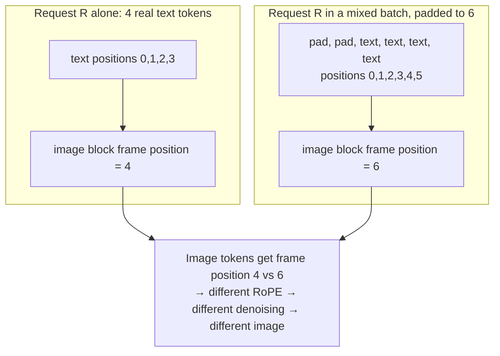
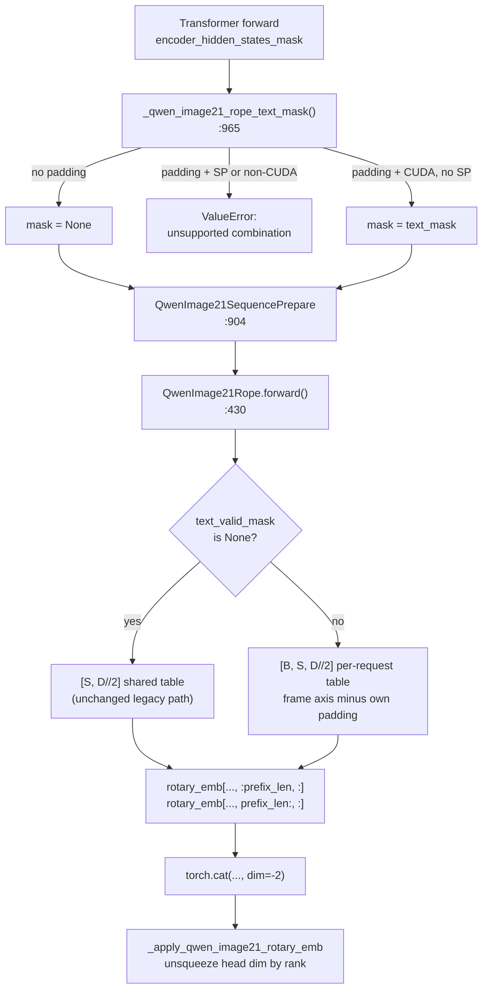

# Case Study 01: Mixed-length batches corrupt Qwen-Image-2.1 output

| | |
| --- | --- |
| **Difficulty** | Difficult |
| **Subsystem** | Diffusion request batching, rotary position embeddings |
| **Issue** | [#10374](https://github.com/vllm-project/vllm-omni/issues/10374) — `[Bug]: Qwen-Image-2.1 output changes in eager mode when other requests in the same batch have longer prompts` (`bug`, `medium priority`) |
| **Fix** | [PR #10376](https://github.com/vllm-project/vllm-omni/pull/10376), commit `e13bd170e` |
| **Backport** | [#10804](https://github.com/vllm-project/vllm-omni/pull/10804) to v0.34.0 |
| **Diff size** | 2 files, +165 / −14 |

## The symptom

A user running Qwen-Image-2.1 in request-batch serving mode observed that a
request's generated image **changed depending on what else was in its batch** —
with the same prompt, the same seed, and the same batch size.

The reporter's experiment is a model of how to isolate this. Request R is
identical in both waves and sent first. Only its two batchmates change:

| | Wave B (equal length) | Wave C (mixed length) |
| --- | --- | --- |
| R | `A ceramic teapot on a wooden table.` | same |
| Other two | short prompts of similar length | a ~60-word prompt, both |

Results for request R:

| | Single request | Wave B (equal length) | Wave C (mixed length) |
| --- | --- | --- | --- |
| PSNR vs single request | — | 43.99 dB | **27.94 dB** |
| PSNR / SSIM vs wave B | — | — | **27.66 dB / 0.964** |

Both waves were run twice, and R's output was byte-identical between runs of the
same wave. So this was not nondeterminism — it was a **deterministic dependence
on batchmates**, which is worse: it is reproducible, silent, and invisible to
the user.

Configuration: `--enforce-eager --max-num-seqs 4 --request-batch-max-wait-ms 500`,
1024×1024, 50 steps, seed 42, `true_cfg_scale=1.0`, BF16, cuDNN attention.

## Why this is the dangerous class of bug

A crash tells you something is wrong. This does not. The request succeeds, the
image looks plausible, and 27.94 dB PSNR is "a somewhat different image" rather
than garbage. In production, nobody files a bug — they just get slightly
different images depending on server load.

Worth noting what the reporter explicitly did **not** claim: the investigation
covered eager text-to-image on one GPU with one attention backend. Image
editing, true CFG, and CUDA-graph mode were untested. That scoping discipline is
what made the fix reviewable.

## Background: how Qwen-Image-2.1 lays out positions

The model runs a joint text + image token sequence through one transformer. Its
rotary embedding has three axes, and `QwenImage21Rope`
(`vllm_omni/diffusion/models/qwen_image_21/qwen_image_21_transformer.py:401`)
documents the scheme:

```text
3-axis (frame, height, width) rotary embedding over the joint text/image sequence.

Text tokens advance a shared position on all three axes. Every image block freezes the frame axis at the position
reached by the preceding text and lays its tokens out on a height/width grid centred on zero, so a block's spatial
positions do not depend on where it sits in the sequence.
```

The critical sentence is the second one: **an image block's frame position is
"the position reached by the preceding text".** The image tokens inherit a
position that is a function of *how many text tokens came before them*.

Here is the position construction, from `forward()`:

```python
for _, height, width in img_shapes:
    block_start = is_image_token.index(True, cursor)
    text_len = block_start - cursor
    frame_index.extend(range(position, position + text_len))
    position += text_len

    cursor = block_start + height * width
    frame_index.extend([position] * (height * width))
    position += max(height, width)
```

So `text_len` drives everything downstream.

## The root cause

Now bring in request batching. To batch requests with different prompt lengths,
the text embeddings are padded to a common length, and
`encoder_hidden_states_mask` marks which text positions are real. The padding
is on the **left**: padded slots precede valid tokens.

But `image_pad_mask` — the layout the RoPE table is built from — is *shared
across the batch*. The model explicitly requires this
(`qwen_image_21_transformer.py:1334`):

```python
# All samples must share a token layout (same interleaving of text and image blocks);
# per-sample variation enters only through `encoder_hidden_states_mask` padding.
```

Before the fix, `QwenImage21Rope.forward()` returned a single `[S, D // 2]`
frequency table for the whole batch, computed from that shared layout. Padded
text slots are text slots as far as the loop above is concerned, so they
**advance the frame position**. Every request in the batch received the frame
positions of the *longest* prompt.



That is the bug in one line: **padding leaked into position-dependent math.**

The reporter had already identified the neighbourhood, citing #9040, which
groups by prompt length only for CUDA-graph-eligible batches and therefore does
not cover eager mode. Length grouping would have hidden the symptom; it would
not have fixed the cause.

## The fix

Commit `e13bd170e` makes the frame axis **per request**, so each request's image
tokens get the frame position they would have had alone.

### 1. Subtract each request's own padding

```python
height_freqs = self.freqs[1].index_select(0, height_index)
width_freqs = self.freqs[2].index_select(0, width_index)
if text_valid_mask is None:
    return torch.cat([self.freqs[0].index_select(0, frame_index), height_freqs, width_freqs], dim=-1)

# Text padding can precede valid tokens. Each request's frame position
# must exclude its own padded text positions; padded slots are masked.
padded_text = ~text_valid_mask.bool() & ~image_pad_mask.unsqueeze(0)
frame_by_request = (frame_index.unsqueeze(0) - padded_text.long().cumsum(dim=1)).clamp_min_(0)
batch_size = text_valid_mask.shape[0]
frame_freqs = self.freqs[0].index_select(0, frame_by_request.flatten()).view(batch_size, total_len, -1)
return torch.cat(
    [
        frame_freqs,
        height_freqs.unsqueeze(0).expand(batch_size, -1, -1),
        width_freqs.unsqueeze(0).expand(batch_size, -1, -1),
    ],
    dim=-1,
)
```

The arithmetic is elegant. `padded_text.cumsum(dim=1)` is, at each sequence
position, the number of padded text slots at or before it *for that request*.
Subtracting it from the shared `frame_index` removes exactly that request's
padding contribution. A `clamp_min_(0)` guards the padded slots themselves,
whose values are masked out anyway.

Height and width stay batch-shared, and for the image tokens that is exact —
their height/width indices come from the centred grid
(`image_height_index` / `image_width_index`), which does not depend on text
length at all. The valid text tokens' height/width axes still carry the padded
layout's values; the fix and its tests pin the **image** positions, which is
what the reported symptom was about.

### 2. Make every consumer rank-agnostic

The frequency tensor is now `[S, D//2]` *or* `[B, S, D//2]`, so everything that
touches it had to stop assuming rank 2. The rotary application:

```python
def _apply_qwen_image21_rotary_emb(x: torch.Tensor, freqs: torch.Tensor) -> torch.Tensor:
    """Rotate interleaved pairs with complex FP32 multiplication.

    Same contract as the reference `apply_rotary_emb_qwen(..., use_real=False)`:
    `x` is [B, S, H, D]; `freqs` is [S, D // 2] or [B, S, D // 2].
    """
    fused = rotary(x, freqs)
    if fused is not None:
        return fused
    paired = torch.view_as_complex(x.float().reshape(*x.shape[:-1], -1, 2))
    freqs = freqs.unsqueeze(1) if freqs.ndim == 2 else freqs.unsqueeze(2)
    return torch.view_as_real(paired * freqs).flatten(3).to(x.dtype)
```

The head axis to unsqueeze moves with the rank: dim 1 for `[S, D//2]`, dim 2
for `[B, S, D//2]`. The same change lands in
`_apply_qwen_image21_rotary_emb_native` via `head_dim = 1 if freqs.ndim == 2 else 2`.

And every slice switched from dim 0 to dim −2:

```python
-            return prefix_hidden_states, target_hidden_states, rotary_emb[:0], rotary_emb[prefix_len:]
+            return prefix_hidden_states, target_hidden_states, rotary_emb[..., :0, :], rotary_emb[..., prefix_len:, :]
```

```python
-        freqs = torch.cat([prefix_freqs, target_freqs], dim=0)
+        freqs = torch.cat([prefix_freqs, target_freqs], dim=-2)
```

This is the unglamorous majority of the diff, and the part most likely to hide
a mistake: a single surviving `[0]`-indexed slice would silently take request
0's frequencies for the whole batch.

### 3. Fail loudly where the per-request path is not supported

```python
def _qwen_image21_rope_text_mask(
    text_mask: torch.Tensor | None, device: torch.device, sp_active: bool
) -> torch.Tensor | None:
    if text_mask is None:
        return None
    if sp_active or device.type != "cuda":
        if not bool(text_mask.all()):
            raise ValueError(
                "Qwen-Image-2.1 mixed-length text padding requires CUDA without sequence parallelism "
                "for per-request image RoPE."
            )
        return None
    return text_mask
```

This is the judgement call in the fix, and it is the right one. The per-request
path is not supported with sequence parallelism (which shards the sequence, so
per-request position arithmetic needs more work) or on non-CUDA backends — the
NPU path in `_npu_rope_tables()` builds its cos/sin tables with
`.unsqueeze(0).unsqueeze(2)`, which assumes a rank-2 `freqs`.

So instead of silently producing the old wrong answer, the configuration
**raises** — but only when padding is actually present (`not text_mask.all()`).
An unpadded batch on NPU or under SP keeps working exactly as before.

### Control flow, before and after



## The tests

`tests/diffusion/models/qwen_image_21/test_per_request_rope.py` is worth
studying as a model of how to test this class of bug. It runs on CPU with no
weights — just the RoPE module.

The central assertion compares a *padded request inside a batch* against the
*same request computed alone*:

```python
def test_mixed_prompt_padding_keeps_each_image_frame_position():
    rope = QwenImage21Rope(theta=10000, axes_dim=[16, 56, 56])
    prepare = QwenImage21SequencePrepare(nn.Identity(), rope)
    layout = [(1, 2, 2)]
    image_slots = torch.tensor([[False] * 6 + [True]] * 2)
    text_mask = torch.tensor([[0, 0, 1, 1, 1, 1], [1] * 6])

    _, _, _, target_freqs = prepare(
        torch.zeros(2, 4, 64), torch.zeros(2, 6, 64), layout, image_slots, False, text_mask,
    )

    short = rope(layout, torch.tensor([False] * 4 + [True] * 4), torch.device("cpu"))[-4:]
    long = rope(layout, torch.tensor([False] * 6 + [True] * 4), torch.device("cpu"))[-4:]
    assert target_freqs.shape == (2, 4, 64)
    assert torch.equal(target_freqs[0], short)
    assert torch.equal(target_freqs[1], long)
```

`torch.equal` — exact equality, not a tolerance. The whole point is that
batching must not perturb the positions at all.

The other four tests cover the rest of the surface:

| Test | What it pins |
| --- | --- |
| `test_mixed_prompt_padding_with_reference_image_keeps_target_frame_position` | Same property with a reference-image block in the sequence |
| `test_singleton_decode_after_mixed_prefill_keeps_target_frame_position` | A cached decode step reuses the *same* per-request geometry as its prefill |
| `test_unsupported_mixed_padding_is_rejected` | The guard raises for `(cpu, no SP)` and `(cuda, SP)` |
| `test_batched_rotary_matches_individual_requests` | Batched rotary application equals per-request application |

The third one deserves a note: it checks that
`prepare._request_geometry["rotary_emb"]` cached during prefill still matches
the single-request table at decode. Caching per-request geometry and then
reusing it for a *different* request set would reintroduce the bug in a new
place.

## Lessons

1. **Padding must never reach position-dependent math.** Masking padded tokens
   out of attention is not sufficient if their *existence* shifts the positions
   of real tokens.
2. **Grouping by length is a workaround, not a fix.** #9040's length grouping
   made the symptom rarer for CUDA-graph batches. The cause survived in eager
   mode.
3. **Prefer raising over silently falling back.** The SP/non-CUDA guard turns an
   unsupported combination into an error message instead of a wrong image.
4. **Batch invariance is a testable property, cheaply.** These tests need no
   GPU, no weights, and no model download — they compare a batched computation
   against single-request computations at exact equality.
5. **When a tensor's rank becomes variable, audit every consumer.** Most of
   this diff is dim-0 → dim-−2 changes. The interesting arithmetic was four
   lines.

## Related

- Issue #8586 — mixed-length batching, same area
- Issue #9040 — prompt-length grouping for CUDA-graph-eligible batches
- Issue #5512 — general batch invariance
- [Diffusion Stage Execution](../features/03-diffusion-stage.md) — batch
  compatibility keys and why they are a correctness surface
