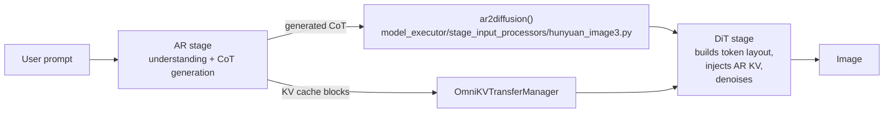
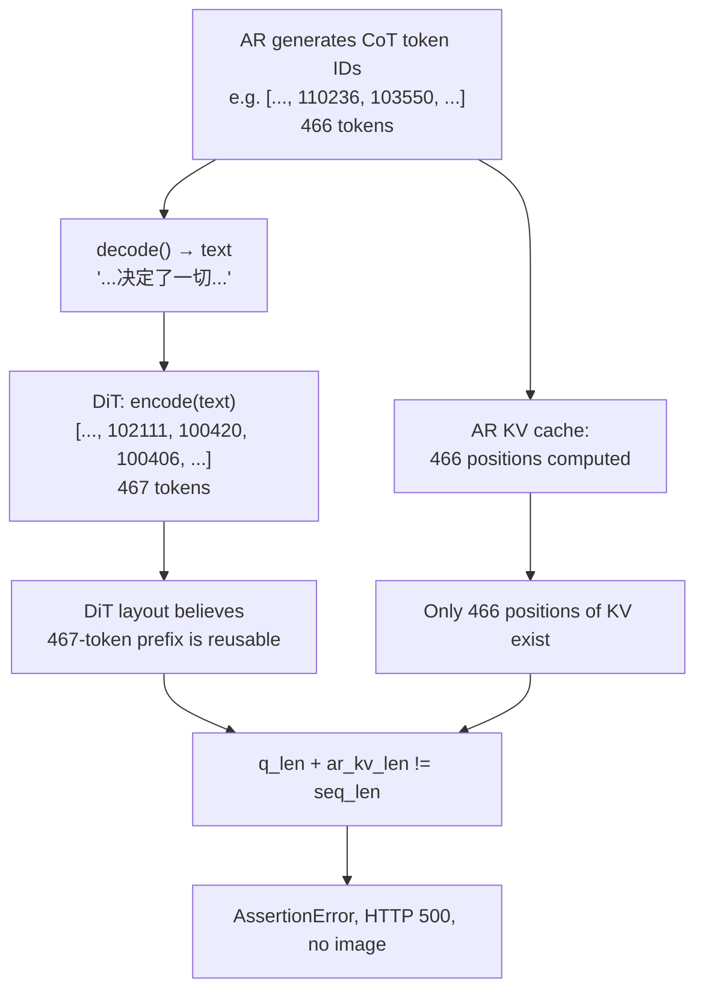
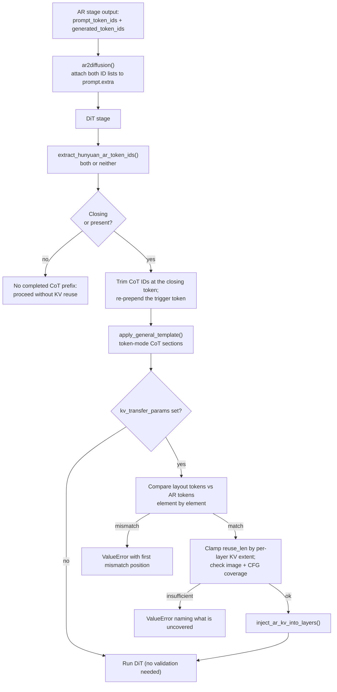

# Case Study 02: AR-to-DiT KV reuse breaks on token re-encoding

| | |
| --- | --- |
| **Difficulty** | Difficult |
| **Subsystem** | Cross-stage KV reuse, tokenization, AR → DiT hand-off |
| **Issue** | [#9214](https://github.com/vllm-project/vllm-omni/issues/9214) — `[Bug]: HunyuanImage3.0 AR-to-DiT KV reuse can fail when re-tokenizing generated CoT changes token boundaries` (`bug`, `high priority`) |
| **Fix** | [PR #9323](https://github.com/vllm-project/vllm-omni/pull/9323), commit `6039984e3` |
| **Diff size** | 9 files, +608 / −41 |

## The symptom

A HunyuanImage-3.0 text-to-image request with chain-of-thought (CoT) enabled
returned **HTTP 500 and no image**, failing with an assertion before the first
DiT attention operation completed:

```text
AssertionError: q_len + ar_kv_len != seq_len
```

The logs showed successful KV receipt on all four TP ranks, so the transfer
itself worked. The failure was in what the DiT *believed* about the KV it had
received.

## The architecture that makes this possible

HunyuanImage-3.0 can be deployed as an AR stage followed by a DiT stage, with
the AR stage's KV cache transferred to the DiT so the DiT does not recompute
the prefix. The AR stage produces a chain of thought — a `<think>` and/or
`<recaption>` section — which becomes part of the DiT's conditioning.



The DiT has to reconstruct the *same token sequence* the AR stage had, because
the imported KV is indexed by position in that sequence. It then computes only
the uncached suffix and attends over the imported prefix.

## The root cause

Before the fix, the bridge forwarded the CoT as **decoded text**, and the DiT
re-encoded that text to build its layout. The issue states the problem in one
line:

```python
encode(decode(ar_generated_ids)) != ar_generated_ids
```

Tokenizers are not invertible for arbitrary token sequences. A BPE tokenizer
chooses a canonical segmentation when encoding text, but a *generated* sequence
need not be that canonical segmentation — the model can emit any sequence of
token IDs that decodes to the same string.

The reporter supplied a **deterministic, weightless reproduction**, which is
the single most valuable thing in the whole report. No GPU, no model weights,
just the tokenizer:

```python
cases = [
    ([110236, 103550], [102111, 100420, 100406]),
    ([114980, 100449], [67494, 114745]),
]
for original, expected in cases:
    text = tokenizer.decode(original, skip_special_tokens=False)
    rebuilt = tokenizer.encode(text, add_special_tokens=False).ids
    print(original, "->", rebuilt, "text:", repr(text))
    assert rebuilt == expected
    assert rebuilt != original
```

Verified output, against a SHA-256-pinned tokenizer:

```text
[110236, 103550] -> [102111, 100420, 100406] text: '决定了一切'
[114980, 100449] -> [67494, 114745] text: '说明了她'
```

Two different failure modes:

| Case | Original | Re-encoded | Consequence |
| --- | --- | --- | --- |
| First | 2 tokens | **3** tokens | The full output went from 466 to 467 tokens — the planned reusable prefix became longer than the actual AR KV, tripping the assertion |
| Second | 2 tokens | 2 tokens, **different IDs** | Same length, different tokens — no assertion fires, so the KV silently describes different tokens |

The second case is the more alarming one, and the reporter was careful about
it: *"Equal lengths therefore do not prove token identity; this second sample
alone does not establish image corruption."* It is a correctly-scoped claim —
the length check that existed could not have caught it, and whether it degrades
the image was not demonstrated.



### Why the previous fix for the same assertion did not cover this

The same `AssertionError` had been reported before, as issue #3499, and fixed
by PR #3516. That diagnosis concerned whole-string versus segmented
tokenization of the **input prompt**, and the fix aligned AR/DiT prompt
construction and system prompt propagation.

The reporter checked this explicitly: *"all 1312 input prompt tokens match
exactly, including the DiT prefix before the generated CoT. The mismatch occurs
inside the AR-generated text, so input-template alignment alone does not
address it."*

The same exception, a genuinely different cause. This is why reusing an old
diagnosis for a recurring error message is dangerous.

## The fix

Commit `6039984e3` stops round-tripping through text, and adds validation so a
future violation fails loudly with a useful message instead of an assertion.

### 1. Carry the original token IDs across the stage boundary

In the bridge (`model_executor/stage_input_processors/hunyuan_image3.py`):

```python
# The transferred KV belongs to these exact tokens. Decoding generated
# text and encoding it again can change both token IDs and token count.
prompt_token_ids = getattr(ar_output, "prompt_token_ids", None)
if prompt_token_ids is not None and generated_token_ids is not None:
    diffusion_input["extra"][HUNYUAN_AR_PROMPT_TOKEN_IDS_KEY] = list(prompt_token_ids)
    diffusion_input["extra"][HUNYUAN_AR_GENERATED_TOKEN_IDS_KEY] = list(generated_token_ids)
```

The two keys are defined in `prompt_utils.py`, the stated "single source of
truth for the AR-prefill prompt format", so both sides agree on the names:

```python
HUNYUAN_AR_PROMPT_TOKEN_IDS_KEY = "ar_prompt_token_ids"
HUNYUAN_AR_GENERATED_TOKEN_IDS_KEY = "ar_generated_token_ids"
```

On the DiT side, `request_layout.py` reads them back, insisting that they
arrive as a pair:

```python
def extract_hunyuan_ar_token_ids(
    prompts: list[Any],
) -> list[tuple[list[int], list[int]] | None] | None:
    """Read the original AR sequence without a lossy text round trip."""
    result = []
    for prompt in prompts:
        extra = prompt.get("extra", {}) if isinstance(prompt, dict) else {}
        prompt_ids = extra.get(HUNYUAN_AR_PROMPT_TOKEN_IDS_KEY)
        generated_ids = extra.get(HUNYUAN_AR_GENERATED_TOKEN_IDS_KEY)
        if (prompt_ids is None) != (generated_ids is None):
            raise ValueError("Hunyuan AR token metadata requires both prompt and generated token IDs.")
        result.append(None if prompt_ids is None else (list(prompt_ids), list(generated_ids)))
    return result if any(item is not None for item in result) else None
```

### 2. Make the template accept tokens, not only text

`get_cot_sections()` previously split the CoT **string** on `<think>` and
`<recaption>` tags. It now handles either representation, keyed off the input
type:

```python
is_text = isinstance(cot_text, str)
content_key = "text" if is_text else "tokens"
for tag in ("think", "recaption"):
    opening, closing = f"<{tag}>", f"</{tag}>"
    start = opening if is_text else self.special_token_map[opening]
    end = closing if is_text else self.special_token_map[closing]
    if start not in cot_text or end not in cot_text:
        continue
    start_pos = cot_text.index(start)
    body_pos = start_pos + (len(start) if is_text else 1)
    end_pos = cot_text.index(end, body_pos)
    after_pos = end_pos + (len(end) if is_text else 1)
```

This is a nice piece of refactoring: the original had two near-identical
`<think>` and `<recaption>` branches, each ~15 lines. Unifying them into one
tag loop made adding the token path a small change rather than a doubling.
Note the `len(start) if is_text else 1` pattern — a tag is several characters
in a string but exactly **one** element in a token list.

### 3. Find the reusable boundary in token space

```python
cot_ids = list(generated_ids)
# Match the text path's recaption-first boundary, and let
# the template rebuild answer/image metadata exactly once.
for closing in (self.end_recaption_token_id, self.end_think_token_id):
    if closing in cot_ids:
        cot_ids = cot_ids[: cot_ids.index(closing) + 1]
        break
else:
    # Vanilla/img_ratio and unfinished thoughts do not
    # supply a completed CoT prefix for KV reuse.
    continue
trigger_ids = (self.special_token_map["<think>"], self.special_token_map["<recaption>"])
if prompt_ids and prompt_ids[-1] in trigger_ids:
    cot_ids.insert(0, prompt_ids[-1])
batch_cot_text[i] = cot_ids or None
```

Three decisions worth calling out:

- **Recaption first, matching the text path.** The ordering of the two closing
  tags is not arbitrary; it reproduces the old behavior exactly so the fix does
  not change results for working requests.
- **A `for...else` to opt out.** If no closing tag is present, the CoT is
  incomplete — an unfinished thought, or a vanilla/`img_ratio` task — and there
  is no completed prefix to reuse. The request proceeds **without** KV reuse
  rather than reusing something uncertain.
- **The trigger token is re-prepended.** If the AR prompt ended with `<think>`
  or `<recaption>`, that token belongs at the head of the CoT section for the
  layout to match.

### 4. Validate identity, not length

The decisive addition. When a request carries KV transfer params, the layout is
checked against the original AR sequence **token by token**:

```python
if validate_ar_kv_prefix and batch_ar_token_ids is not None:
    # Conditional rows precede CFG rows. Check identity, not just
    # length, before either dense KV injection or native KV admission.
    for i, ar_tokens in enumerate(batch_ar_token_ids):
        if ar_tokens is None:
            continue
        boundary = output.think_recaption_end_pos[i][0]
        if boundary is None:
            continue
        source_ids = ar_tokens[0] + ar_tokens[1]
        # Dense and native reuse both stop before the closing CoT
        # token. AR tokens past it, such as an unfinished
        # <recaption>, are rebuilt by the template and never reused.
        prefix_len = boundary
        layout_ids = output.tokens[i, :prefix_len].tolist()
        if layout_ids != source_ids[:prefix_len]:
            mismatch = next(
                (pos for pos, (a, b) in enumerate(zip(layout_ids, source_ids)) if a != b),
                min(len(layout_ids), len(source_ids)),
            )
            raise ValueError(
                "Hunyuan AR KV prefix token IDs do not match the DiT layout: "
                f"first mismatch at {mismatch}, checked prefix {prefix_len}, "
                f"AR sequence length {len(source_ids)}."
            )
```

Compare the two error messages:

| Before | After |
| --- | --- |
| `AssertionError: q_len + ar_kv_len != seq_len` | `Hunyuan AR KV prefix token IDs do not match the DiT layout: first mismatch at 1341, checked prefix 1778, AR sequence length 1779.` |

The second tells you *where* the divergence starts, which immediately
distinguishes "prompt template mismatch" (mismatch near 0) from "generated CoT
re-encoding" (mismatch inside the generated region) — the exact confusion
between #3499 and #9214.

Validation is gated on `request.kv_transfer_params is not None`, so requests
that are not reusing KV pay nothing.

### 5. Verify the KV actually covers what will be removed

Separately, the pipeline now checks the imported KV before injecting it
(`hunyuan_image3_transformer.py`):

```python
# Sampled tokens can extend beyond the prefix actually computed by
# AR. Every decoder layer must have KV for the prefix we remove.
for layer in self.model.model.layers:
    layer_kv = ar_kv_data.get(layer.layer_idx)
    if layer_kv is None or layer_kv.get("key") is None or layer_kv.get("value") is None:
        raise ValueError(f"AR KV cache is missing key/value tensors for layer {layer.layer_idx}")
    positive_reuse_len = min(positive_reuse_len, layer_kv["key"].shape[0], layer_kv["value"].shape[0])
if positive_reuse_len <= 0:
    raise ValueError("AR KV cache does not contain a computed prefix")
if any(
    image_slice.stop > positive_reuse_len
    for image_slices in model_kwargs["tokenizer_output"].joint_image_slices or []
    for image_slice in image_slices
):
    raise ValueError("AR KV cache does not cover the conditional images")
if (
    self.do_classifier_free_guidance
    and not getattr(self.model.config, "cfg_distilled", False)
    and negative_reuse_len is not None
    and positive_reuse_len <= negative_reuse_len
):
    raise ValueError("AR KV cache does not cover the negative CFG prefill boundary")
```

The reuse length is clamped by the *minimum* across every layer, because a
sampled token can extend past the prefix AR actually computed, and a per-layer
shortfall would otherwise read uninitialized KV. Three further checks cover
conditional image coverage and the negative CFG boundary.

### Flow after the fix



## The tests

Two new test files, with complementary jobs:

| File | Purpose |
| --- | --- |
| `tests/diffusion/models/hunyuan_image3/test_ar_token_identity.py` (315 lines) | The token path: changed-length and equal-length-changed-ID sequences, boundary trimming, trigger re-prepending, the validation error |
| `tests/diffusion/models/hunyuan_image3/test_hunyuan_image3_ar_kv_coverage.py` (122 lines) | The coverage checks: missing layer KV, short per-layer KV, uncovered conditional images, the CFG boundary |

The PR description makes the regression requirement explicit: coverage for
**both** changed-length and equal-length/changed-ID sequences. Testing only the
length change would leave the silent case unprotected — which is precisely how
the bug survived the earlier fix.

## Lessons

1. **`encode(decode(x)) != x`.** If a cache is keyed by token sequence, carry
   the token sequence. Text is a lossy serialization of tokens.
2. **Equal length does not imply equal tokens.** Any check that compares
   lengths to validate a cached prefix is incomplete by construction.
3. **The same exception can have unrelated causes.** #3499 and #9214 produced
   the identical `AssertionError`. Fixing the error message to name the
   divergence point is what separates them for the next reporter.
4. **A weightless reproduction is worth more than a stack trace.** A ~15-line
   tokenizer script with a pinned SHA-256 turned "sometimes fails on H100" into
   a deterministic, reviewable fact.
5. **Decline to optimize when the precondition is unproven.** When no closing
   CoT tag is found, the fix skips reuse entirely rather than guessing a
   boundary. A missed optimization is cheap; a wrong cache is not.
6. **Validate at the boundary, not in the kernel.** The old failure surfaced as
   an assertion inside attention. The new one fails at admission, with the
   information needed to diagnose it.

## Related

- Issue #3499 / PR #3516 — the earlier, different cause of the same assertion
- [Prefix Caching and KV Reuse](../features/06-prefix-caching-and-kv.md)
- [OmniConnector Transport](../features/04-omni-connector-transport.md) — how
  the KV actually moves
- Issue [#10643](https://github.com/vllm-project/vllm-omni/issues/10643)
  ("HunyuanImage AR CoT misses `<recaption>` under MRv2 with vLLM 0.34.0") shows
  this model's CoT path continues to need care
