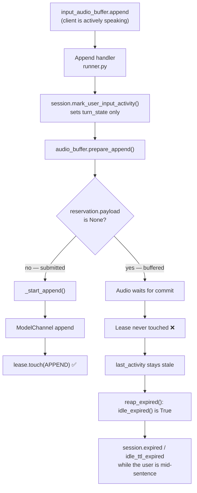
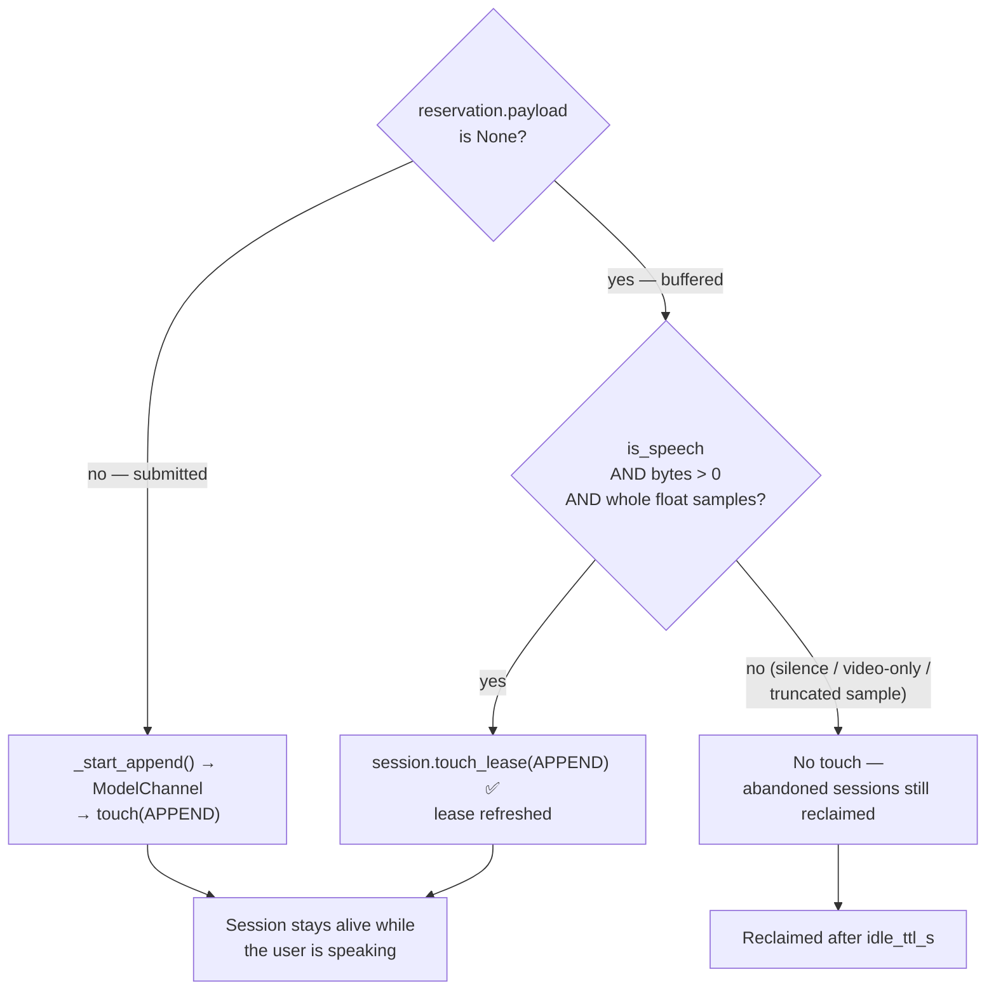

# Case Study 03: Duplex sessions expire while the user is still talking

| | |
| --- | --- |
| **Difficulty** | Difficult |
| **Subsystem** | Full-duplex session lifetime, lease accounting |
| **Issue** | [#10579](https://github.com/vllm-project/vllm-omni/issues/10579) — `[Bug]: duplex idle_ttl_s expires a session while the client is still streaming input audio` (`bug`, `medium priority`) |
| **Fix** | [PR #10617](https://github.com/vllm-project/vllm-omni/pull/10617), commit `7a8270541` |
| **Backport** | [#10801](https://github.com/vllm-project/vllm-omni/pull/10801) to v0.34.0 |
| **Follow-up** | [#10760](https://github.com/vllm-project/vllm-omni/pull/10760) — idle leases for buffered audio without server VAD |
| **Diff size** | 2 files, +68 / −0 |

## The symptom

A realtime session was closed with `idle_ttl_expired` **while the client was
continuously streaming audio into it**. Reproduced by a user of an out-of-tree
plugin (Sophon-Realtime) on an RTX 4090 Laptop:

1. Set `idle_ttl_s` in `duplex_session` (tested with 60 and 300).
2. Open a realtime session and stream continuous uplink audio with no reply.
3. The session closes with `idle_ttl_expired` at about `idle_ttl_s`: **61.2 s**
   with 60, **304.5 s** with 300.

The timings are the giveaway. 61.2 s and 304.5 s are `idle_ttl_s` plus the
reaper interval — this is not a flaky timeout, it is the idle timer firing
exactly as implemented, on a session that was not idle.

## Why it matters

The affected use cases are not exotic:

- a long monologue or dictation,
- a listen-only mode where the model is not expected to reply,
- any model that uses `supports_model_native_turn_policy`, where the *model*
  decides when a turn ends.

In all of these, the user can talk for minutes without the model producing
output. The documented workarounds — a larger `idle_ttl_s`, or
`idle_ttl_s: null` — both have the cost the reporter identified: *"Both also
delay the cleanup of sessions whose client disappeared without closing, since a
detached session keeps its admission slot until the TTL."* With `max_sessions`
defaulting to 1, an un-reclaimed session blocks the server.

So the lease has two jobs in tension: keep live sessions alive, and reclaim dead
ones promptly. Weakening the TTL trades one bug for another.

## The root cause

The report is unusually precise, and names the exact line of the gap.

The lease (`vllm_omni/engine/duplex/session/lease.py:107`) expires on
wall-clock inactivity:

```python
def idle_expired(self, now: float) -> bool:
    expires_at = self.expires_at
    return (
        self.terminal_reason is None and not self.active_operations and expires_at is not None and now >= expires_at
    )
```

`last_activity` is refreshed by `touch()`, whose activity enum enumerates what
counts (`lease.py:12`):

```python
class DuplexLeaseActivity(str, Enum):
    APPEND = "append"
    SIGNAL = "signal"
    PLAYBACK_ACK = "playback_ack"
    HEARTBEAT = "heartbeat"
    ATTACH = "attach"
    DETACH = "detach"
    RESUME = "resume"
    MODEL_OUTPUT = "model_output"
```

`APPEND` exists and *is* used — but only on the **model append** path, in
`model_channel.py`. The uplink audio path called a different method entirely:

```python
def mark_user_input_activity(self) -> None:
    self.turn_state = DuplexTurnState.USER_SPEAKING
```

That sets turn state. It does not touch the lease.

So the gap is precisely this: **an append that does not reach the model is not
lease activity.** And an append frequently does not reach the model. From
[Full-Duplex Sessions](../features/05-full-duplex-sessions.md), the append
handler buffers audio when `pcm_reservation.payload is None` — waiting for a
commit rather than submitting immediately. In that branch, nothing downstream
ever touches the lease.



The bug is therefore a mismatch between two definitions of "active":

| Definition | Held by | What it tracks |
| --- | --- | --- |
| The model ran | `lease.last_activity` | Model appends, model output, signals, heartbeats, playback acks |
| The client is present and speaking | `turn_state` | Uplink audio arrival |

The lease was documenting the first while being used to decide the second.

### The reporter's proposed fix, and why the detail matters

The issue proposed touching the lease in the append handler, *"perhaps only for
speech frames (VAD `is_speech`) so that an open microphone streaming silence is
still reclaimed"*, plus a new `DuplexLeaseActivity.INPUT` value to keep reasons
distinguishable.

The speech-only qualifier is the important half. Refreshing on *any* append
would make an abandoned session with an open microphone immortal — exactly the
leak the TTL exists to prevent. The fix has to distinguish "the user is
talking" from "a socket is open".

## The fix

Commit `7a8270541` adds **three lines** of production code, in the buffered
branch of the append handler (`runner.py:2046`):

```python
# A buffer can retain video while dropping an incomplete float PCM sample.
if payload["is_speech"] and raw_audio_bytes > 0 and (fmt != "pcm_f32le" or raw_audio_bytes % 4 == 0):
    session.touch_lease(DuplexLeaseActivity.APPEND)
```

Each conjunct is load-bearing:

| Condition | Why |
| --- | --- |
| `payload["is_speech"]` | Only speech keeps a session alive. An open mic streaming silence or noise still gets reclaimed — the reporter's own suggestion |
| `raw_audio_bytes > 0` | A video-only append carries no audio. Video frames alone are not evidence the user is speaking |
| `fmt != "pcm_f32le" or raw_audio_bytes % 4 == 0` | A float32 sample is 4 bytes. A payload whose length is not a multiple of 4 ends in an **incomplete sample**, which the buffer drops |

That third condition is the one a reviewer would have to think about, and the
comment above it explains the hazard exactly: *"A buffer can retain video while
dropping an incomplete float PCM sample."* The append can appear to have
succeeded — `pending_byte_count` grows — because the buffer kept the *video*
while discarding a truncated audio fragment. Treating that as speech activity
would let a client hold a session open forever by sending a 1-byte float PCM
payload plus a video frame on a timer.

The placement is also deliberate. The touch goes in the **buffered** branch
only, because the submitted branch already reaches `ModelChannel` and gets its
`APPEND` touch there. Touching in both would be harmless but redundant;
touching only at the top of the handler would have refreshed on refused and
dropped appends too.

Note also that the fix reuses the existing `APPEND` activity value rather than
adding the proposed `INPUT`. Both are defensible; reusing `APPEND` keeps the
enum stable and means the activity reason still answers "an append kept this
session alive", which is true in both branches.



## The tests

The other 65 lines of the diff are two tests in
`tests/engine/duplex/test_session_runner.py`, and they are the better half of
the change. Both inject a fake clock, so the TTL is tested in microseconds
rather than minutes.

### The positive test: buffered speech holds the lease

```python
@pytest.mark.asyncio
async def test_buffered_speech_refreshes_idle_lease() -> None:
    clock = {"now": 100.0}
    h = await open_harness(runtime_config=DuplexSessionRuntimeConfig(idle_ttl_s=2.0), clock=lambda: clock["now"])
    try:
        audio = append_audio(samples=1600)
        for count, now in enumerate((101.0, 102.0), start=1):
            clock["now"] = now
            events = await h.run(audio)
            assert "error" not in types(events)
            assert h.runner.model_state.audio_buffer.pending_byte_count == count * len(audio.audio)
            assert h.port.submissions == []
            assert await h.manager.reap_expired() == 0

        clock["now"] = 103.5
        assert await h.manager.reap_expired() == 0
        clock["now"] = 104.0
        assert await h.manager.reap_expired() == 1
        events = await h.settle()
        assert types(events) == ["session.expired"]
        assert events[0].reason == "idle_ttl_expired"
    finally:
        await close_harness(h)
```

Read what this pins:

- `h.port.submissions == []` — **nothing reached the model.** The test is
  specifically exercising the buffered branch; if the appends were being
  submitted, it would not be testing the bug.
- `pending_byte_count == count * len(audio.audio)` — the audio really is
  accumulating in the buffer.
- `reap_expired() == 0` at t=103.5 but `== 1` at t=104.0, with
  `idle_ttl_s=2.0` and the last append at t=102.0. The lease was refreshed to
  102.0 and expires at 104.0. The test asserts the exact new expiry, not merely
  "it did not expire".

Then it confirms the session *does* still expire once the audio stops. A fix
that made sessions immortal would pass a weaker version of this test.

### The negative test: a truncated float sample does not

```python
@pytest.mark.asyncio
async def test_incomplete_float_pcm_does_not_refresh_idle_lease() -> None:
    frame = BytesIO()
    Image.new("RGB", (8, 8)).save(frame, format="PNG")
    video = b64(frame.getvalue())
    append = translate_realtime_command(
        {
            "type": "input_audio_buffer.append",
            "format": "pcm_f32le",
            "audio": b64(bytes(1)),
            "video_frames": [video],
        }
    )
    clock = {"now": 100.0}
    h = await open_harness(
        plugin=AuraDuplexPlugin(_fake_encode_audio),
        model="aura",
        stage_count=4,
        runtime_config=DuplexSessionRuntimeConfig(idle_ttl_s=2.0),
        clock=lambda: clock["now"],
    )
    try:
        clock["now"] = 101.0
        assert "error" not in types(await h.run(append))
        assert h.runner.model_state.audio_buffer.pending_byte_count == len(video)
        assert h.port.submissions == []
        clock["now"] = 102.0
        assert await h.manager.reap_expired() == 1
        assert find(await h.settle(), "session.expired").reason == "idle_ttl_expired"
    finally:
        await close_harness(h)
```

`b64(bytes(1))` — a **single byte** declared as `pcm_f32le`. And the key
assertion: `pending_byte_count == len(video)`, meaning the buffer retained
*only* the video frame and dropped the incomplete audio sample. The session then
expires on schedule.

Without the `% 4` guard in the fix, this test fails — the append would look like
speech activity and refresh the lease indefinitely.

## Lessons

1. **"The client is active" and "the model is active" are different facts.**
   Conflating them produces a timeout that is simultaneously too aggressive for
   live sessions and the only defence against abandoned ones.
2. **An idle timer's refresh set is a security and capacity decision.** Refresh
   on too much and a client can pin an admission slot forever; refresh on too
   little and you cut off real users.
3. **Partial acceptance is a real state.** An append can be *partly* accepted —
   video kept, audio dropped. Any boolean derived from "the call succeeded" has
   to account for that.
4. **Inject the clock.** Both tests run instantly and assert the exact expiry
   instant. A TTL test that sleeps is slow, flaky, and cannot assert the
   boundary.
5. **A three-line fix can still need two tests.** The negative test is what
   stops a future simplification from dropping the `% 4` condition as
   "defensive noise".
6. **A good bug report is a diagnosis.** This one cited the line numbers for
   `lease.py:107`, `model_channel.py:551`, `runner.py:1309`, and
   `engine_session.py:961`, proposed the speech-only qualifier, and named the
   workaround's cost. The fix follows its reasoning closely.

## Related

- [Full-Duplex Sessions](../features/05-full-duplex-sessions.md) — the session
  model, the lease state machine, and the buffered-append path
- PR [#10760](https://github.com/vllm-project/vllm-omni/pull/10760) — renewing
  idle leases for buffered audio when server VAD is not in use, i.e. the same
  class of gap on a configuration where `is_speech` is not available
