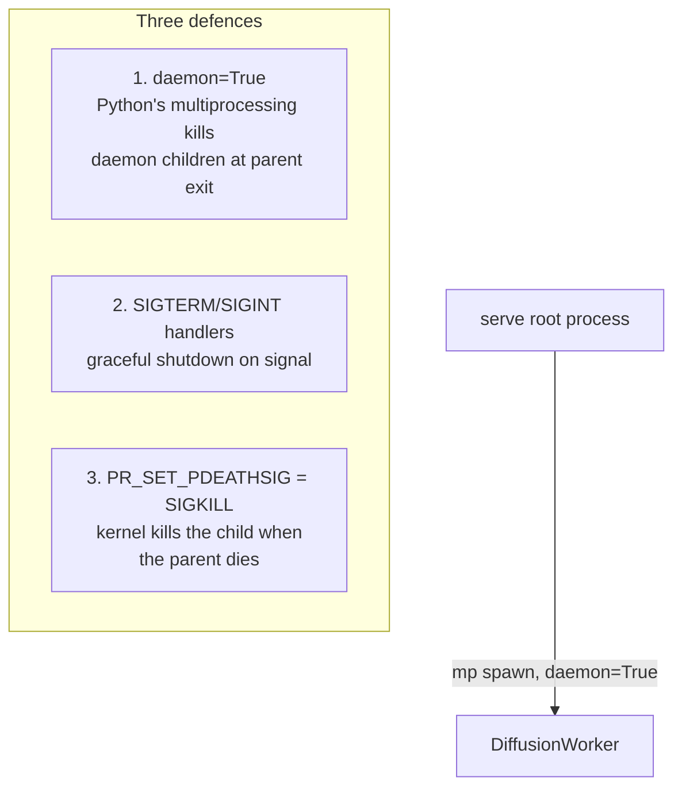
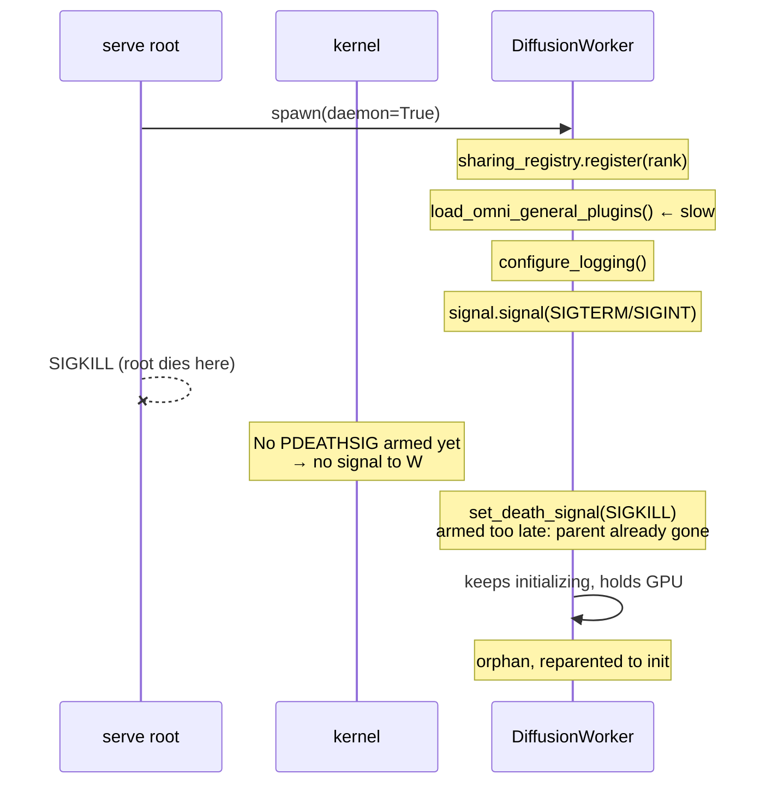
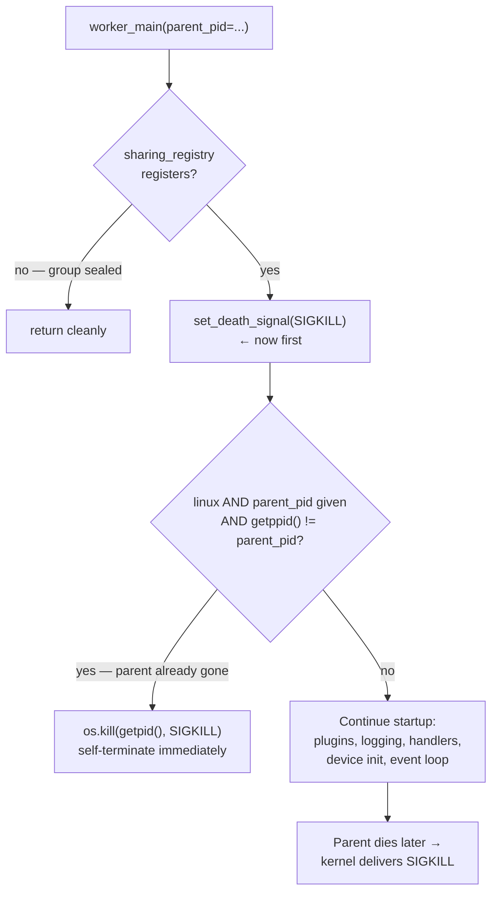

# Case Study 04: Diffusion workers survive a serve-root SIGKILL

| | |
| --- | --- |
| **Difficulty** | Difficult |
| **Subsystem** | Process lifecycle, diffusion worker startup |
| **Issue** | [#10398](https://github.com/vllm-project/vllm-omni/issues/10398) — `[Bug]: Wan2.2 and Hunyuan-Image diffusion workers survive serve-root SIGKILL during startup` (`bug`, `medium priority`) |
| **Fix** | [PR #10440](https://github.com/vllm-project/vllm-omni/pull/10440), commit `bc7a0f487` |
| **Backport** | [#10619](https://github.com/vllm-project/vllm-omni/pull/10619) to v0.34.0 |
| **Diff size** | 6 files, +36 / −15 (production code: +14 / −8) |

## The symptom

During a two-GPU Wan2.2 startup, SIGKILLing **only** the API/serve root — while
workers were still initializing — left a diffusion worker alive past the
30-second cleanup deadline. The API never became ready.

From the reliability test's output:

```text
05:58:07 (DiffusionWorker pid=2091442) Worker 1 created result MessageQueue
[serve-root-crash-at-launch] SIGKILL root with workers=[2091442]
05:58:08 (DiffusionWorker pid=2091441) Worker 0 created result MessageQueue
05:58:14 (DiffusionWorker pid=2091441) Chunked prefill is enabled with max_num_batched_tokens=2048
AssertionError: [serve_root_crash_at_launch] residual server-tree processes remain alive: [2091438, 2091441]
```

Read the timeline: the root is killed at 05:58:07, and Worker 0 **keeps
initializing** — it creates its message queue at 05:58:08 and is still logging
configuration at 05:58:14, seven seconds after its parent died.

A GPU-owning orphan is about the worst kind. It holds device memory
indefinitely, so the next start attempt OOMs, and nothing in the (now dead)
process tree is left to clean it up.

The configuration: `--omni --usp 2 --vae-patch-parallel-size 2 --use-hsdp
--vae-use-slicing`, Wan2.2-I2V-A14B, two H800s.

The reporter was careful about what the evidence did and did not show: PID
2091438's role *"was not established in the supplied excerpt; it must not be
assumed to be another GPU worker"*, and the test cleaned up after the deadline,
so the evidence *"establishes survival beyond 30 seconds, not indefinite
survival."* Both caveats are correct and neither changes the conclusion.

Notably, the same run **passed** root-only SIGKILL tests at idle and under load.
Only startup failed. That is the clue.

## Background: how the cleanup is supposed to work

There are three independent mechanisms protecting against orphaned diffusion
workers:



The third is the one that matters here, because the other two do not apply to
`SIGKILL`:

- **`daemon=True`** relies on the parent running its interpreter shutdown
  hooks. A `SIGKILL` parent runs nothing.
- **Signal handlers** need a signal to be delivered to the *child*. Killing the
  parent sends the child nothing.

So the only real defence is the kernel-level parent-death signal,
`set_death_signal()` (`vllm_omni/engine/stage_init_utils.py:354`):

```python
def set_death_signal(sig: int) -> None:
    """Best-effort parent-death signal for Linux subprocesses."""
    try:
        import ctypes
        import platform

        if platform.system() != "Linux":
            return
        ctypes.CDLL("libc.so.6").prctl(1, sig)
    except Exception:
        pass
```

`prctl(1, sig)` is `PR_SET_PDEATHSIG`. After this call, the kernel sends `sig`
to this process when its parent dies.

## The root cause: a race window

`PR_SET_PDEATHSIG` has a well-known hazard: **it only covers parent deaths that
happen after the call.** If the parent dies in the window between `fork`/`spawn`
and the `prctl` call, no signal is ever sent and the child runs on, reparented
to init.

Before the fix, `worker_main()` called `set_death_signal()` *after* several
other startup steps. The original code and its comment:

```python
if sharing_registry is not None and not sharing_registry.register(rank):
    return  # Parent sealed the sharing group before this worker started.

from vllm_omni.plugins import load_omni_general_plugins

# Spawned workers do not inherit the API server's logging setup. ...
configure_logging(LoggingConfig(log_level=cast("LogLevel", log_level)))

...
signal.signal(signal.SIGTERM, signal_handler)
signal.signal(signal.SIGINT, signal_handler)

# Normal executor shutdown still reaches the handlers above and cleans
# up gracefully. If the API-server parent is already gone, however, no
# manager remains to escalate a worker that stalls during cleanup. Use
# a hard parent-death signal so an abrupt parent exit cannot orphan a
# GPU-owning diffusion worker.
set_death_signal(signal.SIGKILL)
```

The reasoning in that comment is sound, and the mechanism is right. The
*placement* is the bug. By the time it runs, the worker has already:

1. registered with the weight-sharing registry,
2. imported and loaded all omni plugins,
3. configured logging,
4. installed two signal handlers.

Plugin loading alone can take a meaningful amount of time. A parent killed
anywhere in that span leaves the worker permanently unprotected.

This also explains why only the *startup* test failed. At idle or under load,
`set_death_signal()` ran long ago, so the protection is in place and the kernel
does its job.



## The fix

Commit `bc7a0f487` does two things: it **moves the arming earlier**, and it adds
an explicit check for the case arming cannot cover.

### Production diff

```python
 def worker_main(
     ...
     *,
     sharing_registry: ConsumerWorkerRegistry | None = None,
+    parent_pid: int | None = None,
 ) -> None:
     """Worker initialization and execution loops."""
     if sharing_registry is not None and not sharing_registry.register(rank):
         return  # Parent sealed the sharing group before this worker started.
+
+    # Register first, then catch a parent that exited before registration.
+    set_death_signal(signal.SIGKILL)
+    if sys.platform == "linux" and parent_pid is not None and os.getppid() != parent_pid:
+        os.kill(os.getpid(), signal.SIGKILL)
+
     from vllm_omni.plugins import load_omni_general_plugins
```

with the old late call removed, and the executor passing its PID
(`diffusion/executor/multiproc_executor.py:415`):

```python
-                kwargs={"sharing_registry": sharing_registry},
+                kwargs={"sharing_registry": sharing_registry, "parent_pid": os.getpid()},
```

### Why both halves are needed

Moving `set_death_signal()` earlier shrinks the window but cannot close it.
There is irreducibly *some* time between the parent calling `spawn()` and the
child executing its first instruction, and the parent can die in it. No
ordering of calls inside the child fixes that.

The second line closes it, using the standard technique:

```python
if sys.platform == "linux" and parent_pid is not None and os.getppid() != parent_pid:
    os.kill(os.getpid(), signal.SIGKILL)
```

When a process's parent dies, the child is reparented (to init, or to a
subreaper). So `os.getppid() != parent_pid` is a reliable test for "my original
parent is already gone". The child then kills itself with the same signal the
PDEATHSIG would have delivered.

Together they are exhaustive:

| Parent dies… | Caught by |
| --- | --- |
| Before the child's first instruction | `getppid()` check |
| Between `spawn()` and the `prctl` call | `getppid()` check |
| Any time after `prctl` | Kernel PDEATHSIG |

The ordering comment — *"Register first, then catch a parent that exited before
registration"* — records a deliberate decision. `sharing_registry.register()`
stays first because the registry's seal check is how a late worker learns it is
not wanted (see
[Distributed Parallelism](../features/07-distributed-parallelism.md)); that path
already returns cleanly. The death-signal arming goes immediately after, before
anything slow.

`sys.platform == "linux"` matches `set_death_signal()`'s own platform guard —
PDEATHSIG is Linux-only, so on other platforms the check would impose a
self-kill with no corresponding kernel mechanism. The fix declines to change
non-Linux behavior.



## The tests

### The reliability tests were un-skipped

The two end-to-end tests that documented the bug had their skips removed:

```python
 @launch_scenario_params(
     MODEL,
     ServeRootCrashAtLaunch,
-    skip_reason="Worker survives root crash during startup: https://github.com/vllm-project/vllm-omni/issues/10398",
 )
 def test_serve_root_crash_at_launch(launch_params) -> None:
```

in both `tests/dfx/reliability/test_wan22.py` and
`tests/dfx/reliability/test_hunyuan_image.py`. The skip carried the issue URL,
so the known gap was discoverable rather than silently absent — a good pattern,
and the fix's first obligation was to delete it.

### The unit test became a matrix

The existing unit test checked only that the death signal was set. It is now
parameterized over the cases that matter:

```python
@pytest.mark.parametrize(
    ("platform_name", "parent_pid", "current_parent_pid"),
    [("linux", 321, 321), ("linux", 1, 1), ("linux", 321, 1), ("linux", 321, 123), ("darwin", 321, 1)],
)
def test_worker_uses_hard_parent_death_signal(self, monkeypatch, platform_name, parent_pid, current_parent_pid):
```

| Parameters | Scenario | Expected |
| --- | --- | --- |
| `linux, 321, 321` | Parent alive | Normal startup |
| `linux, 1, 1` | Parent *is* init, matching | Normal startup — no false positive |
| `linux, 321, 1` | Reparented to init | Self-kill |
| `linux, 321, 123` | Reparented to a subreaper | Self-kill |
| `darwin, 321, 1` | Non-Linux, mismatched | Normal startup — platform-guarded |

The `("linux", 1, 1)` row is the one that stops a naive implementation: a worker
whose legitimate parent is PID 1 must not self-kill. Comparing against the
*passed* `parent_pid` rather than against a hardcoded `1` is what makes that
work.

And the assertion checks **ordering**, not just occurrence:

```python
if parent_lost:
    assert events == [("death_signal", signal.SIGKILL), ("self_kill", (654, signal.SIGKILL))]
    return

assert events == [
    ("death_signal", signal.SIGKILL),
    ("logging", None),
    ("handler", signal.SIGTERM),
    ("handler", signal.SIGINT),
    ("plugins", None),
    ("worker", None),
    ("destroy", None),
]
```

`("death_signal", ...)` is now **first** in the list; in the pre-fix version it
appeared after `("handler", signal.SIGINT)`. The whole bug was an ordering bug,
so the test asserts the order exactly. A refactor that moves the arming back
down fails this test.

### The spawn-transport test

`tests/distributed/weight_sharing/test_worker_startup.py` gained a real
assertion through the actual spawn path:

```python
def _startup_worker(
    rank, config, writer, broadcast, wake, extension, pipeline_args, *, sharing_registry=None, parent_pid=None
):
    # Exercise real spawn transport and shared registration without initializing CUDA.
    assert parent_pid == os.getppid()
```

This verifies the plumbing end to end: the `parent_pid` the executor passes
really is the PID the spawned child sees as its parent. A unit test with
monkeypatched `getppid` cannot catch a mistake in *which* PID is passed — for
example passing the executor's PID when the spawning process is a different
one.

## Lessons

1. **`PR_SET_PDEATHSIG` has a startup race, always.** Arming it is necessary
   and never sufficient. The `getppid()` comparison is the other half, and the
   two together are exhaustive.
2. **Arm protection before anything slow.** Every instruction between process
   start and arming is unprotected window. Plugin loading is a lot of
   instructions.
3. **`daemon=True` does not survive `SIGKILL`.** It relies on the parent
   running shutdown hooks. Neither do the child's own signal handlers help when
   the signal goes to the parent.
4. **Compare against the known parent, not against PID 1.** A worker whose real
   parent is PID 1 is legitimate.
5. **Startup is a distinct failure regime.** The same kill test passed at idle
   and under load. Protections that are established "eventually" are absent
   exactly when a crash is most likely.
6. **Skips should name their issue.** The two reliability tests carried the
   issue URL in `skip_reason`, which made the known gap visible and gave the
   fix an obvious acceptance criterion.
7. **Assert order when order is the bug.** The unit test compares the full
   event list, so the fix cannot silently regress.

## Related

- Issue #10391 — normal-shutdown FIFO cleanup, explicitly distinguished from
  this startup-time report
- [Stage Runtime and Orchestrator](../features/01-stage-runtime-and-orchestrator.md)
  — `StageRuntime.initialize()`'s cleanup path, which covers failures it can
  observe but cannot help once the root is gone
- [Diffusion Stage Execution](../features/03-diffusion-stage.md) — the
  executor/worker process structure
