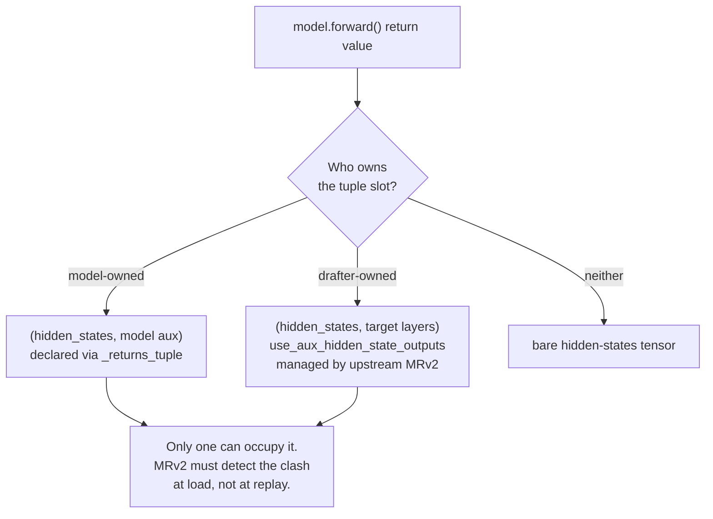
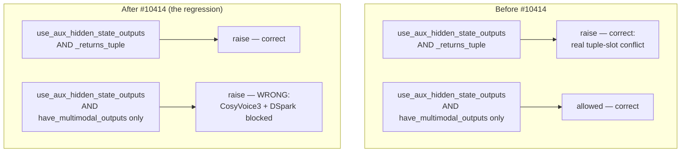

# Case Study 05: A broadened guard blocks a valid speculative config

| | |
| --- | --- |
| **Difficulty** | Medium |
| **Subsystem** | Model Runner V2 output contracts, CUDA graph capture, speculative decoding |
| **Issue** | [#10425](https://github.com/vllm-project/vllm-omni/issues/10425) — `[Bug] CosyVoice3 with the DSpark drafter no longer starts on Model Runner V2 after #10414` (`bug`, `high priority`, `ci-failure`) |
| **Fix** | [PR #10485](https://github.com/vllm-project/vllm-omni/pull/10485), commit `8164ed75b` |
| **Caused by** | [PR #10414](https://github.com/vllm-project/vllm-omni/pull/10414), commit `5555ce3ff` |
| **Diff size** | 6 files, +115 / −4 |

## The symptom

Serving CosyVoice3 with the DSpark speculative drafter on Model Runner V2
failed **at load**:

```text
NotImplementedError: CosyVoice3Model returns its own auxiliary output; a drafter that reads target hidden layers is not supported with it on MRv2 yet
```

This is a regression, and the report nails the cause in its first paragraph:

> Since #10414 (5555ce3ff, merged 2026-11-15), serving CosyVoice3 with the
> DSpark speculative drafter on Model Runner V2 fails at load. […] #10414
> changed that check from `self._model_returns_tuple` to
> `self._model_has_structured_output`, which is set from
> `_needs_capture_tensor_unwrap(self.model)` and is true for `CosyVoice3Model`,
> so the DSpark configuration now trips it.

A clean bisect, in prose, with the mechanism identified. The remaining work was
deciding what the check *should* have said.

## Why CI did not catch it

This part is as instructive as the bug:

> Evidence: the `TTS · CosyVoice3 DSpark Test` step passed in Buildkite build
> 19795, before #10414, and fails in build 19808, after it. […] Main's own
> Buildkite builds do not run that step (main builds 19798, 19800, 19802,
> 19803, 19811 and 19812 have no DSpark step), so main CI stayed green.

The DSpark test step was gated on `source_file_dependencies: tts_cosyvoice3_function`.
PR #10414 touched the *model runner*, not CosyVoice3 files, so the step never
ran. Main stayed green while being broken, and the failure surfaced on an
unrelated CosyVoice3 PR (#10381) whose author had changed only the DiT.

That is the worst failure mode for a conditional CI graph: the breakage is
attributed to whoever next touches the gated area.

## Background: the contested tuple slot

From [AR Stage Scheduling](../features/02-ar-stage-scheduling.md): a model's
`forward()` has **one** return slot, and several features want to put a tuple
in it.



Separately, `have_multimodal_outputs` means something different: the model
builds multimodal outputs *from the live batch after replay*, which affects
CUDA graph **capture** (the warmup pass runs with `CUDAGraphMode.NONE` and would
crash on a non-tensor forward result) but does **not** mean the model owns the
tuple slot.

Before #10414, `_needs_capture_tensor_unwrap()` was simply:

```python
def _needs_capture_tensor_unwrap(model: Any) -> bool:
    return bool(getattr(model, "_returns_tuple", False))
```

## The regression

PR #10414 ("Unwrap multimodal outputs during CUDA graph capture") was fixing a
real problem: models with multimodal outputs also need the capture-time tensor
unwrap. So it broadened the predicate:

```python
 def _needs_capture_tensor_unwrap(model: Any) -> bool:
-    return bool(getattr(model, "_returns_tuple", False))
+    return bool(getattr(model, "_returns_tuple", False) or getattr(model, "have_multimodal_outputs", False))
```

renamed the field to match its new, broader meaning
(`_model_returns_tuple` → `_model_has_structured_output`), and — here is the
mistake — updated **every** consumer to the renamed field, including the
speculative-decoding conflict check:

```python
 if self.use_aux_hidden_state_outputs and (
-    self._model_returns_tuple or hasattr(self.model, "_last_captured_layers")
+    self._model_has_structured_output or hasattr(self.model, "_last_captured_layers")
 ):
     # Both would use the forward's tuple output slot.
     raise NotImplementedError(...)
```

The rename looks mechanical but changes the semantics. The comment states the
invariant exactly — *"Both would use the forward's tuple output slot"* — and
that invariant is about **tuple ownership**, not about capture unwrapping.
`have_multimodal_outputs` does not imply tuple ownership. So the check started
rejecting a configuration where nothing actually conflicts.



The underlying error is a classic one: **one predicate was serving two
questions.** Once the predicate's meaning widened for question A (capture
unwrapping), it became wrong for question B (tuple ownership).

## The fix

Commit `8164ed75b` separates the two questions and lets the model declare the
distinction.

### 1. Track both facts, not one

```python
 _kstep_frames: int = 0
 _last_aux_output: Any
 _last_multimodal_outputs: dict[str, Any] | None
+_model_returns_tuple: bool
 _model_has_structured_output: bool
```

```python
 def _configure_cudagraph_output_contract(self) -> None:
     """Select the CUDA graph output contract declared by the model."""
+    self._model_returns_tuple = bool(getattr(self.model, "_returns_tuple", False))
     self._model_has_structured_output = _needs_capture_tensor_unwrap(self.model)
```

`_model_returns_tuple` is restored with its original, narrow meaning.
`_model_has_structured_output` keeps #10414's broader meaning, which the capture
path still needs.

### 2. Give the conflict check its own named predicate

```python
def _aux_hidden_state_contract_conflicts(self) -> bool:
    """Whether a target-hidden-layer drafter conflicts with the model output.

    ``_returns_tuple`` declares a model-owned auxiliary tuple. The
    drafter-owned ``(hidden, aux layers)`` tuple is managed separately by
    upstream MRv2 and must remain available to speculative decoding.
    """
    return bool(
        self.use_aux_hidden_state_outputs
        and (self._model_returns_tuple or hasattr(self.model, "_last_captured_layers"))
    )
```

and the call site becomes:

```python
-if self.use_aux_hidden_state_outputs and (
-    self._model_has_structured_output or hasattr(self.model, "_last_captured_layers")
-):
+if self._aux_hidden_state_contract_conflicts():
```

Extracting the condition into a named method with a docstring is the real fix.
The inline boolean was easy to "update" during a rename because nothing stated
which invariant it encoded. A method named
`_aux_hidden_state_contract_conflicts`, documenting that `_returns_tuple` is the
relevant declaration, is much harder to break by accident.

### 3. Let the model declare its base output contract

`CosyVoice3Model` is used for two different stages, and they have different
contracts. The fix makes the model say so
(`model_executor/models/cosyvoice3/cosyvoice3.py`):

```python
@property
def mrv2_forward_returns_tensor(self) -> bool:
    """Declare the Talker's base MRv2 output contract.

    The Talker returns hidden states directly. When DSpark requests target
    layers, upstream MRv2 owns the resulting ``(hidden, aux)`` tuple via
    ``use_aux_hidden_state_outputs``. Code2Wav returns ``OmniOutput`` and
    still needs the structured-output capture path.
    """
    return self.model_stage == "cosyvoice3_talker"
```

This feeds back into `_needs_capture_tensor_unwrap()`, whose current form reads:

```python
def _needs_capture_tensor_unwrap(model: Any) -> bool:
    if getattr(model, "_returns_tuple", False):
        return True
    # Native drafters own their (hidden states, target layers) tuple.
    if getattr(model, "mrv2_forward_returns_native_aux", False) is True:
        return False
    # Some models build multimodal outputs from the live batch after replay.
    return bool(getattr(model, "have_multimodal_outputs", False)) and (
        getattr(model, "mrv2_forward_returns_tensor", False) is not True
    )
```

So the final resolution for the two CosyVoice3 stages:

| Stage | `have_multimodal_outputs` | `mrv2_forward_returns_tensor` | `_model_has_structured_output` | Conflicts with a drafter? |
| --- | --- | --- | --- | --- |
| `cosyvoice3_talker` | `True` | `True` | `False` | No — DSpark works |
| `cosyvoice3_code2wav` | `True` | `False` | `True` | N/A — returns `OmniOutput` |

One model class, two stages, two contracts, declared by the model rather than
inferred by the runner.

### 4. Fix the CI gate

```yaml
       - label: "TTS · CosyVoice3 DSpark Test"
-        source_file_dependencies: tts_cosyvoice3_function
+        source_file_dependencies:
+          - tts_cosyvoice3_function
+          - omni_v2_runtime
```

Without this, the exact same regression could recur on the next MRv2 change and
again go unnoticed on main. The dependency list now reflects that the test
exercises the runner as much as the model.

## The tests

Three layers, each catching a different thing:

**Runner-level** (`tests/worker_v2/test_omni_gpu_model_runner.py`) — pins that
the two facts are now distinct:

```python
def test_aux_hidden_state_contract_uses_tuple_slot_not_structured_output():
    runner = _make_runner()
    runner.model = SimpleNamespace(have_multimodal_outputs=True)
    runner.use_aux_hidden_state_outputs = True

    runner._configure_cudagraph_output_contract()

    assert runner._model_has_structured_output is True
    assert runner._model_returns_tuple is False
    assert runner._aux_hidden_state_contract_conflicts() is False

    runner.model = SimpleNamespace(_returns_tuple=True)
    runner._configure_cudagraph_output_contract()

    assert runner._model_returns_tuple is True
    assert runner._aux_hidden_state_contract_conflicts() is True
```

The test name *is* the invariant. Anyone tempted to re-merge the two fields has
to delete a test that explains why they are separate.

**Model-contract level**
(`tests/model_executor/models/cosyvoice3/test_cosyvoice3_dspark_model_contracts.py`)
— verifies the Talker really does pass the drafter's tuple through capture:

```python
def test_talker_dspark_capture_preserves_upstream_aux_tuple(monkeypatch):
    hidden = torch.ones(1, 2)
    aux = [hidden + index for index in (1, 2, 3)]
    ...
    assert runner._model_has_structured_output is False
    assert runner._model_returns_tuple is False
    assert runner._exclude_full_graph is False
    assert runner._aux_hidden_state_contract_conflicts() is False

    def capture_model(self, *, profile_only=False):
        output = self.model.forward(...)
        assert output[0] is hidden
        assert output[1] is aux
```

`output[1] is aux` — identity, not equality. The drafter's auxiliary layers must
arrive *unmodified*, not merely equivalent.

And the sibling test pins the other stage:

```python
def test_code2wav_keeps_structured_output_capture_contract():
    ...
    assert model.mrv2_forward_returns_tensor is False
    assert runner._model_has_structured_output is True
    assert runner._exclude_full_graph is True
```

Together these make the asymmetry between the two stages explicit, so a future
change cannot "simplify" one stage's contract into the other's.

**Pipeline level** (`tests/buildkite/test_upload_pipeline.py`, +15 lines) — the
CI dependency wiring itself is tested.

## Lessons

1. **A predicate serves one question.** When `_needs_capture_tensor_unwrap()`
   widened for the capture question, every other consumer silently inherited a
   meaning it did not want.
2. **Name your guards after their invariant.** The inline boolean was easy to
   mis-update; `_aux_hidden_state_contract_conflicts()` with a docstring is not.
   The comment *"Both would use the forward's tuple output slot"* was already
   there — it just was not attached to anything a rename had to respect.
3. **A rename that changes semantics is not a rename.** Renaming
   `_model_returns_tuple` to `_model_has_structured_output` was right for the
   new predicate, but mechanically applying it at every call site changed
   behavior at one of them.
4. **Models should declare contracts; runners should not infer them.**
   `mrv2_forward_returns_tensor` moves the decision to the only place that
   actually knows.
5. **Conditional CI must include the dependencies the test exercises.** A test
   gated only on model files cannot protect that model from runner changes.
   This is how main stayed green while broken.
6. **An excellent regression report names the commit and the mechanism.** This
   one supplied both, plus the passing and failing build numbers and the
   explanation for main's green status. The fix was a half-day's work because
   the diagnosis was already done.

## Related

- PR #10414 — the change that introduced the regression, itself a valid fix
- [AR Stage Scheduling](../features/02-ar-stage-scheduling.md) — the full
  forward-output contract table
- RFC #9795 — speculative decoding support status tracking
