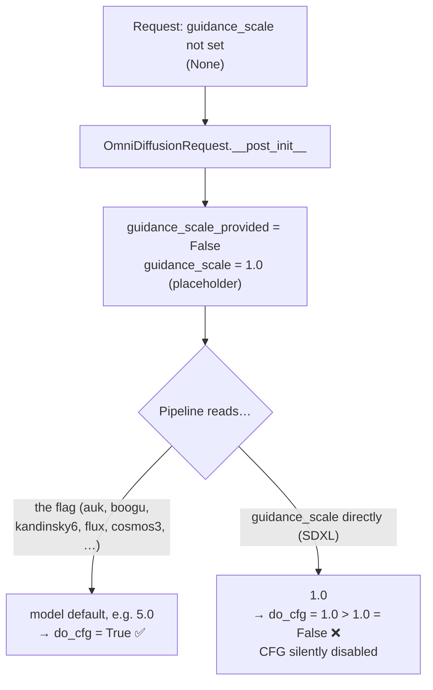
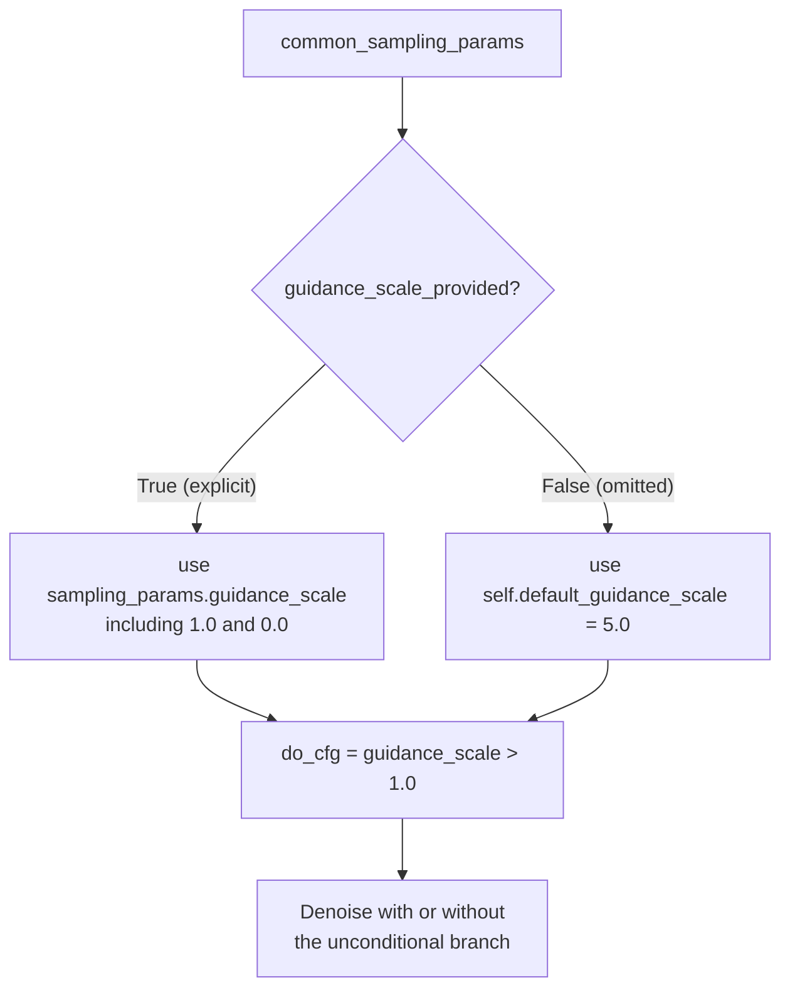

# Case Study 06: An omitted guidance_scale silently disables CFG

| | |
| --- | --- |
| **Difficulty** | Medium |
| **Subsystem** | Diffusion sampling-parameter resolution |
| **Issue** | [#10370](https://github.com/vllm-project/vllm-omni/issues/10370) — `[Bug]: SDXL ignores the model default when guidance_scale is omitted, so CFG is silently disabled` (`bug`, `medium priority`) |
| **Fix** | [PR #10462](https://github.com/vllm-project/vllm-omni/pull/10462), commit `7fa9bbf24` |
| **Diff size** | 2 files, +51 / −3 (production code: +12 / −1) |

Start here if you are new to the codebase. It is the smallest complete story in
this collection — one wrong line, one crisp invariant — and it establishes the
pattern the harder cases follow.

## The symptom

An SDXL request that did not set `guidance_scale` was generated **without
classifier-free guidance**, silently. Diffusers'
`StableDiffusionXLPipeline.__call__` defaults `guidance_scale` to `5.0`, so the
same omitted argument produced different images in vLLM-Omni and in the
reference implementation. Nothing was logged.

The reporter's measurement is the model of how to prove this kind of claim. One
warmup request, then three generations on an A100:

| Request | Latency | vs. `omitted` |
| --- | --- | --- |
| `guidance_scale` omitted | 2.271 s | — |
| `guidance_scale=1.0` | 2.272 s | **bit-identical** (max abs pixel diff 0) |
| `guidance_scale=5.0` | 4.219 s | different (mean abs pixel diff 18.28/255, max 164) |

Two independent signals agree:

1. The omitted request is **bit-identical** to `guidance_scale=1.0`. Not
   similar — identical. That is proof, not evidence.
2. The omitted request takes about **half** the time of `guidance_scale=5.0`.
   CFG runs two forward branches per step (conditional and unconditional), so
   half the latency means the unconditional branch never ran.

The blast radius was broad: *"every path where the field is optional, e.g.
OpenAI-compatible requests that do not send `guidance_scale` and
`benchmarks/diffusion/diffusion_benchmark_serving.py` (which does not send
it)."* The project's own diffusion serving benchmark was measuring SDXL without
CFG — so the published throughput number was for roughly half the work a
reference-equivalent request does.

## Background: the "omitted" vs "explicit" distinction

vLLM-Omni already has the machinery to tell these apart, and the reasoning is
documented at the point where it is established
(`vllm_omni/diffusion/request.py:103`):

```python
# Detect whether the caller explicitly provided guidance_scale before
# resolving the omitted value.  ``0.0`` is API-valid and must not be
# treated as omission because that would unexpectedly enable CFG in
# pipelines with a model-specific default above zero.
if self.sampling_params.guidance_scale is not None:
    self.sampling_params.guidance_scale_provided = True
else:
    self.sampling_params.guidance_scale = 1.0
```

Three things happen here:

1. `guidance_scale_provided` records the caller's *intent*.
2. An omitted value gets the placeholder `1.0`, so downstream code never sees
   `None`.
3. The comment explains why `None` — not falsiness — is the omission test:
   `0.0` is a valid explicit value, and treating it as omission would turn CFG
   *on* for a pipeline whose default exceeds zero.

The two fields are declared together in `vllm_omni/inputs/data.py:301`:

```python
guidance_scale: float | None = None
guidance_scale_provided: bool = False
guidance_scale_2: float | None = None
guidance_scale_2_provided: bool = False
```

The `_provided` convention is established and widely used. A sample of pipelines
that honour it:

```python
# auk
cfg = float(sampling_params.guidance_scale) if sampling_params.guidance_scale_provided else self.default_cfg
# boogu_image
else (sp.guidance_scale if sp.guidance_scale_provided else 4.0)
# kandinsky6
sampling.guidance_scale if sampling.guidance_scale_provided else self.default_guidance_scale
```

## The root cause

SDXL did not consult the flag. One line
(`vllm_omni/diffusion/models/sdxl/pipeline_sdxl.py:334`):

```python
self._guidance_scale = common_sampling_params.guidance_scale
```

So SDXL read the **placeholder** `1.0` and could not distinguish it from an
explicit `1.0`. The downstream decision is `do_cfg = self.guidance_scale > 1.0`,
and `1.0 > 1.0` is false. CFG off.



The placeholder is what makes this invisible. `None` would have raised a
`TypeError` on the first comparison; `1.0` is a perfectly usable number that
happens to mean "do nothing".

## The fix

Commit `7fa9bbf24`. The pipeline declares its default:

```python
 # Both CFG branches share latents and timestep and have fixed 77-token prompts.
 supports_cfg_batching = True
 supports_request_batch = True
+# diffusers' StableDiffusionXLPipeline defaults guidance_scale to 5.0, so an
+# omitted guidance_scale must resolve to the same value here.
+default_guidance_scale: float = 5.0
```

and consults the flag:

```python
-        self._guidance_scale = common_sampling_params.guidance_scale
+        # An omitted guidance_scale must fall back to the model default
+        # (diffusers uses 5.0) instead of the 1.0 placeholder, otherwise CFG
+        # is silently disabled for every request that leaves the field unset.
+        self._guidance_scale = (
+            common_sampling_params.guidance_scale
+            if common_sampling_params.guidance_scale_provided
+            else self.default_guidance_scale
+        )
```

Two details that make this a good fix rather than a mere patch:

- **The default is a class attribute with a sourced comment.** `5.0` is not a
  magic number; it is diffusers' documented default, and the comment says so.
  A reviewer can verify it without reading the diffusers source.
- **It follows the established convention exactly.** Same `_provided` check,
  same shape as the other pipelines. A reader who knows one now knows all of
  them.



## The tests

The three new tests in
`tests/diffusion/models/sdxl/test_sdxl_request_batch.py` cover the complete
truth table, which is what this bug class needs:

```python
def test_omitted_guidance_scale_falls_back_to_model_default() -> None:
    """An omitted guidance_scale must use the diffusers default (5.0), not the 1.0 placeholder."""
    recorder: dict = {}
    pipeline = _make_pipeline(recorder)

    pipeline.forward(_make_batch(["a cat"], guidance_scale=None))

    assert pipeline.guidance_scale == 5.0
    assert recorder["diffuse_kwargs"]["do_cfg"] is True
    assert recorder["diffuse_kwargs"]["guidance_scale"] == 5.0


def test_explicit_guidance_scale_of_one_disables_cfg() -> None:
    recorder: dict = {}
    pipeline = _make_pipeline(recorder)

    pipeline.forward(_make_batch(["a cat"], guidance_scale=1.0))

    assert pipeline.guidance_scale == 1.0
    assert recorder["diffuse_kwargs"]["do_cfg"] is False


def test_explicit_guidance_scale_is_preserved() -> None:
    recorder: dict = {}
    pipeline = _make_pipeline(recorder)

    pipeline.forward(_make_batch(["a cat"], guidance_scale=7.5))

    assert pipeline.guidance_scale == 7.5
    assert recorder["diffuse_kwargs"]["do_cfg"] is True
    assert recorder["diffuse_kwargs"]["guidance_scale"] == 7.5
```

| Test | Input | Pins |
| --- | --- | --- |
| `test_omitted_guidance_scale_falls_back_to_model_default` | `None` | The bug: omitted → 5.0, CFG on |
| `test_explicit_guidance_scale_of_one_disables_cfg` | `1.0` | The regression risk: explicit 1.0 must *still* disable CFG |
| `test_explicit_guidance_scale_is_preserved` | `7.5` | Normal explicit values are untouched |

The middle test is the one that matters most. The naive fix — "if
`guidance_scale == 1.0`, use the default" — passes the first test and breaks
this one. A user who deliberately turns CFG off must keep getting CFG off.
Encoding that as a test is what makes the `_provided` flag's existence
self-documenting.

The test helper was also widened rather than duplicated:

```python
 def _make_batch(
     prompts: list[str],
     latents: list[torch.Tensor] | None = None,
+    guidance_scale: float | None = 1.0,
 ) -> DiffusionRequestBatch:
```

Keeping `1.0` as the helper's default means the existing tests' behavior is
unchanged, so the diff's blast radius is limited to the new cases.

## Lessons

1. **A placeholder default is not a default.** `1.0` was a sentinel meaning
   "unset", but it is also a meaningful value. Any consumer that reads the field
   without the companion flag reads a lie.
2. **Match the reference implementation's defaults, and say where they come
   from.** The comment naming diffusers' `5.0` turns a magic number into a
   checkable fact.
3. **Test the whole truth table for omitted-vs-explicit.** Omitted, explicitly
   the-same-as-placeholder, and explicitly-other. The middle case is where naive
   fixes break.
4. **Silent behavior changes are worse than errors.** There was no log line, no
   warning, and the images were plausible. The bug was found by comparing
   against diffusers, not by anything the server reported.
5. **Benchmarks inherit silent bugs.** The project's own diffusion serving
   benchmark omitted `guidance_scale`, so published SDXL numbers reflected
   CFG-disabled work. A correctness bug in default resolution is also a
   measurement bug.
6. **When a codebase has a convention, use it.** Eight-plus pipelines already
   read `guidance_scale_provided`. SDXL was the outlier, and the fix made it
   conform rather than inventing a new mechanism.

## Related

- `vllm_omni/diffusion/request.py:103` — where `guidance_scale_provided` is set,
  with the reasoning for the `is not None` test
- `vllm_omni/inputs/data.py:301` — the `_provided` field convention, which also
  covers `guidance_scale_2`
- [Diffusion Stage Execution](../features/03-diffusion-stage.md) — where
  guidance configuration enters the batch sampling-params key
