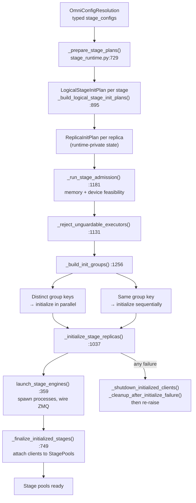
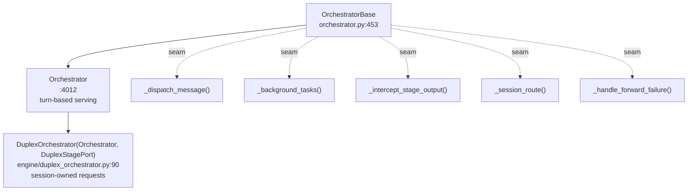
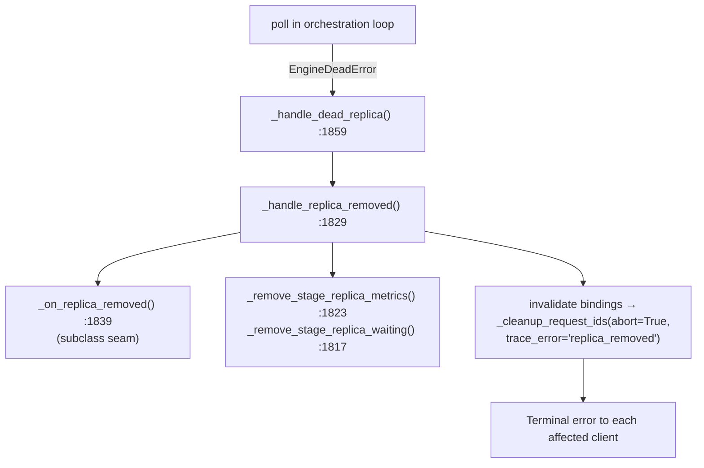
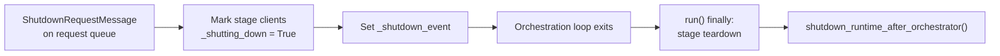

# Stage Runtime and Orchestrator

**Primary source:** `vllm_omni/engine/`
**Related design docs:** [Disaggregated Inference](../../design/feature/disaggregated_inference.md),
[Independent Stage Execution](../../features/independent_stage_execution.md)

The control plane has two halves with a clean split of responsibility:

- **`StageRuntime`** answers *where does a stage run and is it alive?*
- **`Orchestrator`** answers *where does this request go next?*

Neither knows the other's answers. `StageRuntime` has no per-request state; the
Orchestrator has no device or process knowledge.

## StageRuntime: from logical stages to live replicas

`StageRuntime` (`vllm_omni/engine/stage_runtime.py:167`) takes the typed
`stage_configs` from `OmniConfigResolution` and produces running, ready stage
clients.



### Init groups: the non-obvious part

Starting every replica in parallel would be fastest but is wrong, because
replicas that share a GPU must not probe and lock that device simultaneously.
`_init_group_keys()` (`stage_runtime.py:1266`) encodes the policy:

```python
"""One init-group key per replica: same key -> sequential, distinct -> parallel.

Diffusion, remote and parallel-stage-init replicas keep fixed per-replica
keys. Serial local LLM replicas are grouped by connected components of
their resolved physical-device overlap, so ``{0,1}`` and ``{0}`` share a
group and never re-``flock`` a device this process already holds.
"""
```

So the grouping is a connected-components computation over physical device
overlap. Replicas on `{0,1}` and `{0}` overlap on GPU 0, so they land in one
sequential group; a replica on `{2,3}` is independent and initializes in
parallel with them.

Local diffusion replicas get a fixed override key (`"inline:diffusion"`)
because their process spawning must stay on the orchestrator thread
(`_init_group_key_override`, line 1294).

### Failure during startup

`initialize()` (line 329) is written so that a partial failure cannot leave
GPU-owning processes behind:

```python
except Exception as exc:
    initialized_clients_by_stage = getattr(
        exc, "_initialized_clients_by_stage", initialized_clients_by_stage,
    )
    cleanup_clients = self._collect_initialized_clients_for_cleanup(...)
    logger.exception(...)
    self._shutdown_initialized_clients(cleanup_clients)
    self._cleanup_after_initialize_failure()
    raise exc
```

Note the attribute smuggled on the exception: a failure deep in replica
initialization attaches the set of clients it had already brought up, so the
handler can shut down exactly those. Getting startup cleanup right is harder
than it looks — [case study 04](../case-studies/04-diffusion-worker-orphans.md)
is about the window this cleanup path cannot cover.

## StagePool: replicas of one stage

`StagePool` (`vllm_omni/engine/stage_pool.py:196`) is the Orchestrator's only
view of a stage. Its responsibilities:

| Concern | Methods |
| --- | --- |
| Membership | `add_client()`, `remove_client()`, `live_replica_ids()`, `_notify_membership_changed()` |
| Selection | `pick()`, `preselect_replica_id()`, `_collect_serviceable_replicas()` |
| Binding | `bind_request_to_replica()`, `release()`, `invalidate_addr()` |
| Pinning | `validate_requested_replica()`, `reserve_requested_replica()` |
| Output | `poll_llm_raw_output()`, `poll_diffusion_output()`, `process_diffusion_output()` |

The binding concept is the one to understand. A request bound to replica 3 of
stage 1 must keep going to replica 3 for its whole life at that stage, because
its KV cache, prefix-cache state, and multimodal cache entries are all local to
that process. `invalidate_addr()` returns the list of request IDs that have to
be failed when a replica's address goes away — there is no way to migrate them.

## Orchestrator: cross-stage request state

`OrchestratorBase` (`orchestrator.py:453`) is a template with seams that the
turn-based and duplex subclasses fill:



`run()` (line 618) starts the concurrent tasks that make up the Orchestrator:

| Task | Role |
| --- | --- |
| `_request_handler()` | Consume `request_async_queue` (admissions, aborts, RPCs, shutdown) |
| `_orchestration_output_handler()` | Drain stage outputs toward the client |
| `_orchestration_loop()` or `_orchestration_loop_event_driven()` | Poll or read stage replicas |
| `_background_tasks()` | Subclass extras — e.g. the turn-based `_interaction_worker()` |
| membership watcher | Present only in distributed mode |

### Why there are two orchestration loops

`_orchestration_loop()` sweeps every replica of every stage and sleeps 1 ms when
a sweep finds nothing. That is simple and predictable, but its latency floor
scales with the number of replicas.

`_orchestration_loop_event_driven()` (line 1429) instead runs one
`_llm_replica_reader()` task per LLM replica and one `_diffusion_poller()` per
diffusion pool, waking on data. It also has to handle readers appearing and
disappearing as replicas join and die, which is what `_reconcile_readers()`
(line 1489) and `_wake_reconcile()` (line 1573) are for. Selection is via
`_event_driven_orch_enabled()` (line 127).

### Replica death

Replica failure handling is spread over a few deliberately small methods:



The important property: one dead replica fails only the requests bound to it.
Other replicas of the same stage keep serving.

## Membership and distributed mode

When stages run across nodes, `MembershipController`
(`engine/membership_controller.py`) handles replicas registering and
unregistering at runtime. The Orchestrator receives
`RegisterRemoteReplicaMessage` / `UnregisterRemoteReplicaMessage` on the same
request queue as everything else (`_request_handler`, lines 810-816) and
forwards them to the controller, which installs handlers that can clean up the
requests of a vanished member.

`OmniCoordClientForHub` (`distributed/omni_coordinator/`) and the load balancer
attached via `StagePool.attach_load_balancer()` complete the picture:
`_build_load_balancer_factory()` (`stage_runtime.py:147`) turns the configured
`omni_lb_policy` string into a factory.

## Shutdown ordering

Shutdown has a required order, and `engine/async_engine_utils.py` exists mostly
to enforce it:



The pre-marking step in `_request_handler()` is there for a specific reason,
stated in the source: it prevents `proc_monitor` daemon threads from reporting
normal process exit as `EngineDeadError` during teardown. Without it, a clean
shutdown logs spurious replica deaths.

## Where this subsystem is hard

| Area | Why it bites |
| --- | --- |
| Startup cleanup | Processes exist before clients are registered; a crash in between can orphan them ([case study 04](../case-studies/04-diffusion-worker-orphans.md)) |
| Request-to-replica binding | Rebinding silently invalidates caches; failures must be terminal, not retried elsewhere |
| Double submission | Streaming legitimately re-submits downstream; non-streaming must not (`_next_stage_already_submitted`) |
| Session-owned requests | Duplex requests do not die when `finished=True`; many code paths need the `session_owned` guard |
| Clock pairing | Metrics use a monotonic clock, output messages use wall clock; mixing them produces impossible numbers |
