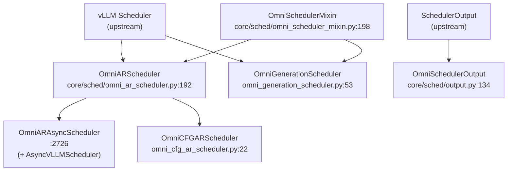
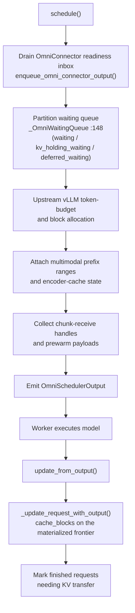

# AR Stage Scheduling and Model Runner V2

**Primary source:** `vllm_omni/core/sched/`, `vllm_omni/worker_v2/`, `vllm_omni/worker/`
**Related design docs:** [Async Chunk](../../design/feature/async_chunk.md),
[Omni Async Output Materialization](../../design/feature/omni_async_output_materialization.md)

An AR stage is the part of vLLM-Omni that looks most like plain vLLM — and that
is the point. The strategy is to subclass rather than fork, so that vLLM's
scheduler, block manager, and continuous batching keep working while
omni-specific data rides alongside.

## Class layering



`_resolve_scheduler()` in `vllm_omni/config/stage_config.py:366` picks between
them: `LLM_AR` gets `OmniARAsyncScheduler` when async scheduling is on and
`OmniARScheduler` otherwise; `LLM_GENERATION` gets `OmniGenerationScheduler`.

The mixin exists because the AR and generation schedulers need the same omni
extensions but have different step semantics; it was introduced to lift the
duplicated helpers out of both.

## What the Omni schedulers add

Upstream vLLM schedules tokens. An omni stage also has to schedule *data
movement* and *cross-stage state*. The extra fields on `OmniSchedulerOutput`
(`core/sched/output.py:134`) enumerate exactly what that means:

```python
@dataclass
class OmniSchedulerOutput(SchedulerOutput):
    """Scheduler output with omni-specific transfer metadata."""

    finished_requests_needing_kv_transfer: dict[str, dict] = field(default_factory=dict)
    # Scheduler-confirmed history for terminal speculative full-payload sends.
    finished_req_output_token_ids: dict[str, list[int]] = field(default_factory=dict)
    pending_input_registrations: list[OmniChunkRecvHandle] = field(default_factory=list)
    data_plane_terminal_req_ids: set[str] = field(default_factory=set)
    input_terminal_req_ids: set[str] = field(default_factory=set)
    pending_request_prewarms: list[OmniRequestPrewarm] = field(default_factory=list)
    # Aborted, errored, and ignored requests whose pending full payloads
    # must be dropped instead of flushed. Empty unless the scheduler recorded
    # one of those terminal statuses.
    discarded_req_ids: set[str] = field(default_factory=set)
```

| Field | Why the scheduler owns it |
| --- | --- |
| `finished_requests_needing_kv_transfer` | Only the scheduler knows when a request's KV is final and safe to ship downstream |
| `pending_input_registrations` | An async-chunk consumer must register to receive chunks *before* they arrive |
| `pending_request_prewarms` | A downstream stage can prepare per-request state before its first chunk |
| `discarded_req_ids` | An aborted request's pending payload must be **dropped**, not flushed — otherwise a cancelled request still sends data |

Similarly, request data gains a payload channel.
`OmniNewRequestData` (`output.py:14`) extends vLLM's `NewRequestData` with
`additional_information` and `model_intermediate_buffer`, which is how a
downstream stage receives a tensor bundle from an upstream one without that
bundle passing through the Orchestrator.

## Scheduling flow for one step



The extra waiting queues matter. `_OmniWaitingQueue`
(`omni_scheduler_mixin.py:148`) splits waiting requests into those that are
simply queued, those *holding KV* while waiting on a transfer, and those
deferred for an external reason. A request waiting for an upstream payload must
not be treated like a request waiting for GPU capacity — otherwise it either
blocks the queue or gets its blocks reclaimed while an inbound transfer still
targets them.

### A concrete invariant: cache only materialized KV

`OmniARScheduler._update_request_with_output()` (line 200) carries this
comment and code:

```python
# vLLM 0.33 moved this publication into update_from_output, which
# Omni overrides. Keep both the plain-decode and general paths on
# the upstream frontier: materialized KV only, never in-flight KV.
if (
    not is_stale
    and status_before_update == RequestStatus.RUNNING
    and (has_output_placeholders or self.num_spec_tokens > 0)
):
    self.kv_cache_manager.cache_blocks(request, request.num_computed_tokens - request.num_in_flight_tokens)
```

Subtracting `num_in_flight_tokens` is the whole point: with async scheduling or
speculative decoding, some tokens have been *scheduled* but their KV is not yet
written. Publishing those blocks to the prefix cache would let a later request
hit a block whose contents do not exist yet.

### Stages that cannot be preempted or reset

Two related guards exist because some omni stages are stateful in ways that AR
text decode never is.

`reset_prefix_cache()` (line 216) refuses to reset running requests when the
stage declares it cannot:

```python
# Reset preempts and resumes in the same step while discarding
# in-flight tokens. The stateful codec and queued PCM have already
# consumed those frames and cannot roll back to that boundary.
```

The same reasoning drives `recompute_preemption` in `StagePipelineConfig`
(`config/stage_config.py:427`). Recompute preemption — vLLM's only preemption
mode — frees a request's KV and replays its prompt. A stage whose decode step
feeds side-channel codes or per-request hidden state into the model cannot
rebuild that KV from the token stream, so it sets `recompute_preemption: "fail"`
and the scheduler emits one terminal error instead of producing spliced audio.

## Model Runner V2

`OmniGPUModelRunner` (`worker_v2/omni_model_runner.py:109`) is the current AR
execution path (`model_runner: v2`, the `DeployConfig` default). It describes
itself as a "thin layer over v2 `GPUModelRunner` for Omni lifecycle hooks",
which is accurate in structure but understates how much contract negotiation it
does.

```mermaid
flowchart TB
    sched["OmniSchedulerOutput"] --> prep["Prepare inputs<br/>(+ MM inputs, encoder cache)"]
    prep --> state["OmniModelState<br/>worker_v2/model_states/omni_model_state.py"]
    state --> graph{"CUDA graph<br/>mode"}

    graph -->|eager| fwd["model.forward()"]
    graph -->|PIECEWISE| pw["Piecewise replay"]
    graph -->|FULL| full["FULL replay<br/>_split_fullgraph_output()"]

    fwd --> contract["Output contract<br/>_configure_cudagraph_output_contract() :131"]
    pw --> contract
    full --> contract

    contract --> hid["hidden states"]
    contract --> aux["auxiliary output<br/>(_last_aux_output)"]
    contract --> mmo["multimodal outputs<br/>(_last_multimodal_outputs)"]

    hid --> samp["OmniSampler<br/>worker_v2/omni_sampler.py"]
    samp --> deliver["Delivery / payload build<br/>worker_v2/delivery.py<br/>worker/output/payload_build.py"]
    aux --> deliver
    mmo --> deliver
```

### The forward-output contract

This is the single most error-prone interface in MRv2, and it is worth reading
closely. A model's `forward()` may return:

- a bare tensor of hidden states,
- a `(hidden_states, aux)` tuple that the *model* owns,
- an `OmniOutput`-style structured object, or
- hidden states plus multimodal outputs built from the live batch after replay.

Meanwhile speculative decoding wants to use the tuple slot for its *own*
`(hidden_states, target_layers)` output. Only one thing can occupy that slot.
`_needs_capture_tensor_unwrap()` (line 87) and the declared model properties
resolve which:

```python
def _needs_capture_tensor_unwrap(model: Any) -> bool:
    if getattr(model, "_returns_tuple", False):
        return True
    # Native drafters own their (hidden states, target layers) tuple.
    if getattr(model, "mrv2_forward_returns_native_aux", False) is True:
        return False
    # Some models build multimodal outputs from the live batch after replay.
    return bool(getattr(model, "have_multimodal_outputs", False)) and (
        getattr(model, "mrv2_forward_returns_tensor", False) is not True
    )
```

Model-side declarations that participate in this negotiation:

| Property | Meaning |
| --- | --- |
| `_returns_tuple` | The model owns a `(hidden, aux)` tuple |
| `mrv2_forward_returns_tensor` | The model's base MRv2 output is a plain tensor |
| `mrv2_forward_returns_native_aux` | A native drafter owns the tuple |
| `have_multimodal_outputs` | Multimodal outputs are built from the live batch |
| `supports_mrv2_full_graph_aux_outputs` | The aux output is a tensor-only pytree, stable across batch shapes, token-axis leading — so FULL graphs may replay it |

Getting one of these declarations wrong does not produce a subtle numerical
error; it produces either a load-time `NotImplementedError` or a CUDA-graph
replay that returns the wrong structure.
[Case study 05](../case-studies/05-cosyvoice3-dspark-capture-contract.md) walks
through a regression where a fix broadened one of these checks and
unintentionally blocked a valid speculative-decoding configuration.

## Supporting machinery worth knowing

| File | Role |
| --- | --- |
| `worker_v2/omni_ar_model_runner.py` | AR specialization of the runner |
| `worker_v2/omni_generation_model_runner.py` | Generation-stage specialization |
| `worker_v2/model_states/omni_model_state.py` | Per-request model state that survives across chunks |
| `worker_v2/model_states/mtp_model_state.py`, `eager_mtp_kernels.py` | Multi-token-prediction paths (e.g. Talker code prediction) |
| `worker_v2/staged_writes.py` | Deferred writes into runner-owned buffers |
| `worker_v2/native_output_worker.py` | Moves CPU-side payload construction off the decode critical path |
| `worker_v2/streaming_audio.py`, `first_audio_sender.py` | First-audio-packet latency path |
| `worker_v2/prefix_cache.py` | `MRv2PrefixCacheMixin`, the runner half of cross-stage prefix caching |
| `worker/talker_cuda_graph.py`, `talker_multiframe.py` | Talker-specific graph capture and multi-frame decode |
| `worker/encoder_cudagraph.py` | Encoder graph capture (separate from the decode graph) |

## Where this subsystem is hard

| Area | Why it bites |
| --- | --- |
| Output contracts | Several models and speculative decoding compete for one return slot; mistakes surface at load or during graph replay |
| CUDA graph capture | Capture-time and replay-time structures must match exactly; multimodal outputs built from the live batch break naive capture |
| Prefix-cache publication | Publishing in-flight KV is silently wrong, and only shows up as a wrong-output bug later |
| Stateful stages | Codec and vocoder stages cannot be preempted or reset mid-request; the guards must be respected by new code paths |
| Async chunk | Partial outputs cross stage boundaries while the producing request is still running, so terminal bookkeeping is subtle |
