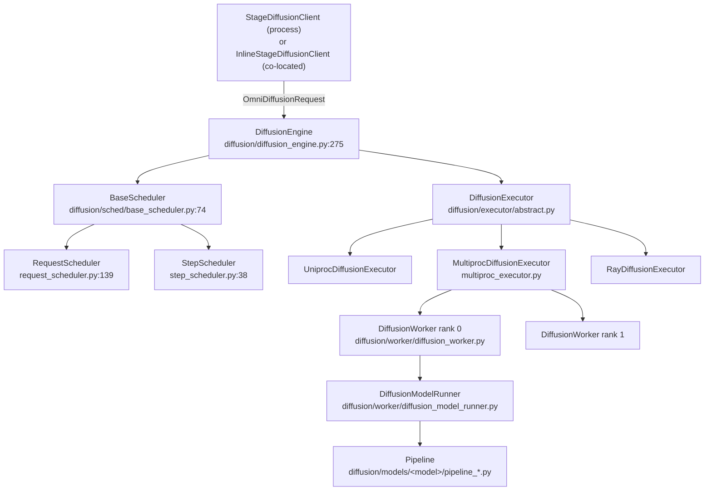
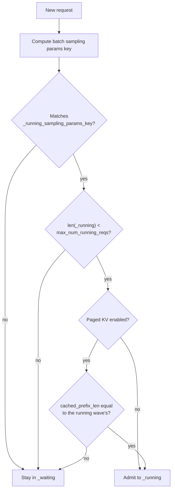
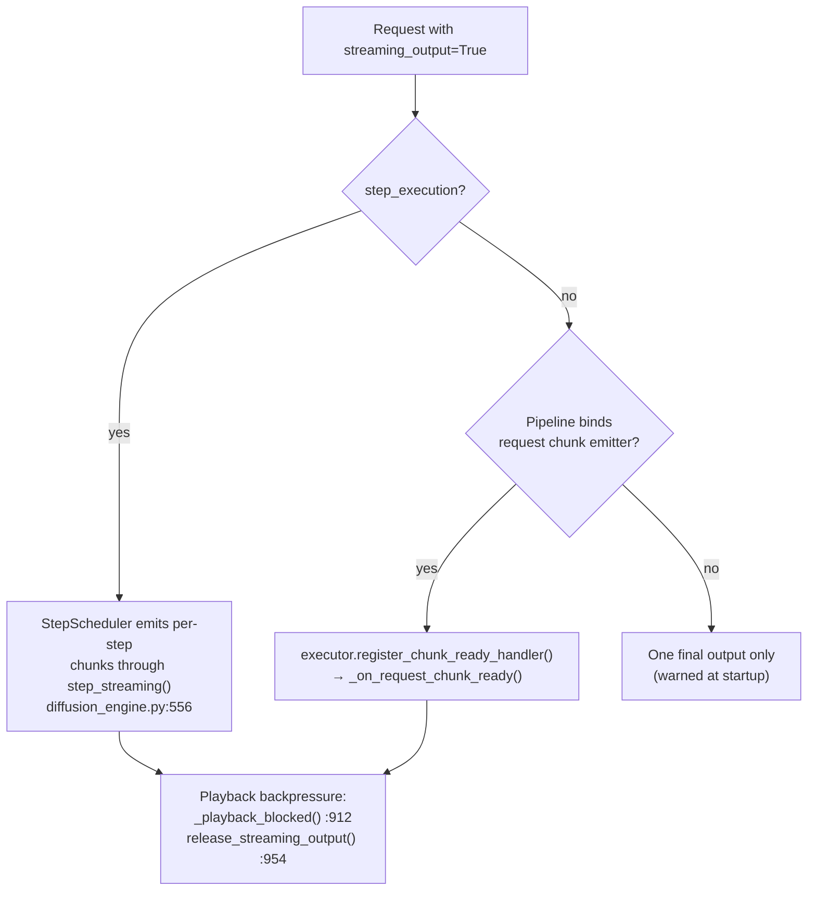

# Diffusion Stage Execution

**Primary source:** `vllm_omni/diffusion/`
**Related design docs:** [Diffusion Continuous Batching](../../design/feature/diffusion_continuous_batching.md),
[Diffusion Paged KV Cache](../../design/feature/diffusion_paged_kv_cache.md),
[Execution Modes](../../user_guide/diffusion/execution_modes.md)

A diffusion stage does not use vLLM's scheduler, worker, or model runner. It
has a parallel implementation of all three, because the workload is
fundamentally different: a fixed number of denoising steps over a large
activation footprint, where each step attends over the entire latent sequence
and there is no KV cache growing token by token.

## The stack



`DiffusionEngine.__init__` (line 295) wires this up in a fixed order worth
knowing, because each step can reject the configuration:

1. `_init_process_hooks()` (line 365)
2. `_resolve_execution_mode()` (line 379) — request batch vs step batch
3. `_init_executor()` (line 431) — uniproc, multiproc, or Ray
4. `_init_scheduler()` (line 437)
5. `_init_runtime_state()` (line 464) and `_init_execute_fn()` (line 523)

## Two execution modes

```python
class DiffusionExecutionMode(str, Enum):
    REQUEST_BATCH = "request_batch"
    STEP_BATCH = "step_batch"
```

| Mode | Scheduler | Semantics |
| --- | --- | --- |
| `REQUEST_BATCH` | `RequestScheduler` | Admit a wave of requests, run *all* their denoising steps together, emit results |
| `STEP_BATCH` | `StepScheduler` | Advance each running request by one step per update; requests may join or leave between steps |

`_resolve_execution_mode()` (line 379) is a good example of how much
compatibility logic lives in this runtime. It:

- rejects `hsdp_data_parallel` for MiniMax-H3, because H3 shares conditioning
  across the world and assumes a single output owner;
- force-enables step execution when MixFusion requires it, with a warning;
- force-enables step execution for `streaming_output` when the pipeline
  advertises step capability, and warns clearly when it cannot:

```python
# Request-only pipelines keep Request execution. Intermediate
# CHUNK_READY media requires the pipeline to bind the request
# chunk emitter (CausVid today); otherwise the client only sees
# a single final result.
```

- rejects `max_num_seqs > 1` on a pipeline that does not declare
  `supports_request_batch`, rather than silently serializing:

```python
raise ValueError(
    f"{getattr(od_config, 'model_class_name', None)!r} does not support request-level batching. "
    "Use max_num_seqs=1 for serial request execution, or choose a pipeline with "
    "supports_request_batch=True."
)
```

The pattern to internalize: **pipeline capability declarations gate runtime
features.** A pipeline class declares `supports_request_batch`,
`supports_cfg_batching`, `supports_step_execution`, and similar flags, and the
engine refuses configurations the pipeline has not claimed to support.

## Batch compatibility keys

Two requests may only share a batch if their *sampling-params key* matches.
These keys live in `diffusion/sched/interface.py`:

- `RequestBatchSamplingParamsKey` (line 109)
- `StepBatchSamplingParamsKey` (line 50)

A key typically folds in the step count, guidance configuration, resolution,
and anything else that changes the computation graph or the per-step math. The
scheduler keeps `_running_sampling_params_key` and only admits a waiting
request whose key matches.



That last condition is real code in `RequestScheduler._can_schedule_waiting()`
(line 150):

```python
# The request-level runner uses one first-step query boundary per wave.
# The Manager already aligns all CFG sequences within each request.
current = manager.get_metadata(self._running[0]).sequences[0].cached_prefix_len
candidate = manager.get_metadata(state.request_id).sequences[0].cached_prefix_len
return candidate == current
```

Because a request wave shares one first-step query boundary, two requests with
different cached prefix lengths cannot batch together even if everything else
matches.

### Why this is a correctness surface, not just a performance one

A batch key that omits something the computation actually depends on produces a
*silent* wrong-output bug: the request still succeeds, but its result depends on
its batchmates. [Case study 01](../case-studies/01-qwen-image-21-mixed-batch-rope.md)
is exactly this failure for Qwen-Image-2.1, where prompt-length padding leaked
into rotary position embeddings.

## Admission coalescing

Request batching only pays off if requests arrive close enough together to
batch. `get_admission_wait_decision()` (`request_scheduler.py:166`) implements
a bounded wait governed by `request_batch_max_wait_ms`: the scheduler will hold
an admissible request briefly to see whether a compatible sibling shows up. The
wait is skipped entirely when `max_num_running_reqs <= 1`, since there is
nothing to coalesce into.

`StepScheduler.get_execution_wait_timeout()` (line 44) is the step-mode analogue
and returns `0.0` — meaning "do not wait" — whenever there is any other reason
to run: a finished request, a pending KV transfer, a draining request, or a
waiting request that could join.

## Acceleration surfaces

The diffusion runtime has an unusually large number of optimization hooks,
because a denoising loop is both expensive and highly repetitive.

| Area | Files | Idea |
| --- | --- | --- |
| Compilation | `diffusion/compile.py`, `graph.py`, `cuda_graph.py`, `xpu_graph.py` | Capture and replay the per-step graph |
| Attention backends | `diffusion/attention/selector.py`, `capabilities.py`, `schedule.py` | Pick an attention implementation per layer and per step |
| Block-sparse attention | `diffusion/attention/ops/*block_sparse*.py`, `rainfusion_hybrid.py`, `video_tiles.py` | Skip attention blocks that contribute little |
| Step caching | Cache-DiT and TeaCache (see design docs) | Reuse a previous step's residual when the step changes little |
| Quantization | `vllm_omni/quantization/`, per-component resolution | FP8/NVFP4 for eligible DiT linears, leaving VAEs alone |
| Offload | `host_weight_runtime/`, DLO (distributed layerwise offload) | Stream blocks from host memory |
| VAE | `diffusion/vae_fast_path.py`, VAE patch parallelism | Tile and distribute decode |
| Async output | `diffusion/executor/async_output_cache.py` | Overlap device-to-host output packing with the next request |

`diffusion/attention/selector.py` is where attention backend choice happens, and
it is deliberately per-layer: a model that mixes causal and full attention may
need different backends in different places, which is why some recipes pin
`TORCH_SDPA` for batched execution.

## Streaming output

Diffusion stages can stream, but the mechanism depends on the mode:



The playback backpressure path exists because a client consuming video or audio
in real time can be slower than generation. `release_streaming_output(request_id,
chunk_index)` is the client's acknowledgement that it has taken a chunk, and
`_playback_blocked()` stops the engine from running ahead without bound.

## Worker-side shape

Inside a `DiffusionWorker`:

| File | Role |
| --- | --- |
| `worker/diffusion_worker.py` | `WorkerProc` process entry, device setup, RPC loop |
| `worker/diffusion_model_runner.py` | Per-step execution, graph replay, offload coordination |
| `worker/input_batch.py`, `request_batch.py` | Batch assembly, including padding across requests |
| `worker/stage_payload.py` | Building and consuming cross-stage payloads |
| `diffusion/forward_context.py` | Per-forward context (SP padding, current step, etc.) |
| `diffusion/ipc.py` | Shared-memory and IPC handling for large tensors |

`diffusion/forward_context.py` deserves a mention: several model
implementations read sequence-parallel padding and step information from the
forward context rather than receiving it as an argument, so the context must be
established before the pipeline runs and torn down after.

## Where this subsystem is hard

| Area | Why it bites |
| --- | --- |
| Batch keys | A missing field makes a request's output depend on its batchmates — a silent correctness bug |
| Padding | Batching requests of different prompt or latent lengths requires padding that must not reach position-dependent math |
| Capability flags | A pipeline that over-claims a capability fails at runtime in a confusing place |
| Graph capture | Capture must see the same shapes as replay; dynamic per-request geometry defeats it |
| Worker lifecycle | Workers own GPUs and are spawned at startup; crashes during init can orphan them ([case study 04](../case-studies/04-diffusion-worker-orphans.md)) |
| Defaults | An omitted sampling parameter must resolve to the model's real default, not a placeholder ([case study 06](../case-studies/06-sdxl-guidance-scale-default.md)) |
