# OmniConnector Transport

**Primary source:** `vllm_omni/distributed/omni_connectors/`
**Related design docs:** [Disaggregated Inference](../../design/feature/disaggregated_inference.md),
[Stage Payload](../../design/feature/omni_connectors/stage_payload.md),
and one document per connector under
[`design/feature/omni_connectors/`](../../design/feature/omni_connectors/)

When stages are disaggregated, the data that flows between them is not small.
A Thinker hands the Talker hidden states. A Talker hands Code2Wav codec
tensors. An AR stage can hand a DiT its entire KV cache. Moving that through
the control plane would be both slow and a layering violation, so vLLM-Omni has
a separate data plane.

The contract is narrow on purpose: **connectors move bytes between named
stages; they never decide where data should go.**

## The connector interface

`OmniConnectorBase` (`omni_connectors/connectors/base.py:12`) has three
abstract methods:

```python
class OmniConnectorBase(ABC):
    """Base class for all OmniConnectors."""

    # Whether the connector can handle raw bytes/torch.Tensor natively
    # without going through OmniSerializer.  Connectors that copy raw
    # payloads directly (e.g. RDMA) should override this to True.
    supports_raw_data: bool = False

    @abstractmethod
    def put(self, from_stage: str, to_stage: str, put_key: str, data: Any) -> tuple[bool, int, dict[str, Any] | None]:
        ...

    @abstractmethod
    def get(
        self, from_stage: str, to_stage: str, get_key: str, metadata: dict[str, Any] | None = None
    ) -> tuple[Any, int] | None:
        ...

    @abstractmethod
    def cleanup(self, request_id: str) -> bool | None:
        ...
```

Three design choices are embedded here:

1. **Addressing is `(from_stage, to_stage, key)`.** There is no notion of a
   node, a rank, or a socket in the interface. Topology is the connector
   implementation's business.
2. **`put` returns metadata.** The returned dict carries transport-specific
   handles — or, for small payloads, the data inline. That metadata travels
   through the control plane as a *handle*, and the receiver passes it back into
   `get()`. This is how the Orchestrator routes a large tensor without ever
   touching it.
3. **`supports_raw_data` exists for RDMA.** A connector that can DMA a tensor
   directly should not pay for serialization. Connectors that cannot handle raw
   tensors get them through `OmniSerializer`.

### Why `get()` takes optional metadata

The docstring explains a real heterogeneous-TP case:

```python
metadata: Optional transport-specific metadata.  When provided,
    the connector uses it directly (e.g. source_host, source_port,
    data_size) instead of querying the sender.  For heterogeneous
    TP the manager may supply partial metadata (host/port only);
    the connector will query the sender at that address to fill
    in data_size.
```

So the metadata path has three modes: full metadata (no round trip), partial
metadata (one round trip to resolve size), and none (query the sender). The
middle case exists because when the sending stage and receiving stage have
different tensor-parallel sizes, the receiver cannot compute the size itself.

## Available connectors

Registration is through `OmniConnectorFactory`
(`omni_connectors/factory.py:24`), with lazy imports so that an unavailable
transport's dependencies are not required at import time:

```python
@classmethod
def register_connector(cls, name: str, constructor: Callable[[dict[str, Any]], OmniConnectorBase]) -> None:
    """Register a connector constructor."""
    if name in cls._registry:
        raise ValueError(f"Connector '{name}' is already registered.")
```

| Connector | File | Scope |
| --- | --- | --- |
| Shared memory | `connectors/shm_connector.py` | Single node, co-located or sibling processes |
| Mooncake Store | `connectors/mooncake_store_connector.py` | Multi-node, store-mediated |
| Mooncake Transfer Engine | `connectors/mooncake_transfer_engine_connector.py` | Multi-node, direct RDMA transfer |
| NIXL | `connectors/nixl_connector.py` | Multi-node |
| Mori Transfer Engine | `connectors/mori_transfer_engine_connector.py` | Multi-node |
| Yuanrong | `connectors/yuanrong_connector.py` | Multi-node, store-mediated |
| Yuanrong Transfer Engine | `connectors/yuanrong_transfer_engine_connector.py` | Multi-node, direct transfer |

Connectors are selected per edge in `DeployConfig` through the `connectors:` and
`edges:` fields, and attached per stage through `input_connectors` /
`output_connectors` in each `StageDeployConfig`.

## Payload transfer vs KV transfer

These are two different flows that both use connectors, and conflating them is
a common source of confusion.

```mermaid
flowchart TB
    subgraph payload["Payload transfer"]
        p1["Stage N runner produces<br/>MultimodalPayload"] --> p2["put(from, to, key, data)"]
        p2 --> p3["metadata handle →<br/>control plane"]
        p3 --> p4["Stage N+1 receives request<br/>with handle in<br/>additional_information"]
        p4 --> p5["get(from, to, key, metadata)"]
        p5 --> p6["Tensors materialized<br/>in stage N+1"]
    end

    subgraph kv["KV cache transfer"]
        k1["Scheduler marks request<br/>finished_requests_needing_kv_transfer"] --> k2["OmniKVTransferManager<br/>extracts KV from GPU blocks"]
        k2 --> k3["KVTPTopology maps<br/>source TP → target TP"]
        k3 --> k4["put per rank-pair"]
        k4 --> k5["Receiver admits request,<br/>allocates blocks"]
        k5 --> k6["get with timeout,<br/>merge or slice per rank"]
        k6 --> k7["KV injected;<br/>request resumes mid-sequence"]
    end
```



`OmniKVTransferManager` (`kv_transfer_manager.py:352`) owns the KV flow. Its
docstring lists its responsibilities:

```python
"""Unified management for OmniConnector and KV cache transfer.

This class encapsulates all KV cache related operations:
- Connector initialization and lazy creation
- KV cache extraction from GPU blocks
- KV cache transfer with retry logic
- KV cache receiving with timeout
"""
```

### Heterogeneous tensor parallelism

The hardest part of KV transfer is that the sender and receiver may have
different TP sizes. `KVTPTopology` handles the mapping:

```python
if config.from_tp <= 1 and config.to_tp <= 1:
    detected_tp = get_tp_world_size()
    from_tp = detected_tp
    to_tp = detected_tp
else:
    from_tp = config.from_tp
    to_tp = config.to_tp

self._tp_topo = KVTPTopology(source_tp_size=from_tp, target_tp_size=to_tp, local_rank=local_rank)
```

When `to_tp > from_tp`, each receiving rank needs a *slice* of a sending rank's
KV; when `to_tp < from_tp`, a receiving rank must *merge* several senders'
contributions. The manager exposes injectable hooks for exactly this, so a
model with an unusual KV layout can supply its own logic:

```python
self.kv_send_key_builder: Callable | None = None
self.kv_recv_key_builder: Callable | None = None
self.kv_payload_merger: Callable | None = None
self.kv_payload_slicer: Callable | None = None
```

### Async prefetch

KV receive is on the critical path of admitting a request, so the manager can
prefetch:

| Mechanism | Detail |
| --- | --- |
| Executor | A single-worker `ThreadPoolExecutor` named `kv-prefetch` |
| Why single-worker | "serial mode ensures at most one outstanding prefetch and avoids stream-creation races on `_bg_copy_stream`" |
| Memory guard | `kv_prefetch_min_free_mem_ratio` — do not prefetch into a nearly full device |
| Copy stream | A dedicated background copy stream so prefetch does not serialize with compute |

The scheduler side cooperates through the waiting-queue split described in
[AR Stage Scheduling](02-ar-stage-scheduling.md): a request waiting for its KV
sits in `kv_holding_waiting`, not in the general waiting queue, so its blocks
are not reclaimed while a transfer still targets them.

## Supporting structure

| Path | Role |
| --- | --- |
| `omni_connectors/adapter.py` | Adapts the connector interface to runner-side call sites |
| `omni_connectors/transfer_adapter/` | Per-transport adaptation |
| `omni_connectors/model_runner/` | Runner-side integration points |
| `worker/omni_connector_model_runner_mixin.py` | The mixin that puts and gets payloads from inside a model runner |
| `worker/omni_connector_validation.py` | Startup validation of a connector topology |
| `worker/payload_span.py` | Tracking which part of a payload belongs to which request |
| `distributed/kv_transfer/` | KV-transfer-specific plumbing |

`worker/omni_connector_validation.py` and
`StageRuntime._validate_native_kv_topology()`
(`engine/stage_runtime.py:785`) both exist so that an impossible connector or
KV topology fails at startup with a clear message rather than at the first
request.

## Lifecycle: the easy thing to get wrong

Connectors own resources — shared memory segments, RDMA registrations, store
entries. Every one must be released, on both the success and failure paths:

- `cleanup(request_id)` releases per-request resources.
- The runner must close connectors during shutdown. Commit `8a23872d8`
  ("Close Omni connectors during runner shutdown") fixed exactly this leak.
- An aborted request's pending payload must be **dropped**, not sent, which is
  why `OmniSchedulerOutput.discarded_req_ids` exists.

## Where this subsystem is hard

| Area | Why it bites |
| --- | --- |
| Heterogeneous TP | Slicing and merging KV across differing TP sizes, per rank, with no shared registry |
| Lifetime | A payload must outlive the control-plane handle but not leak; abort paths must drop rather than flush |
| Timeouts | A receive that never arrives has to fail the request, not hang the stage |
| Serialization | `supports_raw_data` changes the data path; a connector that mis-declares it pays or corrupts |
| Startup validation | Topology errors are far cheaper to catch at startup than on the first request |
