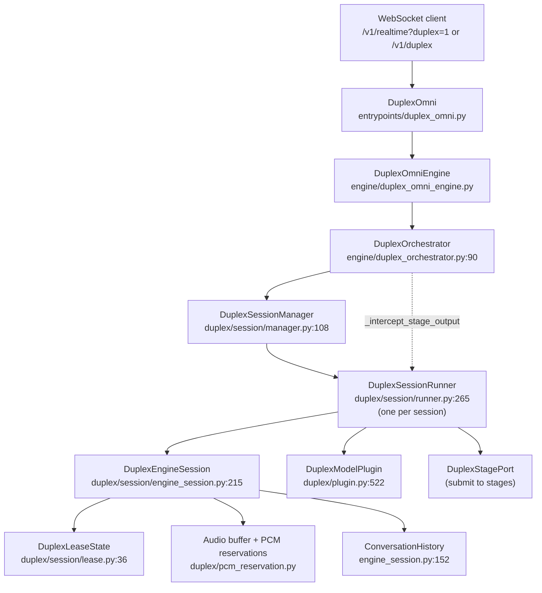
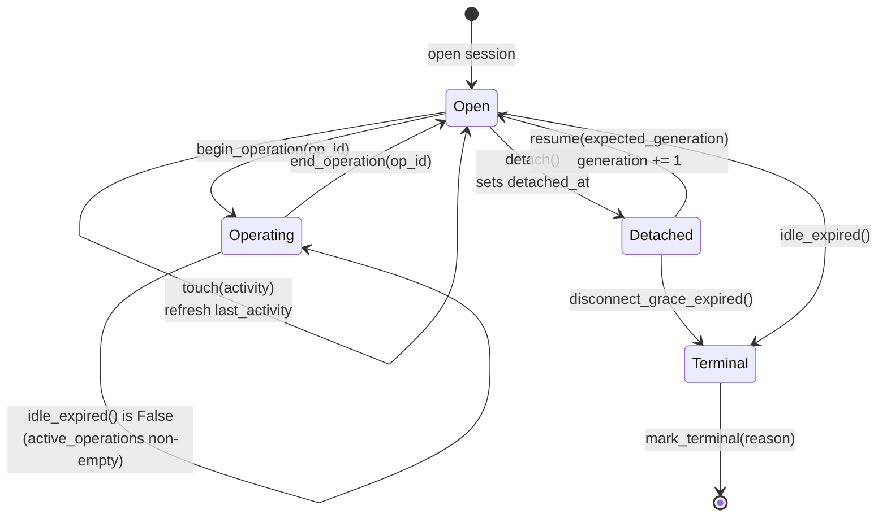
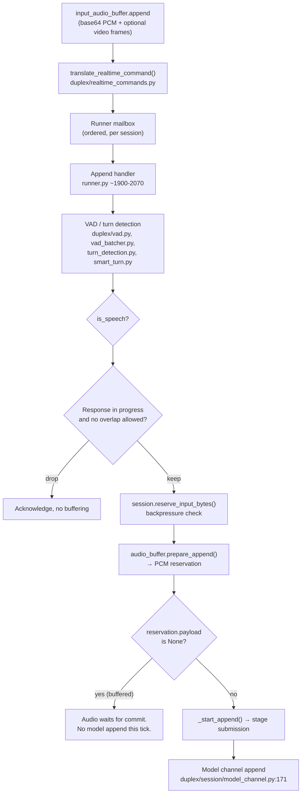
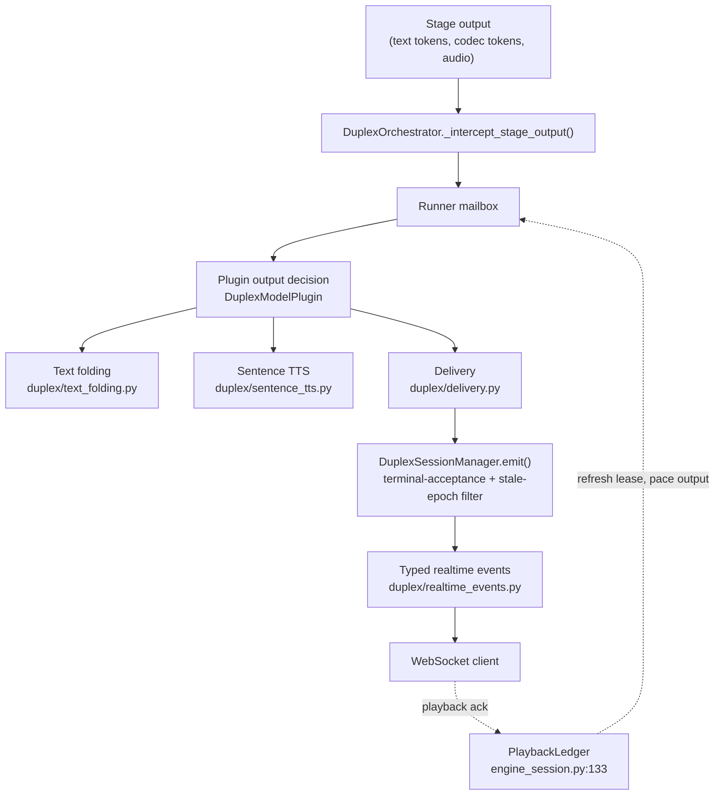

# Full-Duplex Sessions

**Primary source:** `vllm_omni/engine/duplex/`
**Related design docs:** [Full Duplex](../../design/fullduplex.md),
[Full Duplex PersonaPlex](../../design/fullduplex-personaplex.md),
[Realtime Duplex API](../../serving/realtime_duplex_api.md),
[Session State Manager](../../features/session_state_manager.md)

Turn-based serving has a simple lifetime: a request arrives, it is served, it
ends. Full-duplex realtime serving does not. The client streams audio in
continuously while the model streams audio out, the model may decide when a
turn ends, the client may interrupt mid-sentence, and the connection may drop
and reattach. The unit of lifetime is a **session**, not a request.

This is the most stateful subsystem in vLLM-Omni, and the one where "obviously
correct" changes most often turn out to be wrong.

## Structure



### The single-loop rule

`DuplexSessionRunner`'s module docstring states the invariant that the whole
subsystem depends on:

```text
``DuplexSessionRunner`` owns the whole lifecycle of one session on the
orchestrator loop (the session is never touched from another thread):

* every mutation of ``DuplexEngineSession`` happens on this loop, through the
  mailbox worker (commands, stage outputs, internal items) or through tracked
  tasks that re-validate ``(epoch, turn_id)`` after each ``await``;
* appends are planned with the model plugin and submitted to the stage port
  in wire order on the per-session append tail (no RPC hop);
* stage outputs are pushed in by ``DuplexOrchestrator._intercept_stage_output``
  instead of being polled through request queues;
* everything the session says leaves as typed events through
  ``DuplexSessionManager.emit`` after terminal-acceptance / stale-epoch
  filtering, so a cancelled epoch can never speak again.
```

Four consequences that matter when you write code here:

1. **No locks, but no cross-thread access either.** Session state is
   single-threaded by construction. A helper that touches session state from a
   thread pool is a bug even if it "works".
2. **Re-validate `(epoch, turn_id)` after every `await`.** An `await` is a
   yield point at which the client may have cancelled. A task resuming after
   an await must check that its epoch is still current before acting.
3. **Stage outputs are pushed, not polled.** The duplex path is why
   `_intercept_stage_output()` exists as a seam on `OrchestratorBase`.
4. **Everything leaves through `emit`.** A cancelled epoch cannot speak again
   because the filtering is centralized, not sprinkled at each emit site.

## Epochs and turns

Two counters coordinate cancellation:

| Counter | Bumped when | Purpose |
| --- | --- | --- |
| `epoch` | The session is cancelled or interrupted | Everything in flight from the previous epoch becomes stale and is filtered out |
| `turn_id` | A new turn starts | Distinguishes outputs within an epoch |

The combination is what makes barge-in safe. When the user interrupts, the
epoch advances; any stage output still arriving for the old epoch is dropped at
`emit` rather than being spliced into the new turn's audio.

## The lease: session lifetime

`DuplexLeaseState` (`duplex/session/lease.py:36`) is small enough to read in
full and is worth understanding completely, because it governs when a session
is reclaimed.

```python
@dataclass
class DuplexLeaseState:
    config: DuplexLeaseConfig
    generation: int
    last_activity: float
    detached_at: float | None = None
    active_operations: set[str] = field(default_factory=set)
    terminal_reason: str | None = None
    resumed_by: str | None = None

    @property
    def expires_at(self) -> float | None:
        if self.config.idle_ttl_s is None:
            return None
        return self.last_activity + self.config.idle_ttl_s

    def idle_expired(self, now: float) -> bool:
        expires_at = self.expires_at
        return (
            self.terminal_reason is None and not self.active_operations and expires_at is not None and now >= expires_at
        )
```



Three details that are easy to miss:

- **An active operation suspends idle expiry.** `idle_expired()` returns
  `False` whenever `active_operations` is non-empty, so a long model operation
  cannot be reaped mid-flight.
- **`resume` is idempotent per control id.** If a client's resume RPC times out
  and it retries with the same `control_id`, the lease answers with the current
  generation instead of bumping it again. The comment in the source explains
  why: "the caller lost the first answer ... and is finding out whether the
  resume landed."
- **Generation fencing.** `resume()` requires `expected_generation` to match.
  A stale client cannot resurrect a session whose generation has moved on.

Which activities refresh the lease is a policy decision with real consequences
for users, and getting it wrong closes sessions while the client is still
talking. That is
[case study 03](../case-studies/03-duplex-idle-lease.md).

## Input path



The branch at the bottom is the one to remember: **an append does not always
reach the model.** Depending on chunk period, overlap policy, and turn state,
the audio may simply be buffered until a commit. Any logic that assumes "append
means model activity" is wrong for the buffered branch.

Backpressure is enforced per session through
`max_pending_input_bytes_per_session`, and the reserve/release accounting around
`prepare_append()` is transactional: a rejected mutation rolls back, and the
*exact* pending delta is re-applied so retained video frames stay counted.

## Output path



The playback ledger closes the loop. The client acknowledges what it has
actually played, which lets the server know how far ahead of the listener it is
— needed both for pacing and for computing where to cut history when the user
interrupts mid-sentence.

## The plugin boundary

`DuplexModelPlugin` (`duplex/plugin.py:522`) is how a model participates:

```python
class DuplexModelPlugin(ABC):
    """Everything vLLM-Omni needs to know about one full-duplex model.

    Engine policy (sampling params, append planning, output decisions) and
    session policy (capabilities, runtime configuration, per-session state,
    data-plane projection) live on the same object so a mismatch between the
    two halves is impossible by construction.
    """
```

That last clause is the design argument: engine policy and session policy are
deliberately on *one* object, because splitting them across two extension
points allowed them to disagree.

A pipeline opts in by setting `duplex_plugin` (a dotted path) in its
`PipelineConfig`, and a deployment activates it with `session_mode: duplex` in
`DeployConfig`. A pipeline that declares only the legacy
`duplex_runtime_extension` / `duplex_serving_adapter` fields is served
turn-based — the comment in `stage_config.py` is explicit that nothing reads
them, and they exist only until the last model is ported.

## Runtime configuration

`DuplexSessionRuntimeConfig` (`config/stage_config.py:751`) is "server-owned
lifecycle and per-session buffering limits". The fields split into groups:

| Group | Fields |
| --- | --- |
| Lifetime | `idle_ttl_s`, `disconnect_grace_s`, `reaper_interval_s` |
| Resume | `resume_replay_ttl_s`, `resume_replay_max_bytes_per_session` |
| Input limits | `max_pending_input_bytes_per_session`, `max_pending_turns_per_session` |
| Output limits | `max_pending_output_bytes_per_session`, `max_pending_output_events_per_session` |
| Admission | `max_sessions`, `max_sessions_per_replica`, `replica_policy`, `replica_groups` |
| Turn detection | `server_vad_model_path`, `semantic_vad_model_path` |
| History | `history_asr_url`, `history_asr_model`, `history_asr_max_concurrency`, `history_ms_per_token` |
| Tools | `max_tool_calls_per_session` |

Note `max_sessions: int = 1`. Full-duplex sessions hold model state and
admission slots, so concurrency is opt-in rather than unbounded.

Two comments in that dataclass are worth reading as examples of the care this
area needs. On tool calls:

```python
# Keeping terminal tombstones prevents a late ``function_call_output`` from
# binding to a newer call that reuses its call_id.
```

And on the ASR history URL:

```python
# Experimental Qwen heard-text calibration. Server-owned URL; never accept
# a transcription endpoint from a client session.update.
```

A client-supplied transcription endpoint would be a server-side request
forgery; the field is deliberately server-owned.

## Where this subsystem is hard

| Area | Why it bites |
| --- | --- |
| Lease activity policy | Too strict closes live sessions; too loose never reclaims abandoned ones ([case study 03](../case-studies/03-duplex-idle-lease.md)) |
| Epoch validation after await | Any missed re-validation lets a cancelled turn speak |
| Buffered vs submitted appends | "Append happened" and "model ran" are different events |
| Byte accounting | Reserve/release must balance exactly across rollback, partial retention, and commit |
| Interruption | Cutting history at the right point requires knowing what the client actually played |
| Session-owned requests | The orchestrator's normal terminal and cleanup logic must be suppressed via `session_owned` |
