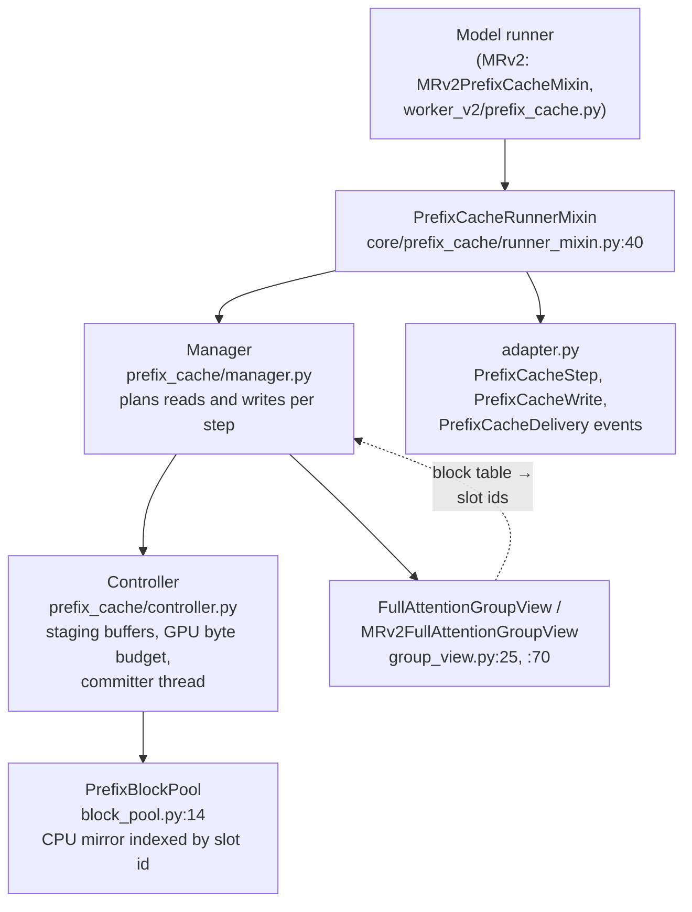
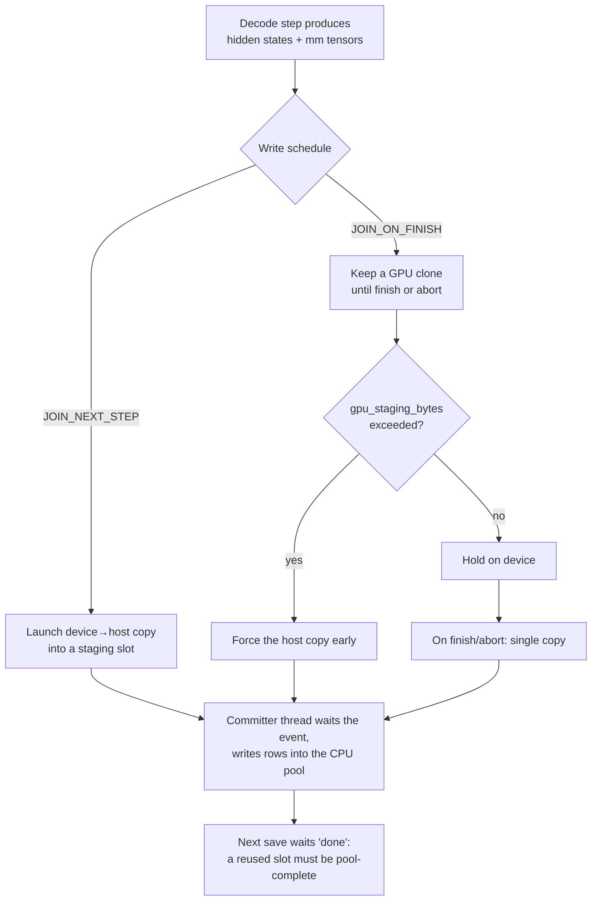
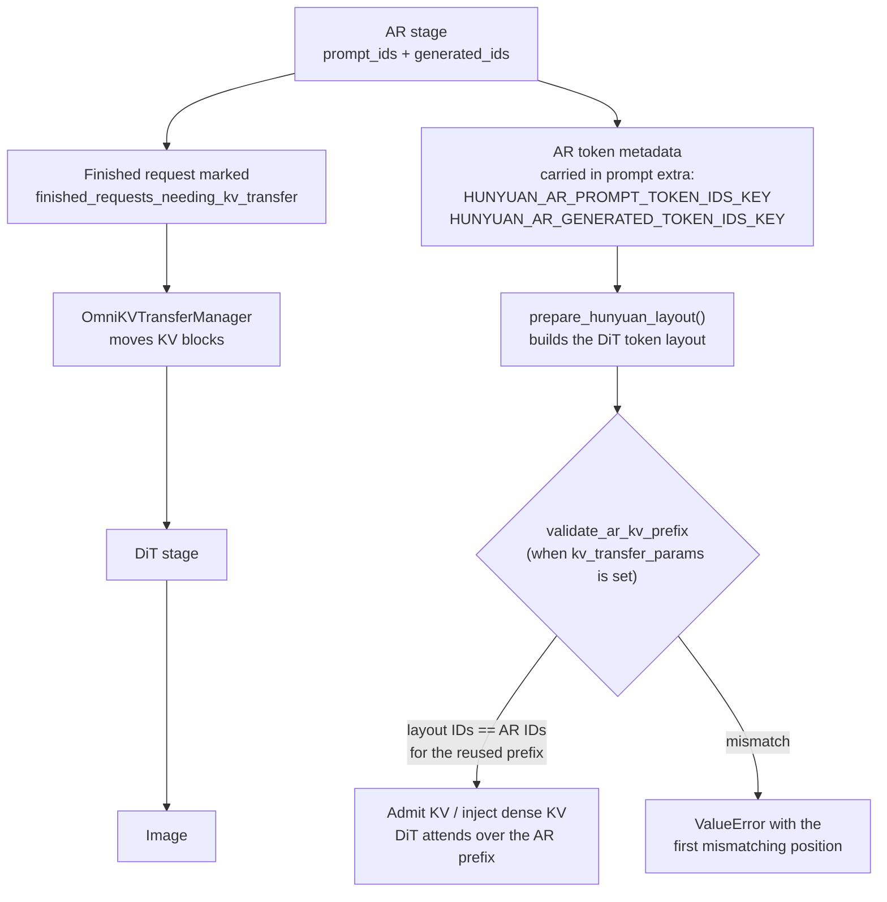

# Prefix Caching and KV Reuse

**Primary source:** `vllm_omni/core/prefix_cache/`, `vllm_omni/worker_v2/prefix_cache.py`
**Related design docs:** [Prefix Caching](../../design/feature/prefix_caching.md),
[Diffusion Paged KV Cache](../../design/feature/diffusion_paged_kv_cache.md),
[AR/Diffusion KV Backends](../../design/feature/ar_diffusion_kv_backends.md),
[Model-Local KV Caches](../../design/feature/model_local_kv_caches.md)

vLLM's automatic prefix caching reuses KV blocks for requests that share a
token prefix. In an omni pipeline, there are two additional reuse problems:

1. A stage's output is not only tokens. If two requests share a prefix, they
   also share the **hidden states and multimodal tensors** that the prefix
   produced — and those are what downstream stages consume.
2. An AR stage's KV cache may be handed to a **diffusion** stage, which has a
   completely different cache layout and lifetime.

This document covers both.

## Reuse of stage outputs, not just KV

The core idea in `vllm_omni/core/prefix_cache/` is a **durable CPU mirror of
vLLM's KV slots**, holding the per-token tensors that a stage produced. From
`PrefixBlockPool` (`core/prefix_cache/block_pool.py:14`):

```text
Durable CPU mirror of vLLM KV slots, one tensor per name.

Storage is ``(num_blocks, block_size, feat)`` per key, viewed flat as
``(num_slots, feat)`` so vLLM slot ids index rows directly. Write
access is single-writer (the controller committer thread); readers
take row views.

``_caches`` is not an unbounded store and has no LRU. Dict keys are
tensor names (``__hidden_states__`` plus mm whose first dim is tokens),
opened once by ``ensure_key`` and never dropped — a model emits a
handful of those names, not a per-request set. Each value is a
fixed tensor sized to the same ``num_blocks`` as the upstream KV
pool. Rows *are* those kv slots: when vLLM recycles a block, the
next pool write overwrites that row. Slot reuse is the eviction.
```

That last sentence is the key design decision: **slot reuse is the eviction.**
The mirror has no eviction policy of its own because it does not need one. By
indexing rows with vLLM slot ids and sizing the pool to the same
`num_blocks`, the mirror inherits vLLM's eviction for free. When vLLM recycles
a block, the row for that slot becomes garbage, and the next write overwrites
it. There is no separate lifetime to get wrong.

### Components



| Component | Responsibility |
| --- | --- |
| `PrefixCacheRunnerMixin` | Runner-side integration. Explicitly "no state machine here" — it wires, it does not decide |
| `manager.py` | Per-step planning: which rows to read, which to write, split by consumer |
| `controller.py` | Staging buffer ownership, GPU-byte budget accounting, the committer thread |
| `block_pool.py` | The CPU mirror itself |
| `group_view.py` | Translating a KV-cache group's block table into slot ids |
| `adapter.py` | The event and layout vocabulary between runner and cache |
| `worker_v2/prefix_cache.py` | `MRv2PrefixCacheMixin` — the Model Runner V2 specialization |

### Write scheduling

Writes are not all alike, and `WriteSchedule`
(`core/prefix_cache/interface.py:39`) encodes the two policies:

```python
class WriteSchedule(Enum):
    """Write scheduling policy for one WriteTask."""

    # Immediately-cached keys: device→host launched at save into the
    # staging pool; committer waits that event and writes the CPU pool.
    # The next save waits done (a reused slot must be pool-complete).
    JOIN_NEXT_STEP = "join_next_step"
    # Deferred mm: stays on the GPU clone until finish/abort (GPU-byte
    # budget may force a copy earlier). One WriteTask per request.
    JOIN_ON_FINISH = "join_on_finish"
```



Two hazards this structure defends against:

- **Torn rows.** A slot being reused while its previous contents are still
  mid-copy would produce a row that is neither the old nor the new value. The
  "next save waits done" rule prevents that.
- **Unbounded GPU staging.** Deferring multimodal writes saves copies, but a
  long-running request could pin arbitrary device memory. `gpu_staging_bytes`
  (default 512 MiB) caps it and forces an early copy when exceeded.

### Why the pool is left uninitialized

```text
Leave storage uninitialized to avoid clearing the whole pool on first save;
the manager zeroes rows that were absent when a read was planned.
```

Zeroing a multi-gigabyte pool at startup is pure latency. Instead the manager
zeroes only the specific rows that a planned read needs and that were never
written. The correctness obligation moves from "the pool is always clean" to
"the manager knows what it never wrote" — which it must track anyway.

### Stages that cannot participate

Some stages cannot be rolled back to a cache boundary at all. `OmniARScheduler.
reset_prefix_cache()` refuses to reset running requests for such a stage, and
`StagePipelineConfig.supports_running_prefix_cache_reset` is the declaration.
The reason, from the scheduler source:

```python
# Reset preempts and resumes in the same step while discarding
# in-flight tokens. The stateful codec and queued PCM have already
# consumed those frames and cannot roll back to that boundary.
```

Cache *correctness* for streaming stages also involves re-entry: a request that
leaves and re-enters a stage must not emit duplicate or missing output rows.
`PrefixCacheDelivery` (`adapter.py:48`) exists for exactly this — "rows a
re-entering request must replay or drop to keep its output gapless."

## AR-to-DiT KV hand-off

The second reuse problem is cross-stage. HunyuanImage-3.0 runs an AR
understanding/chain-of-thought stage and then an image-generation DiT. The DiT
can attend over the AR stage's KV cache instead of recomputing the prefix,
which is a large saving — and a large correctness risk.



The invariant is simple to state and was historically violated:

> The token sequence the DiT believes it is reusing must be **identical** to the
> token sequence that produced the transferred KV — not merely the same length,
> and not merely the same decoded text.

Why "same text" is insufficient: tokenization is not invertible.
`encode(decode(ids)) != ids` for many real generated sequences. Forwarding the
chain of thought as *text* and re-encoding it on the DiT side therefore produces
a different token sequence — sometimes a different *length* — while the imported
KV still describes the original tokens.

The fix carries the original token IDs through the stage boundary and validates
identity before admitting the KV.
[Case study 02](../case-studies/02-hunyuanimage3-ar-token-identity.md) works
through the whole story, including the deterministic tokenizer reproduction.

## Diffusion-side KV caching

Diffusion stages have their own KV modes, visible in
`BaseScheduler.initialize()` (`diffusion/sched/base_scheduler.py:102`):

```python
diffusion_kv_enabled = od_config.diffusion_kv_mode is DiffusionKVCacheMode.PAGED_SCHEDULER
if diffusion_kv_enabled:
    if kv_cache_config is None:
        raise ValueError("paged_scheduler Diffusion KV requires a native Scheduler KVCacheConfig")
    if scheduler_block_size is None or hash_block_size is None:
        raise ValueError("paged_scheduler Diffusion KV requires native scheduler/hash block sizes")
    if kv_vllm_config is None:
        raise ValueError("paged_scheduler Diffusion KV requires the native VllmConfig used for cache sizing")
```

In `PAGED_SCHEDULER` mode a diffusion stage uses vLLM's native paged cache
machinery, which is what allows the unified AR/DiT paged KV runtime. The
scheduler-side consequence appears in admission: a waiting request may only
join a running wave when its `cached_prefix_len` matches, because a
request-level wave uses one first-step query boundary (see
[Diffusion Stage Execution](03-diffusion-stage.md)).

Beyond that, several models keep **model-local** caches — a per-request cache
owned by the model implementation rather than the framework. Qwen-Image-2.1's
`prefix_kv_cache_dtype` switch is an example, including an FP8 storage option
with a measured note in the source:

```python
# V-only FP8 storage: K stays in the native dtype. On H200 T2I 1024
# (CFG 4, 50 steps) PSNR vs bf16 is 44.0 dB for V-only vs 34.2 dB for
# K+V fp8 — post-RoPE K is the precision-sensitive half of the cache.
```

Post-RoPE keys are precision-sensitive in a way values are not, so quantizing
only V keeps ~10 dB of PSNR. This is the kind of asymmetry worth knowing before
proposing "just quantize the cache".

## Where this subsystem is hard

| Area | Why it bites |
| --- | --- |
| Publication timing | Publishing in-flight KV or an incomplete mirror row is silently wrong |
| Eviction coupling | The CPU mirror's correctness depends on sharing vLLM's slot lifetime exactly |
| Token identity | Length equality does not imply token equality; decode/encode round trips break reuse ([case study 02](../case-studies/02-hunyuanimage3-ar-token-identity.md)) |
| Re-entry | A streaming request re-entering a stage must replay or drop exactly the right rows |
| Stateful stages | Codec and vocoder stages cannot roll back; reset and preemption must be refused, not attempted |
| Numerics | A cache hit must produce the same output as a cold run; attention backends do not always guarantee that |
