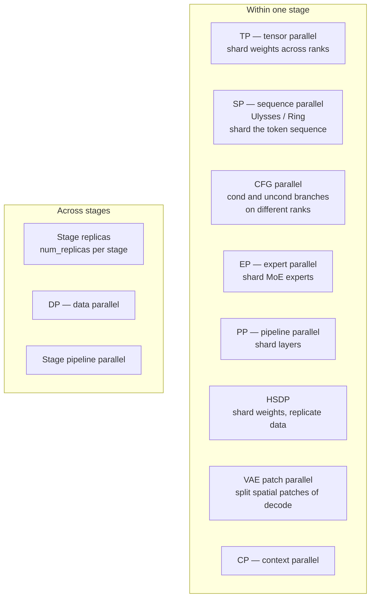
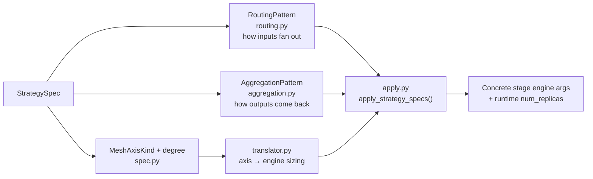
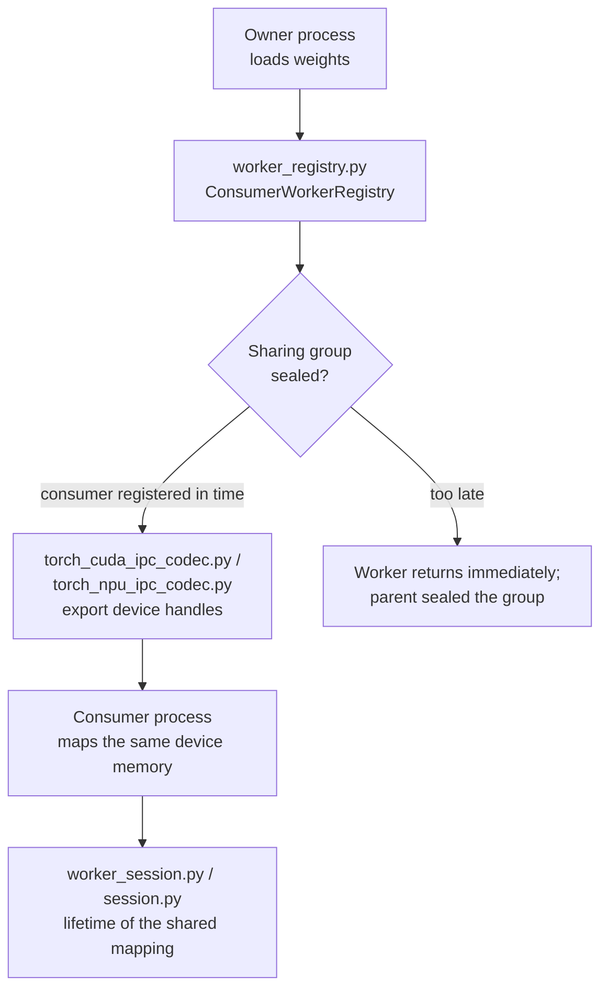

# Distributed Parallelism

**Primary source:** `vllm_omni/config/composable_parallel/`, `vllm_omni/distributed/`
**Related design docs:** [Composable Parallel](../../configuration/composable_parallel.md),
[Tensor Parallel](../../design/feature/tensor_parallel.md),
[Sequence Parallel](../../design/feature/sequence_parallel.md),
[CFG Parallel](../../design/feature/cfg_parallel.md),
[Expert Parallel](../../design/feature/expert_parallel.md),
[HSDP](../../design/feature/hsdp.md),
[Pipeline Parallel](../../design/feature/pipeline_parallel.md),
[VAE Parallel](../../design/feature/vae_parallel.md)

Omni pipelines have more parallelism axes than a text LLM, because the
components being parallelized are more varied. A single MiniMax-H3 deployment
can simultaneously use tensor parallelism for the DiT, a *different* tensor
parallel size for the text encoder, Ulysses sequence parallelism over the latent
sequence, CFG parallelism across the conditional/unconditional branches, and
patch parallelism for the VAE decode.

The hard part is not implementing any one of these. It is composing them
without the combinations becoming a combinatorial mess of per-model special
cases.

## The parallelism axes



## The composable-parallel contract

`vllm_omni/config/composable_parallel/` is a declarative description layer. Its
purpose, from `spec.py`:

```text
A :class:`StrategySpec` declares one parallelism scheme: the mesh axis it sizes
(kind + degree), how a batch is routed across that axis, and how per-worker
results are aggregated back. A *stack* of specs (one per axis) fully describes a
stage's parallel layout in a runtime-agnostic, data-only form that can be
translated into concrete engine sizing.
```

So a strategy spec is a triple: **axis, routing, aggregation.**



### Aggregation patterns

The aggregation vocabulary (`aggregation.py`) is small and closed, and reading
it is the fastest way to understand what each axis actually *means* for data
flow:

| Pattern | Semantics | Used by |
| --- | --- | --- |
| `TakeRank(rank=0)` | Select one rank's result; all ranks agree | TP |
| `Union` | Union of disjoint replica results | DP, HSDP |
| `GatherDim(dim=1)` | Gather along a dimension onto one designated rank | sequence-sharded axes |
| `AllGather(dim)` | Every rank materializes the same aggregate | axes where all ranks must proceed |
| `StitchSpatial(grid)` | Stitch spatial patches back into an image | VAE patch parallel |
| `StitchPipeline` | Stitch pipeline-stage outputs | PP |
| `Combine` | Custom reducer; adapter resolves `reducer_id` | CFG |

The base class is deliberately closed to external subclassing:

```python
def __init_subclass__(cls, **kwargs: object) -> None:
    super().__init_subclass__(**kwargs)
    if cls.__module__ != __name__:
        raise TypeError("AggregationPattern is closed to external subclassing")
```

That is a design statement: the set of ways results can come back is meant to
stay enumerable. A new model needing a genuinely new aggregation should be a
discussed addition to this module, not a plugin.

### Wired vs reserved axes

This is important and easy to get wrong when reading the enum, which lists more
axes than are usable through this contract:

```text
* **Wired** (translatable now): ``tp``, ``dp``, ``pp``, ``ep``,
  ``stage_replica``.
* **Reserved** (declared in the type system but not yet translatable — the
  translator raises ``AxisTranslationError`` for them): ``sp_ulysses``,
  ``sp_ring``, ``cfg``, ``vae_pp``, ``hsdp``, ``stage_pp``, ``cp``.

Reserved kinds fail fast at translation time rather than silently doing nothing,
so declaring one is an explicit "not yet" rather than a no-op.
```

Reserved does **not** mean unimplemented. Sequence parallelism, CFG
parallelism, HSDP, and VAE patch parallelism all work — they are configured
through their own flags (`--usp`, `--vae-patch-parallel-size`, `--use-hsdp`,
and so on) rather than through the composable-parallel strategy contract. The
reservation is about *this configuration path*, and the fail-fast behavior is
there so a strategy YAML declaring `cfg` does not look accepted while doing
nothing.

The `MeshAxisKind` enum subclasses `str` for a stated reason:

```python
"""Subclassing ``str`` keeps existing string comparisons and dict keys working
(``MeshAxisKind.TP == "tp"`` and both hash the same), while making the type
refactor-safe: a typo'd kind is an ``AttributeError`` on the enum rather than
a silently-wrong bare string.
"""
```

### Device-layout validation

`apply.py` validates that a declared strategy is consistent with the devices a
stage was actually given:

| Function | Check |
| --- | --- |
| `_parse_device_count()` (line 142) | How many devices the stage's `devices` string names |
| `check_device_layout()` (line 154) | Declared degrees multiply to the available device count |
| `_check_devices()` (line 188) | Per-role device consistency |
| `_set_explicit()` (line 112) | Writes an engine arg, failing loudly on conflicting explicit values |

Ordering matters here. The check must run **after** stage overrides are merged,
because an override can change the device layout — a real bug fixed by commit
`fd872e0c4` ("Check strategy device layout after stage overrides are merged").
Validating too early passes a configuration that is then broken by the
overrides.

## Runtime support in `vllm_omni/distributed/`

| Path | Role |
| --- | --- |
| `omni_connectors/` | Cross-stage payload and KV transport ([doc](04-omni-connector-transport.md)) |
| `kv_transfer/` | KV-transfer-specific plumbing |
| `omni_coordinator/` | Coordination hub for distributed replicas and membership |
| `weight_sharing/` | Sharing loaded weights between co-located engines |
| `ray_utils/` | Ray-based multi-node placement helpers |

### Weight sharing

Weight sharing exists because co-located stages often need the *same* weights,
and loading them twice wastes both time and device memory. The implementation
(`distributed/weight_sharing/`) hands device memory between processes using CUDA
or NPU IPC:



The registry's sealing behavior shows up directly in the diffusion worker entry
point, and is the first thing a worker checks:

```python
if sharing_registry is not None and not sharing_registry.register(rank):
    return  # Parent sealed the sharing group before this worker started.
```

A worker that starts too late must exit rather than load its own copy — and the
ordering of this check against the parent-death signal turned out to matter, as
[case study 04](../case-studies/04-diffusion-worker-orphans.md) shows.

### Ray for multi-node

Ray is optional. The 0.32.0 release notes describe "optional Ray-based
multi-node inference", and the diffusion executor set includes
`RayDiffusionExecutor` alongside the uniproc and multiproc executors.
`DiffusionExecutor.get_class(od_config)` selects among them, so choosing Ray is
a configuration decision rather than a code path change in the engine.

## Practical composition notes

Facts worth knowing before designing a parallel topology:

- **Text-encoder TP is independent of DiT TP.** `--text-encoder-tp-size N`
  shards the encoder across the first `N` DiT ranks. The encoder and the DiT do
  not have to agree.
- **Quantization and offload can conflict.** Online FP8 is documented as
  incompatible with layerwise offload for the MiniMax-H3 DiT. Capability
  conflicts like this are checked at configuration time where possible.
- **Some pipelines reject some combinations outright.** `_resolve_execution_mode()`
  rejects `hsdp_data_parallel` for MiniMax-H3 ("conditioning and output
  ownership are not request-local") and rejects it for step execution entirely.
- **TP replicates or shards depending on the component.** A reported bug,
  "Ascend pin_memory OOM in diffusion IPC, and USP4 replicates DiT weights"
  (issue #9951), is a reminder that a parallel axis that is supposed to shard
  weights can end up replicating them if the layer mapping is incomplete.
- **Heterogeneous TP across stages is supported but costly.** The KV transfer
  manager must slice or merge per rank; see
  [OmniConnector Transport](04-omni-connector-transport.md).

## Where this subsystem is hard

| Area | Why it bites |
| --- | --- |
| Composition | N axes means N² interaction surfaces; most bugs are in combinations, not single axes |
| Validation ordering | Checks must run after overrides merge, or they validate a configuration nobody runs |
| Reserved axes | Declared-but-not-translatable axes must fail loudly, not silently no-op |
| Sharding completeness | A layer missed by the sharding map silently replicates and blows up memory |
| Per-request geometry under SP | Sequence parallelism shards the sequence, so per-request position math needs extra care ([case study 01](../case-studies/01-qwen-image-21-mixed-batch-rope.md) guards against exactly this) |
