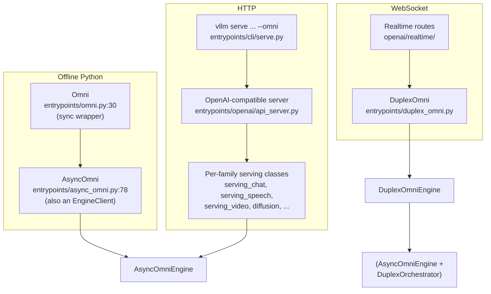
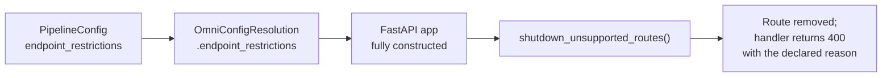

# Entrypoints and APIs

**Primary source:** `vllm_omni/entrypoints/`
**Related docs:** [Serving](../../serving/README.md), [CLI](../../cli/README.md),
[Standalone Servers](../../serving/standalone_servers.md)

Entrypoints translate protocols. That is their whole job, and the package
README is explicit about the boundary:

```text
## What Does Not Belong Here

- OpenAI endpoint-family route bodies and request helpers; those should move
  toward `openai/<family>/` packages as part of #5227.
- Generic model execution internals that belong under engine, worker, or model
  executor packages.
```

Every surface ends up calling the same `AsyncOmniEngine`. If you find yourself
wanting engine logic in an entrypoint, that logic belongs in the engine.

## The three surfaces



`AsyncOmni` declares `class AsyncOmni(AsyncOmniBase, EngineClient)`, which is
what lets the OpenAI server treat it like any vLLM engine client while the
multi-stage machinery lives underneath.

## Offline inference

```python
from vllm_omni.entrypoints.omni import Omni

omni = Omni(model="Qwen/Qwen3-Omni-30B-A3B-Instruct")

om_inputs = {
    "prompt": prompt,
    "multi_modal_data": {
        "video": video_frames,
        "audio": audio_signal,
    },
}

outputs = omni.generate(om_inputs, sampling_params_list)
```

The thing newcomers trip on: the second argument is a **list**, one entry per
stage. A three-stage pipeline needs three sampling-params entries, and the
Orchestrator rejects an empty list outright
(`orchestrator.py:4185`).

## Online serving

```bash
vllm serve Qwen/Qwen3-Omni-30B-A3B-Instruct --omni --port 8091
```

The `--omni` flag routes `vllm serve` through vLLM-Omni's CLI
(`entrypoints/cli/serve.py`) and server (`entrypoints/openai/api_server.py`)
instead of upstream vLLM's.

### Endpoint families

Omni models produce heterogeneous outputs, so the server exposes more than
`/v1/chat/completions`:

| Family | Serving class | Documented at |
| --- | --- | --- |
| Chat completions | `serving_chat.py` | [chat_completions_api.md](../../serving/chat_completions_api.md) |
| Speech (TTS) | `serving_speech.py`, `serving_speech_stream.py` | [speech_api.md](../../serving/speech_api.md) |
| Audio generation | `serving_audio_generate.py` | [audio_generate_api.md](../../serving/audio_generate_api.md) |
| Images | `openai/images/`, `image_api_utils.py` | [image_generation_api.md](../../serving/image_generation_api.md), [image_edit_api.md](../../serving/image_edit_api.md) |
| Video | `serving_video.py`, `serving_video_stream.py`, `serving_video_output_stream.py` | [videos_api.md](../../serving/videos_api.md), [video_stream_api.md](../../serving/video_stream_api.md) |
| Diffusion (generic) | `diffusion.py`, `diffusion_request_utils.py` | model-specific |
| Realtime / duplex | `openai/realtime/`, `ming3_realtime.py` | [realtime_duplex_api.md](../../serving/realtime_duplex_api.md), [realtime_openai_duplex_api.md](../../serving/realtime_openai_duplex_api.md) |
| Robot policy | `entrypoints/openpi/` | [openpi_api.md](../../serving/openpi_api.md) |
| RL rollout | `serving_rl_rollout.py`, `rollout_session.py` | VeRL-Omni integration |
| Run (pipeline yield) | `serving_run.py` | partial-pipeline execution |

### Endpoint restrictions

Not every route applies to every model. A text-only TTS pipeline should not
advertise video generation. `PipelineConfig.endpoint_restrictions` declares what
a pipeline cannot do, and `shutdown_unsupported_routes()`
(`config/endpoint_policy.py:64`) enforces it at startup:

```python
def shutdown_unsupported_routes(
    app: FastAPI,
    endpoint_restrictions: tuple[EndpointRestriction, ...],
) -> None:
    """Given an initialized FastAPI server instance and a set of model specific
    endpoint restrictions, remove the restricted routes and patch a handler that
    returns 400.
    """
```



Each restriction carries a `reason` string, so the 400 explains *why* the
endpoint is unavailable for this model rather than looking like a 404 bug.

## Realtime / duplex

Two URL shapes reach the duplex runtime:

- `/v1/realtime?duplex=1` — the OpenAI-realtime-compatible surface
- `/v1/duplex` — vLLM-Omni's native duplex surface

Commands are translated into internal commands by
`engine/duplex/realtime_commands.py` (`translate_realtime_command()`), and
events are emitted through `engine/duplex/realtime_events.py`. The session
machinery behind them is covered in
[Full-Duplex Sessions](05-full-duplex-sessions.md).

A deployment only gets the duplex path when **both** sides opt in:
`PipelineConfig.duplex_plugin` names the model's plugin, and `DeployConfig`
sets `session_mode: duplex`. Otherwise the model is served turn-based even if a
plugin exists — `default_session_mode` exists to preserve legacy turn
deployments while a plugin is being added.

## Request flow through the server

```mermaid
sequenceDiagram
    participant C as HTTP client
    participant R as FastAPI route
    participant S as Serving class
    participant A as AsyncOmni
    participant E as AsyncOmniEngine

    C->>R: POST /v1/chat/completions
    R->>S: parsed protocol model (openai/protocol/)
    S->>S: validate; build prompt + per-stage sampling params
    S->>A: generate(...)
    A->>E: add_request_async(...)
    E-->>A: async generator of OmniRequestOutput
    A-->>S: outputs
    S-->>R: render to protocol (SSE deltas or final JSON)
    R-->>C: response
```

The serving classes own two translations that are easy to conflate:

1. **Protocol → engine.** Turning an OpenAI-shaped request into a prompt plus a
   `sampling_params_list` with one entry per stage.
2. **Engine → protocol.** Turning `OmniRequestOutput` objects into SSE deltas,
   JSON, or binary media, with the right content type and the right streaming
   semantics.

Bugs here tend to be about *stream lifetime* rather than content. Commit
`20c94bf21` ("Keep the stream alive when a queued interaction is rejected") is a
good example: an event-scoped rejection must not terminate the whole stream, or
a single bad event kills a working session.

## Supporting pieces

| File | Role |
| --- | --- |
| `entrypoints/utils.py`, `stage_utils.py` | Shared stage-config preparation across entrypoints |
| `entrypoints/client_request_state.py` | Client-side per-request state |
| `entrypoints/pd_utils.py` | Prefill/decode disaggregation mixin |
| `entrypoints/api_server_shared_dir.py` | Shared artifact directory for media outputs |
| `openai/app_state.py` | Server-wide state attached to the FastAPI app |
| `openai/errors.py` | Error shaping for OpenAI compatibility |
| `openai/batch_serving.py` | Batch request handling |
| `openai/reference_audio.py`, `ming3_voices.py` | Voice and reference-audio resolution for TTS |
| `openai/chat_template.py` | Chat-template resolution, including `PipelineConfig.chat_template` |
| `cli/main.py`, `cli/serve.py`, `cli/benchmark/` | CLI surface, including `vllm bench serve --omni` |

## Where this subsystem is hard

| Area | Why it bites |
| --- | --- |
| Per-stage sampling params | A single flat params object is wrong for a multi-stage pipeline |
| Stream lifetime | Event-scoped errors must not terminate request-scoped streams |
| Media artifacts | Generated media lives on disk and must expire with its job (commit `57046d7f1`) |
| Input validation | Rejecting bad input at validation with a useful hint beats failing deep in a worker (commit `152540631`) |
| Endpoint capability | A route that exists but cannot work is worse than one that is absent with a reason |
| Port reuse | Restarting a server can race `EADDRINUSE`; the server retries (commit `84a89177e`) |
