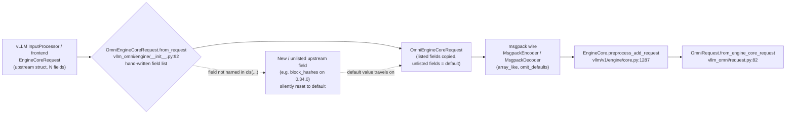
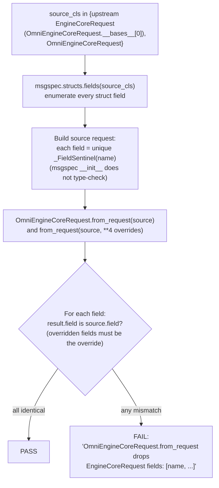

# ISSUE-4015: field-drift guardrail for `OmniEngineCoreRequest.from_request`

> Fork-only working notes. Not intended for upstream submission as-is.

- Issue: https://github.com/vllm-project/vllm-omni/issues/4015
  "[Subissue][Engine cleanup] Add field-drift guardrail for
  OmniEngineCoreRequest.from_request"
- Parent: #4009 (engine cleanup tracking issue).
- Prior attempt: #6805 (closed, stale). It only added `session_id` copying,
  which is already on main, and added no guardrail.
- Branch: `test/4015-from-request-field-drift`, based on upstream main
  `62d0e880a` (rebased from `2e3ad0a4f`; no changes to the affected files).
- Target vLLM: 0.34.0 (`docker/Dockerfile.ci:3`, `ARG VLLM_VERSION=0.34.0`).

## Summary

`OmniEngineCoreRequest.from_request()` rebuilds an Omni request from any
`EngineCoreRequest` by passing every upstream field explicitly to the
constructor. Any field that upstream adds and that this list does not name
takes its default value, with no error. The issue asks for a guardrail (Option A:
keep the explicit constructor and add a unit test).

This change adds that test (Option A). On vLLM 0.34.0 the test **found a field
that is already being dropped today: `block_hashes`**. The same commit fixes it
with one added line.

## Root cause

- `vllm_omni/engine/__init__.py:92-139` (after fix): `from_request` builds the
  result by hand-listing fields (`return cls(...)`, line 112).
- Upstream `vllm/v1/engine/__init__.py:164-226` (vLLM 0.34.0):
  `EngineCoreRequest` is a `msgspec.Struct` (`array_like=True`,
  `omit_defaults=True`). Its last field is
  `block_hashes: list[bytes] | None = None` (line 226), "Prompt block hashes
  computed by the frontend with the engine's PrefixHashConfig".
- Before the fix, `from_request` copied every field up to `abort_immediately`
  (`__init__.py:134`) but **not `block_hashes`**. The Omni copy therefore
  always had `block_hashes=None`.
- Consumer: `vllm/v1/engine/core.py:1287` calls
  `frontend_block_hashes(request, ...)` (`vllm/v1/core/kv_cache_utils.py:1037`),
  which returns `None` when `request.block_hashes is None`. The engine then
  hashes the prompt itself.
- Impact assessment: **performance only, not correctness**. Dropping the field
  skips the frontend-hash fast path and the engine falls back to its own
  hashing. A grep of vLLM 0.34.0 found no in-tree `InputProcessor` code that
  populates `EngineCoreRequest.block_hashes`. A frontend that does set it would
  lose it on every Omni stage-input / final-stage-metadata upgrade
  (`vllm_omni/engine/async_engine_utils.py:228,253`,
  `vllm_omni/engine/orchestrator.py:2581`,
  `vllm_omni/engine/duplex_orchestrator.py:697`). No end-to-end reproduction
  of a user-visible effect was attempted.
- Why it went unnoticed: nothing compared the hand-written list with the
  upstream struct definition. `vllm_omni/patch.py:385-386` also rebinds
  `vllm.v1.engine.EngineCoreRequest` to `OmniEngineCoreRequest` once vllm_omni
  is imported. In tests, the name `EngineCoreRequest` therefore already refers
  to the Omni subclass.

### (a) Request flow and the silent-drop point



### (b) How the new test detects drift



Because each field gets a distinct sentinel, a new upstream field **with a
default** is still caught: the sentinel never equals the default. The test
also needs no maintenance when upstream adds fields, since the field list
comes from the struct itself.

## Before / after

Before (`vllm_omni/engine/__init__.py`, base `2e3ad0a4f`):

```python
            reasoning_parser_kwargs=request.reasoning_parser_kwargs,
            abort_immediately=request.abort_immediately,
            additional_information=additional_information,
```

After:

```python
            reasoning_parser_kwargs=request.reasoning_parser_kwargs,
            abort_immediately=request.abort_immediately,
            block_hashes=request.block_hashes,
            additional_information=additional_information,
```

New test (`tests/engine/test_omni_request.py`, appended; the module already
has `pytestmark = [pytest.mark.core_model, pytest.mark.cpu]`):

```python
_UPSTREAM_ENGINE_CORE_REQUEST = OmniEngineCoreRequest.__bases__[0]
_FROM_REQUEST_OVERRIDES = ("prompt_embeds", "additional_information",
                           "model_intermediate_buffer", "payload_sender_info")

@pytest.mark.parametrize("source_cls", [_UPSTREAM_ENGINE_CORE_REQUEST, OmniEngineCoreRequest],
                         ids=["upstream", "omni"])
def test_from_request_preserves_every_struct_field(source_cls):
    ...
    source = source_cls(**{name: _FieldSentinel(name) for name in field_names})
    upgraded = OmniEngineCoreRequest.from_request(source)
    dropped = _dropped_fields(source, upgraded)
    assert not dropped, f"OmniEngineCoreRequest.from_request drops {source_cls.__name__} fields: {dropped}"
    # then the same with all four keyword overrides passed
```

## Validation

Environment: shared venv `/workshop/vllm-omni/venv` (Python 3.12, CPU torch,
vLLM 0.34.0, `vllm._C` absent, which is expected on CPU). Tests were run from
the worktree root with `PYTHONPATH=$PWD`, and
`vllm_omni.__file__` was confirmed to be
`/workshop/vllm-omni/wt/4015-from-request-field-drift/vllm_omni/__init__.py`.
The run was single-process. `pytest-xdist` is not installed in the venv,
which makes the repo's default `addopts` (`--dist=loadgroup`) a usage error.
The runs therefore override `addopts` and keep `--strict-markers`.

### 1. New test and existing tests pass (fixed code)

```console
$ PYTHONPATH=$PWD python -m pytest tests/engine/test_omni_request.py \
    -p no:xdist -p no:cacheprovider -o addopts="--strict-markers" -v
test_omni_params_are_keyword_only PASSED
test_positional_construction_matches_base_request PASSED
test_positional_prompt_embeds_does_not_collide PASSED
test_keyword_omni_params_round_trip PASSED
test_model_intermediate_buffer_round_trips_to_streaming_update PASSED
test_kv_hints_survive_omni_upgrade_wire_transport_and_scheduler_conversion PASSED
test_from_request_preserves_every_struct_field[upstream] PASSED
test_from_request_preserves_every_struct_field[omni] PASSED
======================== 8 passed, 2 warnings in 0.36s =========================
```

The two warnings come from the existing code: the vLLM-Omni/vLLM
version-mismatch warning for a dev build, and the existing non-writable NumPy
warning in `test_keyword_omni_params_round_trip`.

### 2. Drift demos (local only, not committed)

Demo 1: the unfixed `from_request` from base `2e3ad0a4f`. This is the real
drift on 0.34.0.

```console
$ git show HEAD:vllm_omni/engine/__init__.py > vllm_omni/engine/__init__.py   # (pre-commit HEAD)
$ PYTHONPATH=$PWD python -m pytest tests/engine/test_omni_request.py -k from_request_preserves \
    -p no:xdist -p no:cacheprovider -o addopts="--strict-markers" -q
E       AssertionError: OmniEngineCoreRequest.from_request drops EngineCoreRequest fields: ['block_hashes']
E       AssertionError: OmniEngineCoreRequest.from_request drops OmniEngineCoreRequest fields: ['block_hashes']
2 failed, 6 deselected, 1 warning in 0.24s
```

Demo 2: the fixed code with `session_id=request.session_id,` deleted (an
injected drift):

```console
$ sed -i '/            session_id=request.session_id,/d' vllm_omni/engine/__init__.py
$ PYTHONPATH=$PWD python -m pytest tests/engine/test_omni_request.py -k from_request_preserves \
    -p no:xdist -p no:cacheprovider -o addopts="--strict-markers" -q
E       AssertionError: OmniEngineCoreRequest.from_request drops EngineCoreRequest fields: ['session_id']
E       AssertionError: OmniEngineCoreRequest.from_request drops OmniEngineCoreRequest fields: ['session_id']
2 failed, 6 deselected, 1 warning in 0.30s
```

After each demo the file was restored from a backup, and `git diff --stat`
showed only the intended one-line `block_hashes` change.

### 3. pre-commit on changed files

```console
$ /workshop/vllm-omni/venv/bin/pre-commit run --files \
    vllm_omni/engine/__init__.py tests/engine/test_omni_request.py
```

First run: `ruff format` reformatted the test file (it collapsed one
`parametrize` call onto one line). Every other hook passed. Second run: all
hooks passed or were skipped (no matching files). The hooks included
ruff check, ruff format, typos, mypy-3.10, check-mark (CI marks), SPDX
headers, forbidden imports and the torch.cuda guard. Exit code 0.

### Checks not run

- Full test suite, GPU/L2 CI (Buildkite), and any end-to-end serving run. The
  `block_hashes` fix has no end-to-end reproduction. The impact claim
  (performance fallback only) comes from reading the source, not from
  measurement.
- Test run with the repo's default `addopts` (needs `pytest-xdist`, which is
  not in the venv).
- Behavior on vLLM versions other than 0.34.0.
- precheck-pr contributor-intent gate: requires the human contributor's own
  answers, so it is left as TODO below.

### precheck-pr quick self-check (agent-run, excluding the intent gate)

| Dimension | Result |
| --- | --- |
| PR title format | Pass: `[Bugfix]` (the change fixes a dropped `block_hashes` field and adds the guardrail test). |
| Code quality (kwargs fragility, broad except, Any hints, hot-path clone, event-loop blocking) | Pass: one added kwarg line in the engine; test helpers only. |
| Examples policy | Not applicable: no examples changed. |
| Simplification | Pass: no new abstraction; Option A as preferred by the issue. |
| Design contracts / docs | Pass: no public config/behavior change. The fix restores upstream semantics, so no docs page is affected. |
| Local pre-commit gates | Pass (see above). |
| Contributor intent | Blocking until a human answers: TODO(human). |

## Draft PR description

Suggested title: `[Bugfix] Preserve block_hashes in OmniEngineCoreRequest.from_request and add field-drift guardrail`

```markdown
<!-- markdownlint-disable -->
## Contributor intent (required human answers)

### 1. What outcome do you want to achieve?

<!-- TODO(human): contributor's own answer required; do not let an agent fill this in. -->

### 2. What is the highest-leverage variable for that outcome?

<!-- TODO(human): contributor's own answer required; do not let an agent fill this in. -->

### 3. How will this work move that variable?

<!-- TODO(human): contributor's own answer required; do not let an agent fill this in. -->

### 4. Whose customer or user needs does this address, and what are those needs?

<!-- TODO(human): contributor's own answer required; do not let an agent fill this in. -->

## Purpose

Closes #4015 (sub-issue of #4009). Supersedes the stale #6805.

`OmniEngineCoreRequest.from_request` copies upstream `EngineCoreRequest`
fields by hand, so a field added in a vLLM bump is silently dropped. This PR
keeps the explicit constructor (Option A in the issue) and adds a CPU unit
test, `test_from_request_preserves_every_struct_field`. For both the upstream
base struct and the Omni subclass, the test enumerates every msgspec field
with `msgspec.structs.fields`, fills each with a unique sentinel, and asserts
that `from_request` preserves it and also honours its four keyword overrides.
A failure names the dropped field(s).

The test found a live drift on vLLM 0.34.0: `block_hashes` (frontend-computed
prompt block hashes, upstream `vllm/v1/engine/__init__.py:226`) was not copied.
With the field missing, `EngineCore` drops to its own prompt hashing
(`frontend_block_hashes` returns `None`). That is a performance fallback and
does not affect correctness. This PR copies the field (one line).

Before: a new or unlisted upstream field is reset to its default with no error;
`block_hashes` is dropped today.
After: all upstream fields are preserved, and any future drift fails
`tests/engine/test_omni_request.py` (`core_model`, `cpu`) with the missing field
name.

Docs/contracts: unchanged. No public configuration or supported behavior
changes; the fix restores upstream field semantics.

Note for reviewers: `vllm_omni/patch.py` rebinds
`vllm.v1.engine.EngineCoreRequest` to `OmniEngineCoreRequest`, so the test
takes the true upstream class from `OmniEngineCoreRequest.__bases__[0]` and
asserts that its `__module__` is `vllm.v1.engine`.

AI assistance: Claude Code (Claude Opus 5.5) drafted the code change, the
regression test, the notes and this PR description. The human contributor
must review every change and be able to explain it before submission.

## Test Plan

**vLLM Version:** 0.34.0 (CPU wheel, Python 3.12)

**vLLM-Omni Commit:** base `62d0e880a` + this PR (re-tested after rebase from `2e3ad0a4f`: 8 passed)

    PYTHONPATH=$PWD python -m pytest tests/engine/test_omni_request.py \
      -p no:xdist -p no:cacheprovider -o addopts="--strict-markers" -v
    # Drift demo: run the new test against the unfixed from_request and against
    # from_request with session_id removed (local only).
    pre-commit run --files vllm_omni/engine/__init__.py tests/engine/test_omni_request.py

## Test Result

- `tests/engine/test_omni_request.py`: 8 passed (6 existing + 2 new
  parametrized cases).
- Unfixed `from_request` (base `2e3ad0a4f`): the new test fails with
  `OmniEngineCoreRequest.from_request drops EngineCoreRequest fields: ['block_hashes']`.
- Injected drift (removed `session_id`): fails with `... fields: ['session_id']`.
- pre-commit on changed files: all hooks pass.

Not run: full suite, GPU/Buildkite CI, end-to-end serving, other vLLM
versions, the default `addopts` (`pytest-xdist` not installed locally). The
`block_hashes` impact assessment is based on reading the source and has not
been measured.
```
