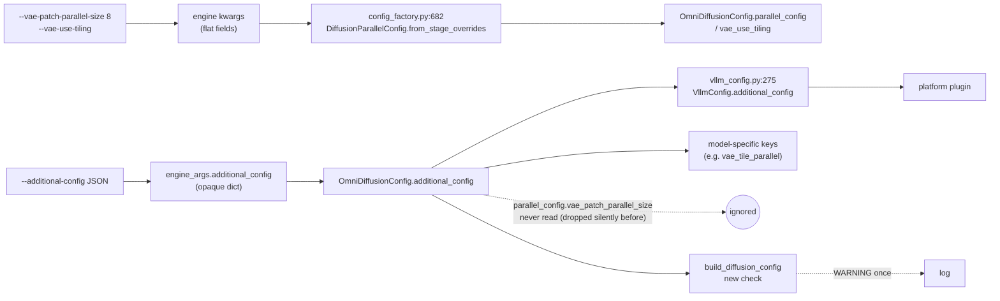
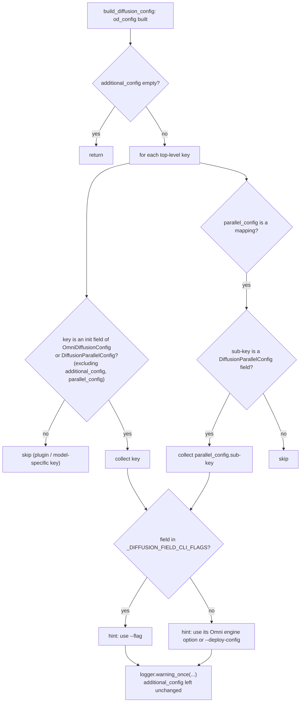

<!-- markdownlint-disable -->
# Issue #5639: `--additional-config` silently ignores diffusion config fields

Fork-only notes. Do not submit this file upstream.

- Issue: https://github.com/vllm-project/vllm-omni/issues/5639
- Branch: `fix/5639-additional-config-warning`, based on upstream main `62d0e880a` (rebased from `2e3ad0a4f`; no changes to the affected files)
- Related closed PR: #5711 (warned only for `vae_patch_parallel_size`, `vae_parallel_mode`, `vae_use_tiling`)

## Summary

```bash
vllm serve <model> --omni \
  --additional-config '{"vae_use_tiling":true,"parallel_config":{"vae_patch_parallel_size":8}}'
```

vLLM parses the JSON and lists it among the non-default args. The values never reach
`od_config.vae_use_tiling` or `od_config.parallel_config.vae_patch_parallel_size`, and
nothing is logged. The dedicated flags (`--vae-patch-parallel-size 8 --vae-use-tiling`) work.

## Maintainer decision

hsliuustc0106 said `--additional-config` is intentionally forwarded to the platform plugin
through `VllmConfig.additional_config`. It is not a generic overlay for Omni's
`DiffusionParallelConfig`. Propagating the values would make precedence ambiguous.
The accepted mitigation is a warning that points to the dedicated CLI flags. The maintainer
asked for something more general than the three VAE fields, and #5711 was closed.

The issue's latest proposal (from a contributor, **no maintainer reply yet**) is to warn when
`--additional-config` has a key, at top level or under `parallel_config`, that names an
`OmniDiffusionConfig` or `DiffusionParallelConfig` field. The warning names the dedicated
option where one exists and leaves `additional_config` unchanged. This branch implements
that proposal.

## Root cause (base `2e3ad0a4f`)

- `vllm_omni/config/config_factory.py:682`: the stage's `parallel_config` is built only from
  the flat CLI/engine kwargs and an explicit `parallel_config` kwarg
  (`DiffusionParallelConfig.from_stage_overrides(kwargs)`). It never reads `additional_config`.
- `vllm_omni/diffusion/data.py:1159`: `OmniDiffusionConfig.additional_config` is an opaque
  `dict[str, Any]`. `data.py:1425-1430` only normalizes it to a dict, and `data.py:1434-1437`
  builds `parallel_config` from its own field.
- `vllm_omni/engine/stage_init_utils.py:2106` (base; `build_diffusion_config`) constructs
  `OmniDiffusionConfig` with both values side by side and does not compare them.
- `vllm_omni/diffusion/vllm_config.py:275`: `additional_config` is passed as-is to
  `VllmConfig(additional_config=...)`, which is the platform-plugin channel.

So `parallel_config.vae_patch_parallel_size` stays in `additional_config`, the plugin
receives it, and nothing in Omni reads it. That is where the value is dropped without notice.

## Config flow



## New check decision logic



"Consumed elsewhere?" is handled by audit, not at runtime. No key that Omni reads from a
diffusion `additional_config` matches a field name (see the false-positive analysis below),
so the field-name test is the whole rule. A regression test pins the known consumed keys.

## Before / after

Before (base): no output, and the value is dropped.

After (`vllm_omni/engine/stage_init_utils.py`):

```python
od_config = OmniDiffusionConfig(**{name: value for name, value in diffusion_kwargs.items() if value is not None})
warn_ignored_diffusion_additional_config(od_config.additional_config)
```

Logged message:

```text
additional_config sets Omni diffusion config field(s) vae_use_tiling (use --vae-use-tiling),
parallel_config.vae_patch_parallel_size (use --vae-patch-parallel-size). These values are
ignored for Omni: additional_config is forwarded to the platform plugin and model-specific
options and does not override OmniDiffusionConfig or DiffusionParallelConfig.
```

`_DIFFUSION_FIELD_CLI_FLAGS` is an explicit map of 15 entries: parallel fields with Omni
serve flags, `--tensor-parallel-size`, and `--vae-use-tiling`/`--vae-use-slicing`. I did not
derive flags from `OmniEngineArgs` field names because that produced wrong hints.
`--data-parallel-size` and `--enable-expert-parallel` are rejected under `--omni`
(`serve.py:314-321`), and `model_stage`, `omni_kv_config` and `enable_multithread_weight_load`
have no same-name flag. A test checks that every mapped flag parses to the field it names.

## False-positive analysis

These keys are read from a diffusion `od_config.additional_config` at `2e3ad0a4f`. None of
them is a field of `OmniDiffusionConfig` or `DiffusionParallelConfig`:

- engine/runtime: `diffusion_kv_profile_height`, `diffusion_kv_profile_width` (`diffusion_engine.py:1991`,
  set in `stage_init_utils.py`), `weight_sharing_bootstrap` (`distributed/weight_sharing/runtime.py:24`),
  `auto_detected_quant_method` (`config/omni_config.py:1189`)
- flux3: `variant` (`diffusion/utils/flux3_package.py:33`), `batch_cfg` (`flux3/pipeline_flux3.py:385`)
- minimax_h3: `vae_tile_parallel` (`pipeline_minimax_h3_image.py:407`), `min_generation_area`,
  `text_encoder_cudnn_sdp`, `latent_cache_clips`, `lightvae_decoder_path`
  (`lightvae/checkpoint.py:24`), `video_vae_decoder`, `latent_refine`, `latent_upscale`,
  `latent_refine_max_tokens_per_rank`, `latent_upscaler_path`/`_dtype`/`_chunk_frames`/`_resident`
- magi2: `magi2_allow_unsupported_topology`, `magi2_deterministic` (via `_config_value`)
- cosmos3: `cosmos3_mixed_precision`; ltx2: `ltx2_audio_limits`; omnivoice: `omnivoice_asr`
- longcat_video avatar: `model_type`, `use_distill`, `use_int8`, `build_components_on_gpu`, `resolution`
- NPU minimax_h3_image: `npu_deterministic`, `npu_vae_tile_graph`, `npu_disable_internal_format`,
  `npu_disable_jit_compile`, `npu_vae_encoder_precision`, `npu_vae_encoder_batch`,
  `npu_vae_tile_streams`, `npu_vae_tile_batch`

AR/generation-stage readers of `vllm_config.additional_config` (for example `hf_numerics`,
`cfg_prefill_delay_tokens`, Qwen3-TTS/MiniCPM-o keys) do not go through
`build_diffusion_config`, so the check never sees them. Plugin keys such as
`torchair_graph_config` are not diffusion fields. A `parallel_config` mapping with no
matching sub-keys produces no warning.

Limits: the audit was done with grep. It covered literal and constant-named keys. Keys
built dynamically, or read by out-of-tree platform plugins, could be missed. A future model
that reads a diffusion field name from `additional_config` would also get the warning.

## Validation (CPU, vLLM 0.34.0, Python 3.12, torch 2.15.0+cpu)

Tests were run from the worktree with `PYTHONPATH=$PWD`, and `vllm_omni.__file__` resolved
to the worktree. The repo's `--dist=loadgroup` option (in `addopts`) needs xdist, so it was overridden:

```bash
PYTHONPATH=$PWD python -m pytest -p no:xdist -p no:cacheprovider \
  -o addopts="--strict-markers --strict-config" -q -rA \
  tests/entrypoints/test_async_omni_diffusion_config.py tests/engine/test_async_omni_engine_stage_init.py \
  -k "additional_config or dedicated_vae or serve_flags or ray_diffusion"
# after: 9 passed
```

Before the fix (`stage_init_utils.py` reverted to base, new tests kept): 3 failed, 3 passed.
`test_additional_config_diffusion_fields_warn_and_stay_unapplied` failed with
`Expected 'warning_once' to have been called once. Called 0 times.`, and the two helper
tests failed on the missing attribute.
`test_dedicated_vae_flags_set_diffusion_fields_without_warning` passed both before and
after (the CLI flag path is unchanged).

Demo script (parses real `vllm serve --omni` args, `create_default_diffusion` → `build_diffusion_config`):

```text
=== BEFORE: --additional-config '{"vae_use_tiling":true,"parallel_config":{"vae_patch_parallel_size":8}}'
RESULT vae_patch_parallel_size = 1 | vae_use_tiling = False | additional_config = {'vae_use_tiling': True, 'parallel_config': {'vae_patch_parallel_size': 8}}
=== AFTER: same args
additional_config sets Omni diffusion config field(s) vae_use_tiling (use --vae-use-tiling), parallel_config.vae_patch_parallel_size (use --vae-patch-parallel-size). These values are ignored for Omni: ...
RESULT vae_patch_parallel_size = 1 | vae_use_tiling = False | additional_config = {'vae_use_tiling': True, 'parallel_config': {'vae_patch_parallel_size': 8}}
=== AFTER: --vae-patch-parallel-size 8 --vae-use-tiling
RESULT vae_patch_parallel_size = 8 | vae_use_tiling = True | additional_config = {}
=== AFTER: --additional-config '{"torchair_graph_config":{"enabled":true},"vae_tile_parallel":false}'
RESULT vae_patch_parallel_size = 1 | vae_use_tiling = False | additional_config = {'torchair_graph_config': {'enabled': True}, 'vae_tile_parallel': False}   (no warning)
```

Neighbouring files: `tests/entrypoints/test_async_omni_diffusion_config.py`,
`tests/engine/test_async_omni_engine_stage_init.py` and `tests/engine/test_single_stage_mode.py`
gave 272 passed, 4 failed. The 4 failures are in `test_single_stage_mode.py`
(`test_frontend_only_head_plans_every_replica_remote`,
`test_prepare_stage_plans_splits_only_local_device_pool[*]`, with a `NotImplementedError`
raised in orchestrator init). They fail the same way on unmodified base `2e3ad0a4f` in this
CPU environment, so they are pre-existing and unrelated. Without the stub update, the change
broke two tests (`test_build_ray_diffusion_config_preserves_explicit_stage_env`): their
`OmniDiffusionConfig` stub had no `additional_config`. The stub now carries
`additional_config={}`, like the real config.

`pre-commit run --files <4 changed files>` passed every hook, including ruff, ruff-format,
typos, markdownlint, mypy-3.10, test CI marks, SPDX, forbidden imports and torch.cuda.

## Checks not run

- No real `vllm serve` startup or GPU/NPU run. The machine is CPU-only, and the demo stops at
  `build_diffusion_config`.
- The full test suite was not run (small shared machine). Only targeted files were.
- No out-of-tree platform plugin (vllm-ascend) was checked for keys that collide with
  diffusion field names.
- The precheck-pr contributor-intent gate was not done. Only the human can answer it.

---

## Draft PR description

Suggested title: `[Frontend] Warn when --additional-config sets ignored diffusion config fields`

Title: `[Frontend] Warn when --additional-config sets ignored diffusion config fields (#5639)`

> Coordinate on #5639 before opening. The general-warning proposal this implements is the
> issue's latest comment and has **not yet been confirmed by a maintainer**.

```markdown
## Contributor intent (required human answers)

### 1. What outcome do you want to achieve?

<!-- TODO(human): your own answer -->

### 2. What is the highest-leverage variable for that outcome?

<!-- TODO(human): your own answer -->

### 3. How will this work move that variable?

<!-- TODO(human): your own answer -->

### 4. Whose customer or user needs does this address, and what are those needs?

<!-- TODO(human): your own answer -->

## Purpose

Fixes #5639. Follows the maintainer decision on the issue: `--additional-config` is forwarded
to the platform plugin through `VllmConfig.additional_config`. It is not an overlay for
`OmniDiffusionConfig`/`DiffusionParallelConfig`, so values are **not** propagated. This
generalizes the closed #5711, which only covered the three VAE fields. The design follows
the latest proposal on the issue, which still awaits maintainer confirmation.

Before: `--additional-config '{"parallel_config":{"vae_patch_parallel_size":8}}'` was dropped
without any log output, and `od_config.parallel_config.vae_patch_parallel_size` stayed 1.

After: `build_diffusion_config` logs one warning (`warning_once`) when a top-level or
`parallel_config` key in `additional_config` matches an `OmniDiffusionConfig` or
`DiffusionParallelConfig` field. The warning names each key and its dedicated flag, for
example `parallel_config.vae_patch_parallel_size (use --vae-patch-parallel-size)`, and says
the value is ignored for Omni (`additional_config` is forwarded to the platform plugin and
model-specific options, not to these configs). `additional_config`
itself is unchanged. No key that pipelines read from a diffusion `additional_config` (for
example `vae_tile_parallel`, `lightvae_decoder_path`, `variant`) matches a field name, so
those keys do not warn.

Docs: one note in `docs/user_guide/diffusion/parallelism/vae_parallelism.md`.

AI assistance: Claude Code (Claude Opus 5.5) drafted the code, tests, notes and this PR text.
<!-- TODO(human): confirm you reviewed every change and can explain it, then edit this line. -->

## Test Plan

**vLLM Version:** 0.34.0

**vLLM-Omni Commit:** base 62d0e880a (upstream main) + this PR (re-tested after rebase from 2e3ad0a4f: 9 passed)

PYTHONPATH=$PWD python -m pytest -p no:xdist -o addopts="--strict-markers --strict-config" -q \
  tests/entrypoints/test_async_omni_diffusion_config.py tests/engine/test_async_omni_engine_stage_init.py \
  -k "additional_config or dedicated_vae or serve_flags or ray_diffusion"
pre-commit run --files <changed files>

## Test Result

CPU only (Python 3.12, torch 2.15.0+cpu).
- New regression tests: 9 passed. On base, the warning test fails with
  "Expected 'warning_once' to have been called once. Called 0 times."
- Neighbouring files: 272 passed, 4 failed. The 4 failures are in
  tests/engine/test_single_stage_mode.py and fail the same way on base in this CPU environment.
- pre-commit on the changed files: all hooks passed, including mypy-3.10.
- Not run: real `vllm serve` startup, GPU/NPU, full test suite, out-of-tree plugin key audit.
```
