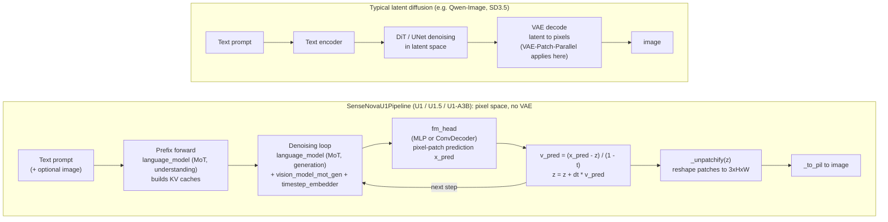
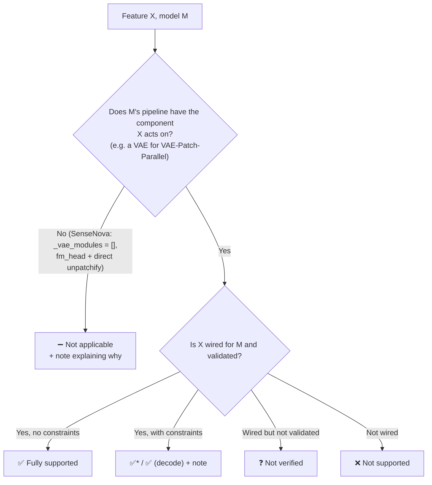

# ISSUE-7874: Clarify SenseNova-U1 VAE parallelism scope

> Fork-only working notes. Do not submit this file upstream.

- Issue: <https://github.com/vllm-project/vllm-omni/issues/7874> "[Docs] Clarify SenseNova-U1 VAE parallelism scope"
- Related: PR #7845 "Mark SenseNova VAE parallelism as not applicable", closed
  unmerged because it went inactive, not because it was rejected.
- Branch: `docs/7874-sensenova-vae-na`
- Base: upstream `main` at `62d0e880a` (rebased from `2e3ad0a4f`; the 3 intervening commits do not touch the changed files)
- Fix commit: `a3d109d4b` "[Docs] Mark SenseNova VAE parallelism as not applicable (#7874)"

## Summary

In the ImageGen table of `docs/user_guide/diffusion_features.md`, the
`💾VAE-Patch-Parallel` column was ❌ ("Not supported") for SenseNova-U1,
SenseNova-U1.5 and SenseNova-U1-A3B. ❌ suggests the model has a VAE that just
can't be distributed yet. The registered `SenseNovaU1Pipeline` has no VAE at all,
so the right value is "not applicable". The legend had no symbol for that.

Acceptance criteria from the issue:

| Criterion | Status |
|---|---|
| Feature matrix distinguishes not applicable from unsupported | Done: new legend entry `➖ = Not applicable ...`; the three SenseNova cells now use ➖ |
| The note names `_vae_modules = []`, `fm_head`, and direct unpatchify as the reason | Done: new note 11 under the ImageGen table |
| No runtime support or performance improvement is claimed | Done: docs-only diff, and the note claims nothing about runtime behavior |

## Root cause / analysis

All references are at base `2e3ad0a4f`.

### All three variants use the same pipeline

- `vllm_omni/diffusion/data.py:798-799` and `:1893-1894`: `model_type == "neo_chat"` resolves to `SenseNovaU1Pipeline`.
- `vllm_omni/diffusion/registry.py:376-379`: `SenseNovaU1Pipeline` maps to `sensenova_u1/pipeline_sensenova_u1.py`.
- `recipes/SenseNova/SenseNova-U1.md:40-41` (A3B) and `recipes/SenseNova/SenseNova-U1.5.md:16-17` (U1.5): both checkpoints keep `model_type: neo_chat` and run on the same `SenseNovaU1Pipeline`.
- `docs/models/supported_models.md:137-138`: lists U1, U1.5 and U1-A3B under `SenseNovaU1Pipeline`.

So any VAE fact about the pipeline holds for all three rows. The one variant
difference that matters here is `use_pixel_head` (true for U1.5): it changes
which module `fm_head` is (`ConvDecoder` instead of an MLP). It does not add a VAE.

### The pipeline has no VAE

File: `vllm_omni/diffusion/models/sensenova_u1/pipeline_sensenova_u1.py`

- `:501-507`: offload-protocol declaration, with the comment "There is no separate VAE."
  ```python
  _dit_modules: ClassVar[list[str]] = ["language_model"]
  _encoder_modules: ClassVar[list[str]] = ["vision_model"]
  _vae_modules: ClassVar[list[str]] = []
  _resident_modules: ClassVar[list[str]] = ["fm_modules"]
  ```
- `:555-575`: `fm_head` is a `ConvDecoder` when `use_pixel_head` is set, and a 2-layer GELU MLP otherwise. Its output dimension is `3 * (patch_size * merge_size) ** 2`, i.e. RGB pixels per patch, not latent channels.
- `:752` / `:761`: `_denoise` uses `self.fm_modules["fm_head"](...)` to produce `x_pred`, the pixel-space prediction, and turns it into `v_pred` (`:763`).
- `:1560-1561`: the denoising loop updates `z` and calls `_unpatchify` directly:
  ```python
  z = z + (t_next - t) * v_pred
  image_prediction = _unpatchify(z, self.patch_size * merge_size, p.image_size[1], p.image_size[0])
  ```
- `:401-409`: `_unpatchify` is a reshape/einsum from patches to `(N, 3, H, W)`, with no learned decoder.
- `:1568`: `images = _to_pil(image_prediction)`. No VAE decode runs at any point.
- `grep -n "\.vae\b\|self\.vae"` on `vllm_omni/diffusion/models/sensenova_u1/*.py` finds nothing.

### Why ❌ was misleading

VAE patch parallelism only takes effect when the pipeline has a distributed VAE.
`vllm_omni/diffusion/registry.py:627-639` checks
`hasattr(model, "vae") and isinstance(model.vae, DistributedVaeMixin)`, and if
that check fails while `vae_patch_parallel_size > 1`, it warns and ignores the
setting. SenseNova has no `vae` attribute, so this feature has nothing to work
on, which is different from a VAE that hasn't been wired for distribution yet.
(This was found by reading the code; I did not run it.)

### Other places checked for consistency

- `recipes/SenseNova/SenseNova-U1.md:18-19` ("no separate text encoder or VAE needed") and `:100` ("There is no VAE. The loop ends in unpatchify / denorm / PIL"): already consistent, no change.
- `docs/design/module/diffusion/parallelism.md`, `docs/user_guide/diffusion/parallelism/vae_parallelism.md`: no SenseNova mention, no change.
- `docs/models/supported_models.md`: has no VAE-parallel column, no change.

## Data flow

### (a) SenseNova generation vs. typical latent diffusion



### (b) Choosing a feature-matrix cell



## Exact changes

`docs/user_guide/diffusion_features.md` only (+5/-3).

Legend, before:

```markdown
- ❌ = Not supported
- ❓ = Not verified; not recommended
```

after:

```markdown
- ❌ = Not supported
- ➖ = Not applicable; the pipeline has no component for this feature to act on
- ❓ = Not verified; not recommended
```

ImageGen rows, before (only the `💾VAE-Patch-Parallel` cell, 10th column, changes):

```markdown
| **SenseNova-U1**         | ... |             ✅             |          ❌           |       ❌        |        ❌         |
| **SenseNova-U1.5**       | ... |             ✅             |          ❌           |       ✅        |        ❌         |
| **SenseNova-U1-A3B**     | ... |             ❌             |          ❌           |       ❌        |        ❌         |
```

after:

```markdown
| **SenseNova-U1**         | ... |             ✅             |          ➖           |       ❌        |        ❌         |
| **SenseNova-U1.5**       | ... |             ✅             |          ➖           |       ✅        |        ❌         |
| **SenseNova-U1-A3B**     | ... |             ❌             |          ➖           |       ❌        |        ❌         |
```

The swap is one character for one character, so column padding is unchanged.

New note added after note 10:

```markdown
> 11. SenseNova-U1, SenseNova-U1.5, and SenseNova-U1-A3B all run on `SenseNovaU1Pipeline`, which has no VAE, so VAE-Patch-Parallel is not applicable (➖) rather than unsupported. The pipeline declares `_vae_modules = []`, predicts pixel patches with `fm_head`, and unpatchifies the denoising result directly into the output image.
```

## Validation

Performed:

1. Code verification by reading source with `grep -n "_vae_modules\|fm_head\|unpatchify" vllm_omni/diffusion/models/sensenova_u1/*.py`. Output (abridged):
   ```text
   pipeline_sensenova_u1.py:401:def _unpatchify(x, patch_size, h=None, w=None):
   pipeline_sensenova_u1.py:506:    _vae_modules: ClassVar[list[str]] = []
   pipeline_sensenova_u1.py:556:            fm_head = ConvDecoder(llm_hidden_size)
   pipeline_sensenova_u1.py:573:                "fm_head": fm_head,
   pipeline_sensenova_u1.py:752:            smoothed_img_2d = self.fm_modules["fm_head"](img_2d)
   pipeline_sensenova_u1.py:761:            x_pred = self.fm_modules["fm_head"](last_hidden_state[:, -image_token_num:].view(B, L, -1)).view(B, L, -1)
   pipeline_sensenova_u1.py:1561:            image_prediction = _unpatchify(z, self.patch_size * merge_size, p.image_size[1], p.image_size[0])
   ```
   The `\.vae\b|self\.vae` grep on the same files returned no matches.
2. A Python edit script asserted that the 10th cell of each SenseNova row was `❌` before swapping it, and that exactly 3 rows changed.
3. pre-commit on the changed doc. The shared venv `/workshop/vllm-omni/venv` was still installing vLLM in the background and had no `pre-commit`, so to avoid racing that pip process I installed pre-commit 4.7.0 into a separate throwaway venv `/tmp/precommit-7874`:
   ```text
   $ /tmp/precommit-7874/bin/pre-commit run --files docs/user_guide/diffusion_features.md
   check yaml.........................................................(no files to check)Skipped
   debug statements (python)..........................................(no files to check)Skipped
   fix end of files.......................................................................Passed
   mixed line ending......................................................................Passed
   trim trailing whitespace...............................................................Passed
   ruff check.........................................................(no files to check)Skipped
   ruff format........................................................(no files to check)Skipped
   typos..................................................................................Passed
   Lint GitHub Actions workflow files.................................(no files to check)Skipped
   markdownlint-cli2......................................................................Passed
   Run mypy for Python 3.10...........................................(no files to check)Skipped
   Ensure test files have CI marks (no direct SKU or bare platform)...(no files to check)Skipped
   Ratchet TTS per-model branches out of serving_speech.py............(no files to check)Skipped
   Lint shell scripts.................................................(no files to check)Skipped
   Check SPDX headers.................................................(no files to check)Skipped
   Check forbidden imports............................................(no files to check)Skipped
   Prevent new torch.cuda API calls...................................(no files to check)Skipped
   Validate Buildkite Pipelines.......................................(no files to check)Skipped
   Suggestion.............................................................................Passed
   ```
   Exit code 0, and the hooks left the file unchanged. Python, YAML and shell hooks were skipped because the diff has no files of those types.

Not run:

- `mkdocs build` / `mkdocs serve`: skipped on purpose (shared 2-CPU / 7 GB machine). I have not checked how the docs theme renders ➖. GitHub markdown renders it as a plain emoji.
- No GPU or runtime test. None is needed for a docs-only change, and the change claims no runtime behavior. The registry warning path (`registry.py:634-639`) was read, not executed.
- Human contributor-intent gate (precheck-pr): left for the human.

### precheck-pr quick self-check (agent part)

| Dimension | Result |
|---|---|
| PR title format | ⚠ Commit uses `[Docs]` as instructed. The precheck table lists `[Doc]`, and recent upstream history uses `[Doc]` (14 of the last 300 commits). Suggest `[Doc]` for the PR title. |
| Type | General (docs-only) |
| Code quality sweep | — no Python added |
| Examples policy | — no Python paths added |
| Simplification | ✓ smallest diff that meets the criteria (1 legend line, 3 cells, 1 note) |
| Design contracts / docs consistency | ✓ recipes already say "no VAE". The parallelism design and VAE-parallel guides don't mention SenseNova. |
| Accuracy / benchmark claims | ✓ none made (L002) |
| Local pre-commit gates | ✓ all applicable hooks passed, including markdownlint-cli2 |
| Contributor intent gate | ✗ pending human answers (blocks submission) |
| Signed-off-by / DCO | ⚠ intentionally absent; human must re-sign before submission |

## Draft PR description

Suggested title: `[Doc] Mark SenseNova VAE parallelism as not applicable`

```markdown
Fixes #7874. Supersedes the inactive, unmerged #7845.

## Contributor intent (required human answers)

### 1. What outcome do you want to achieve?

<!-- TODO(human): answer in your own words; an agent must not fill this in. -->

### 2. What is the highest-leverage variable for that outcome?

<!-- TODO(human): answer in your own words; an agent must not fill this in. -->

### 3. How will this work move that variable?

<!-- TODO(human): answer in your own words; an agent must not fill this in. -->

### 4. Whose customer or user needs does this address, and what are those needs?

<!-- TODO(human): answer in your own words; an agent must not fill this in. -->

## Purpose

Before: the ImageGen feature matrix in `docs/user_guide/diffusion_features.md`
showed ❌ (Not supported) for `💾VAE-Patch-Parallel` on SenseNova-U1, U1.5 and
U1-A3B. That suggests a VAE exists but can't be distributed.

After: the legend gains `➖ = Not applicable`, the three SenseNova cells use ➖,
and a new note 11 gives the reason. `SenseNovaU1Pipeline`, which all three
variants resolve to via `model_type: neo_chat`, declares `_vae_modules = []`,
predicts pixel patches with `fm_head`, and unpatchifies the denoising result
directly (`pipeline_sensenova_u1.py:506`, `:752`/`:761`, `:1561`). No VAE
decode runs.

Documentation-only: no runtime behavior, support level or performance change
is claimed. The SenseNova recipes already say there is no VAE and are
unchanged. `docs/design/module/diffusion/parallelism.md` and
`docs/user_guide/diffusion/parallelism/vae_parallelism.md` don't mention
SenseNova and are unchanged.

## Test Plan

**vLLM Version:** 0.34.0

**vLLM-Omni Commit:** 62d0e880a (base; originally validated at 2e3ad0a4f, pre-commit re-run after rebase)

- Check the claim against source: `grep -n "_vae_modules\|fm_head\|unpatchify" vllm_omni/diffusion/models/sensenova_u1/*.py`
- `pre-commit run --files docs/user_guide/diffusion_features.md`

## Test Result

- Source check: `_vae_modules = []` (L506), `fm_head` produces `x_pred` (L752/L761),
  `_unpatchify(z, ...)` in the denoising loop (L1561), and no `self.vae`
  anywhere in `sensenova_u1/`.
- pre-commit 4.7.0: all applicable hooks passed (end-of-file, mixed line ending,
  trailing whitespace, typos, markdownlint-cli2, suggestion). Python, YAML and
  shell hooks were skipped because no such files changed.
- Not run: `mkdocs build` (rendering of ➖ in the docs theme not checked),
  GPU/runtime tests (not applicable to a docs-only change).

AI assistance: Claude Code (Claude Opus 5.5) drafted the change, notes and PR
text; the human contributor must review every change, verify the cited source
lines, answer the contributor-intent questions, and re-run validation before
submitting.
```
